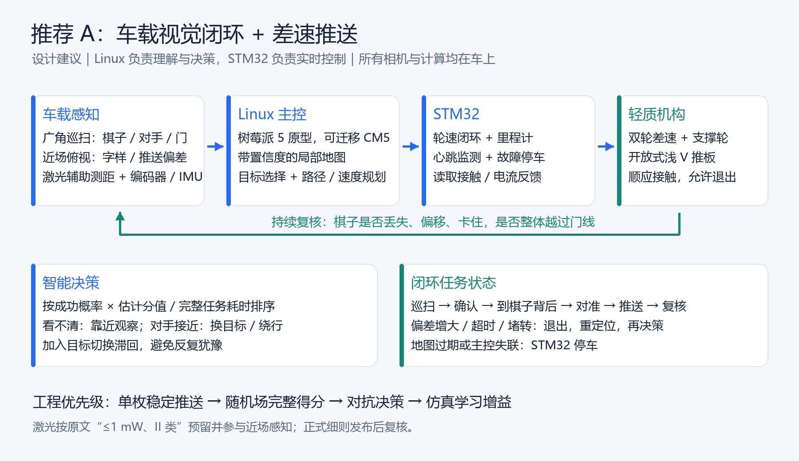
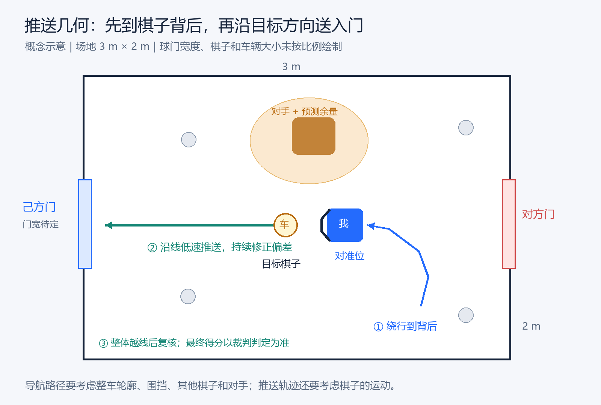

# 2027 光电赛：智能车光电象棋对抗方案

> 初版讨论：2026-10-13；会议同步：2026-10-23。目标：冲击国赛一、二等奖。预算不作为主要限制，可采购 Linux 主控；以下性能指标是研发目标，尚未经过实车验证。

**当前选型：碳纤维底板 + 麦克纳姆轮。** 2026-10-23 会议已确认这两项采购方向，采购待执行。Python 透视变换已完成[官方实拍样图的单图示例](../03_records/01_20261023_透视变换.md)，将斜视图中的目标平面校正为俯视图；项目相机验证待开展，详见[会议纪要](../04_meetings/01_20261023_会议纪要.md)与[开发计划](../01_plans/01_开发计划.md)。

初版建议的“双相机 + 树莓派 5 + STM32 + 差速底盘 + 开放浅 V 推板”保留为参考，底盘部分按本次会议调整。其他主控、相机、推板、接触反馈及控制算法仍按原候选方案评估，不因采用麦克纳姆轮而一并视为已确认。获奖取决于最终细则、实车表现和对手水平。

## 1. 先把比赛理解对

这是**自主小车争夺棋子并推入己方球门**的比赛。根据[官网原始通知及附件](https://gd.moocollege.com/home/newsDetails?newsId=131060)：场地 3 m × 2 m、围挡高 80 mm；32 枚红黑棋子、分值 1–10；每队 1 车，发车尺寸 ≤250 × 200 × 180 mm、质量 ≤1.5 kg、车载电池供电；允许推板、滚轮，禁止电磁吸附、遥控、人工干预和恶意冲撞。平分依次比较进球数、帅/将归属，再进行 60 秒金球加赛。

**必须等细则确认：** 正赛时长、门宽与棋子规格、具体分值、红黑是否限制归属、棋子是否翻面/堆叠、多枚同时进门的计分、外置设备/场地标记权限，以及奖项晋级办法。图示尺寸可能修订。原文写“搭载功率 ≤1 mW 的 II 类安全激光系统”，当前先按需要搭载且参与感知设计，确认是否强制及其用途。当前官网未找到本届正式细则、答疑和报名/展示模板，不能套用第十四届其他赛道要求。

## 2. 四种候选方案

| 方案 | 结构与智能化重点 | 优势 | 难点与定位 |
|---|---|---|---|
| **A 差速视觉闭环（初版参考）** | 两驱差速；开放浅 V 推板；双相机识别与跟踪；按预计得分/完整用时选目标；沿推送方向闭环纠偏 | 抓地和结构容易调试，重量余量较大；适合作为对照基线 | 到棋子背后的绕行耗时；急转会丢棋。以单枚稳定输送为主线 |
| **B 三轮全向 + 接触反馈** | 三轮全向；推板接触/力传感；侧移对准；视觉与接触反馈融合，局部模型预测控制 | 有望保持推板方向并侧向调整，对准与解堵更灵活 | 原三轮方案作参考，当前轮型按会议确定的麦克纳姆轮推进；接触反馈及局部控制增强另行验证 |
| **C 开放滚轮导流 + 成组推送** | 差速底盘；开放导流推板与低速滚轮；识别棋群价值，规划可共同送门的小组 | 有望减少往返次数，以单位时间得分取胜 | 易卡塞、遮挡读字和损失高分棋；多枚计分须先确认。作为吞吐率实验备选 |
| **D SLAM + 3D 场景 + 自主导航（进阶）** | 在 A/B 上增加同步双目/IMU、SLAM 回环与重定位；3D 地图投影为二维代价地图，规划到预推位；保留近场推送闭环 | 有望减小定位漂移、改善丢失后恢复；可复用地图与仿真测试 | 平整小场地纹理少、棋子/对手动态干扰；增加标定、算力与重量。先验证定位问题是否限制得分 |

A/C 是工程设计建议；B 借鉴 [Force Push（RA-L 2024）](https://arxiv.org/abs/2401.17517)，其研究依赖接触点定位和力传感器，电机电流只能用于受阻检测，不能直接替代力反馈。

四种方案的详细实现、定位/导航/仿真分工、研究依据与验收方法统一见[四种方案](./02_四种方案.md)。A/B/C 比较底盘与推送方式，D 是可与 A/B 组合的定位增强路线。当前原型按麦克纳姆轮方向推进，以完整得分率、恢复能力和整车约束评估后续增强模块。

## 3. 初版 A 的实现参考

以下架构图及实现描述对应 2026-10-13 差速方案。底板材料和轮型已按本次会议调整；运动控制、里程计等后续需适配麦克纳姆底盘，图示尚待相应更新。

- **主控：** [树莓派 5，建议 8 GB](https://www.raspberrypi.com/products/raspberry-pi-5/)运行 Linux，负责视觉/地图/决策；现有 STM32 若满足编码器与控制周期要求即可保留，负责轮速闭环、里程计和失联停车。通过 UART/CAN 传递带时间戳的速度指令和状态。先测推理延迟与温升，必要时加推理加速器；需要减小体积时再迁移 [CM5 + 紧凑底板](https://www.raspberrypi.com/products/compute-module-5/)。
- **感知：** 车载广角相机巡扫，近场向下相机确认字样与推送偏差；运动相机优先[全局快门](https://www.raspberrypi.com/products/raspberry-pi-global-shutter-camera/)。远处先找圆盘/大致颜色，靠近后做棋面校正、旋转增强的小分类器与多帧确认。看不清时主动换视角；不默认低机位能一次看全场。编码器/IMU融合已知发车姿态，用围挡和门框几何校正，地面投影补偿棋面高度。正式场不默认允许外置顶视相机或 AprilTag。
- **光电与机构：** ≤1 mW、II 类激光与相机做近距三角测距，尝试开/关差分抑制环境光，辅助接近时减速；需实测反光与对手光源干扰。浅 V 推板保持开放、带柔性接触面，能退出重试；尺寸随棋子规格调整。电机与计算分路稳压，留散热和线缆空间。整车内部设计目标 ≤1.3 kg，给 1.5 kg 上限留余量。
- **闭环：** 巡扫 → 近场确认 → 到棋子背后 → 对准 → 推送 → 整体越线复核。持续监测棋子偏移、丢失和堵转；超时就退出重定位。过门视觉复核用于本车记账，最终计分以裁判为准。

## 4. 智能化要体现在得分上

**目标排序 = 估计分值 × 完整输送成功概率 ÷ 完整任务预计耗时。** 耗时包括观察、接近、绕到背后、对准、推送和入门确认；识别不确定性进入估计分值。避障检查“整车 + 被推棋子”的共同占据区域，其他棋子也作为障碍。碰撞风险作为硬约束，对手接近就绕行或换目标，并设置切换滞回，避免来回犹豫。普通棋、帅/将的权重按实际分值与平局规则配置；金球模式优先最快可靠得分。

有余力再做**离线仿真自博弈/强化学习**，先学习选目标或局部推送参数，保留确定性的避障、限速和失联停车。用实测摩擦、延迟、遮挡和轮滑移做随机化；学习策略只有在同一组随机场景、同等时间下胜过基线才上车。优先比较“最近棋子”“价值/耗时”“加入对手预测”三种策略的实际得分率。

## 5. 开发与验收

近期先落实碳纤维底板与麦克纳姆轮采购，以及 Python 透视变换研究。可执行步骤、状态与完成标准统一维护在[开发计划](../01_plans/01_开发计划.md)中。下表保留阶段目标，周次为初版估计，尚未确定实际起止日期。

| 阶段 | 必须交付的证据 |
|---|---|
| 第 1–2 周：原型 | 碳纤维底板与麦克纳姆轮的规格核对、采购和到货检查；底盘运动、主控通信、单枚推送；Python 透视变换原图/俯视图对比与误差记录；采集真实棋子图片与摩擦/卡塞数据 |
| 第 3–6 周：完整闭环 | 随机场自主识别、定位、送门及失败恢复；近场分值分类宏平均 F1 目标 ≥0.98，单枚全流程 200 次成功率目标 ≥95%；记录完整得分周期，得分/分钟须超过“最近棋子”基线 |
| 第 7–10 周：对抗 | 不同灯光/地面/电量及移动对手测试；至少 100 局对比策略，报告平均分/分钟、胜率和波动；展示录像与消融实验 |

以上是建议节奏与目标，按最终赛程调整。训练/测试按采集场次、灯光和棋子实物分开，避免相邻视频帧泄漏。团队暂按三条工作线组织：机械/电控、视觉/定位、策略/集成；人数待实际组队确定。

## 6. 当前推进顺序

1. 按会议决定推进**碳纤维底板、麦克纳姆轮采购与 Python 透视变换研究**，硬件规格准备与图像算法研究可以并行；完成状态以开发计划和实际成果为准。
2. 向负责老师确认上述规则缺口，尤其激光、棋子翻面、多枚计分和正式比赛时长；先搭可调门宽的训练场。
3. 把“稳定输送 + 有效识别 + 对抗得分率”作为进度依据，论文里的精度或复杂算法名称不能代替实车结果。

关键原始资料和方案成果见[资料清单](../05_resources/01_资料清单.md)；论文、GitHub 项目与适用边界见[四种方案](./02_四种方案.md)。一次性下载、生成和核验脚本统一放在项目根目录 `temp/`。
