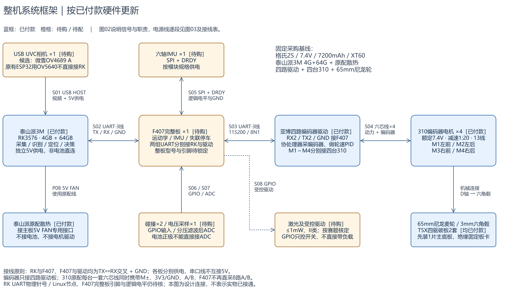
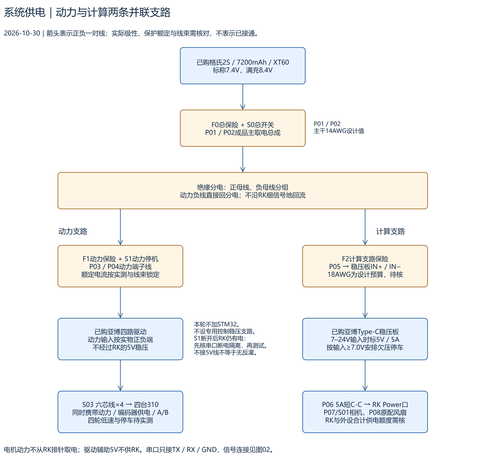
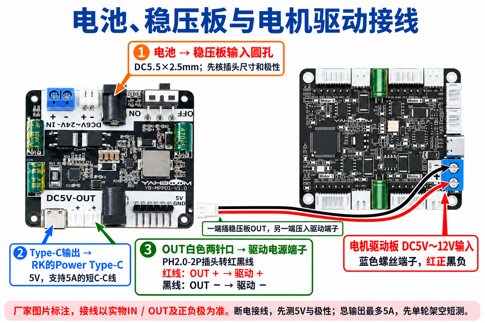

# 整套系统规划

更新日期：2026-11-03。版本：v0.12，更新相机地址配置与工具出图进度，保留后续C程序和电脑预览的软件分工；硬件主线沿用v0.10。本文细化[整机方案](./01_整机方案.md)的控制器、传感器、信号连接与供电；任务状态见[开发计划](../01_plans/01_开发计划.md)，采购统一看[购买清单](../../03_hardware/01_硬件清单.md)。

**用户已确定主控：立创泰山派3M RK3576，4GB RAM＋64GB eMMC，完整成品板LCKFB-TSPI3M-RK3576-4G-64G（C54110287）。** 2026-10-30按用户决定，本轮不加STM32，RK经40针硬件串口直接控制已购亚博四路驱动；驱动负责编码器计数与轮速PID。RK负责四轮速度换算、限速和反馈管理。底盘仍按独立测试推进；车载100度IMX415 30针MIPI相机已在板B识别出图，并将照片取回电脑打开，正式C采集程序、实时预览和装车固定待完成。用户已确定新增1个JY901S九轴IMU，优先I²C接RK，尚未购买与实测；二维定位、场地地图和连续推棋放在基础验证之后实施，三维重建及额外测距暂不实施。

本车主板供电采购按**5V/4A起，并另核相机和5V风扇余量**；规格书与快速指南的电流口径见第6节。官方整板外形已核85×57mm，安装孔、板厚和净重仍未知。用户另一个泰山派项目的烧录、串口经验可复用；本轮板B相机首次工具采集已通过，业务引脚、车载供电和全部负载仍要单独验收。主控及原配散热套件已购买、已付款，采购到货归属和实装状态按[购买清单](../../03_hardware/01_硬件清单.md)核对，资料核查和CAD不等于整机功能通过。

**当前电池与电源：** 普瑞莱12V锂电池组，标称11.1V、充电截止12.6V、2200mAh、最大持续4A，实拍见[开发记录](../03_records/04_20261030_底盘串口调试.md#最终使用电池确认)。现用电源模块的型号与输出能力待核；轻载接法见第6.1节的11.1V小节。

## 1. 当前确定内容与建议边界

| 项目 | 本版安排 | 状态与可调整内容 |
| --- | --- | --- |
| 底盘 | 已购T5X四驱碳板先以1片作主底板试装，四个65mm尼龙麦轮（2左＋2右） | 已定3mm六角联轴器＋310电机（MD310Z20_7.4V，1:20）；T5X实物孔位及承力待核，允许必要补孔/转接；当前65mm模型已重建，外廓/质量和孔位待实物核验 |
| RK 主控 | 泰山派3M RK3576，4GB RAM/64GB eMMC完整成品板，外形85×57mm，负责视觉与决策 | 已购已付款；到货版本、已焊40Pin、镜像、安装孔/板厚/净重待核 |
| 控制连接 | RK40针硬件UART直连驱动RX2/TX2/GND | 撤下额外STM32及其专用控制稳压；针位、电平、节点、掉电接口条件待核 |
| 电机 | 4台亚博MD310Z20_7.4V，A/B编码器、1:20、3mm D轴，含原配支架 | 已付款，用户报告已装配；线序、编码器与运动未验收 |
| 驱动 | 亚博四路编码器驱动，内置协处理器收A/B编码器并做轮速PID；UART接RK40针接口 | 具体版本、逻辑电平、失联停车、启动/散热和制动待验收 |
| IMU | 已确定新增1个JY901S九轴模块，测加速度、角速度和磁场，优先I²C接RK，串口备用 | 尚未购买；排针、供电/信号电平、已有上拉、C程序和安装待核，不保证已满足视觉惯性SLAM的时间同步要求 |
| 相机 | 已购IMX415、30针MIPI、100度M12镜头，使用现有排线直接接RK | 已到货；板B正式驱动识别、工具拍照和电脑取回通过，正式C采集程序与实时预览待开发，长时稳定性待验收 |
| 其他检测 | 电池电压 1 路、前左/前右碰撞触点各 1 个 | 首版建议；触点是已经接触后的保护，不能替代提前避障 |
| 近距测距 | 预留 1–2 个 ToF 模块接口 | 按盲区启用，先不默认采购多种测距传感器 |
| 采购渠道 | 零部件淘宝/京东，优先淘宝；主控用[立创官方入口](https://item.szlcsc.com/57330947.html) | 核对LCKFB-TSPI3M-RK3576-4G-64G、4G+64G版本及配件，不买0+0空存储板 |

本次按单车4个65mm尼龙麦轮（2左＋2右）准备，备件另列；本轮不加额外下位机。整车需将相机、推板、散热、接头和线缆一起计入外廓及质量；沿用赛题原件的发车尺寸不超过 250×200×180mm、质量不超过 1.5kg，后续以官方修订为准。

## 2. 整机系统框架与信号连接



[可编辑draw.io原件](../../05_data/03_results/01_design/02_系统信号连接.drawio)。2026-10-30按RK40针串口直连驱动重画；蓝框为已购，橙框为后续待配/待验证。编码器直接接驱动，驱动内执行轮速PID，RK取得原始轮速和计数。S/P线号见第6节。本图是设计，不表示本车已接通。图中的相机为此前待选占位；2026-10-30已购100度IMX415 MIPI模组，订单、120度参考图差异和最新出图状态以[相机采购说明](../../03_hardware/01_硬件清单.md#已购相机与商家图纸)为准。

### 2.1 泰山派3M与驱动的连接

| RK40针硬件串口 | 驱动端 | 用途 |
| --- | --- | --- |
| TX，物理位置/电平待实物核对 | RX2 | 发厂家参数查询、四轮速度与停车命令 |
| 同一路RX，物理位置/电平待核 | TX2 | 收配置、电压、轮速和编码器计数 |
| 已核对的GND | GND | 共同信号参考，各板单独供电 |

串口固定按厂家115200、8数据位、无校验、1停止位、无流控。串口插头5V线悬空绝缘。硬件UART由内核驱动收发，不用普通GPIO软件模拟串口；不使用登录调试口。物理针号、GPIO名、UART编号与Linux节点分别核对，不由编号相同推定。

正式接线、规格书候选针位、厂家帧、首轮命令与通过条件统一见[底盘串口接线与首轮测试](./05_底盘串口接线与测试.md)。实物版本、电平与掉电防反灌条件未闭合前不接信号上电；不预填未经核实的设备节点或设备树插件名。

### 2.2 电机与后续外设

| 对象 | 当前连接 | 本轮边界 |
| --- | --- | --- |
| 四台310及编码器 | 每轮一套六芯线接驱动对应组 | 动力、编码器电源/GND与A/B按功能核线；不再接RK的8路计数输入 |
| 相机 | 已购IMX415经30针MIPI排线接RK | 已在板B完成工具采集和电脑取回；正式C采集、拍照入口及预览待开发，软件分工见下节 |
| JY901S九轴IMU | 优先I²C直接接RK，TTL串口备用 | 已定新增、未购未接；I²C不占用驱动UART，采样时间、供电、电平与上拉待核 |
| 前部触点 | 后续接RK兼容GPIO并上拉、消抖 | Linux接触输入不能当独立硬件停机；区分正常推棋与异常碰撞 |
| 电池电压 | 先通过驱动查询，同时用万用表核对 | RK收不到驱动回包时不能假设仍掌握电压；独立欠压保护另核 |
| 可选测距/激光 | 按真实需求选兼容RK的接口和受控驱动 | GPIO只发控制信号，模块另按规格供电，不直接带负载 |

### 2.3 相机采集、拍照控制与电脑预览 {#camera-capture}

2026-11-03已在板B通过启动插件将I²C4相机地址改为实测的`0x1a`，重启后正式驱动识别成功。已使用GStreamer（系统已有的视频采集工具），按NV12、1280×720、30fps参数完成两轮各60帧采集，并将照片取回电脑打开。**当前完成的是工具拍照与文件取回，正式C采集程序和浏览器实时预览尚未开发。** 配置、操作和实际结果集中见[同一相机记录](../03_records/05_20261103_相机采集与电脑预览.md)；启动日志中的图像接收和时序提示、长时稳定性、棋子清晰度及装车视野仍待核对。

| 功能 | 谁来完成 | 本轮实现方式 |
| --- | --- | --- |
| 识别和驱动相机 | RK的Linux驱动、设备树和板端图像处理组件 | 已复用现有镜像并修正通信地址，正式驱动识别通过；每次拍照不重新安装驱动 |
| 取得并保存画面 | 待开发的RK端C采集程序 | 工具拍照已通过；正式程序仍需通过GStreamer调用Linux视频采集接口，设置参数、取新帧、编码JPEG、保存照片，返回文件路径、帧号、采集时间及错误 |
| 控制一次拍照 | 电脑发起，RK执行 | 已通过SSH启动GStreamer工具拍照；后续改为调用正式C程序的拍照入口，不能把工具验证记为该入口已完成 |
| 把照片取回电脑 | 电脑按板端文件路径取回 | 工具拍照后的文件取回和电脑打开已通过；正式程序后续返回拍照编号与路径，使用SCP复制并核对文件一致性 |
| 连续预览 | RK持续采集并发送，电脑浏览器显示，待开发 | 增加HTTP/MJPEG输出，即通过网页连接发送连续JPEG图像；预览与拍照共用同一采集源，启动、停止和日志先沿用SSH |

正式C程序的单张拍照目标流程：**电脑发命令 → RK采集程序接收请求 → 通过驱动取得有效新帧 → 编码并保存照片 → 返回本次结果与路径 → 电脑取回、打开照片**。相机排线负责相机与RK之间的连接；RK与电脑之间的控制、文件和预览数据经网络传输。驱动可用、板端采集可用和电脑已收到照片是不同的验收步骤。

正式C拍照入口通过后，在同一采集代码上扩展连续预览：保持相机采集运行，命令行入口通过板内控制通道，把新的拍照或停止请求交给常驻采集进程；该进程取帧、保存并返回本次结果。HTTP服务负责处理浏览器请求、返回预览流，JPEG连续封装本身不替代HTTP服务。预览参数与保存照片的参数分别记录，慢速网络只影响有界的预览缓存，不让旧帧无限积压；源照片保留约定采集分辨率，未加标注的文件与显示标记分开保存。首轮网页只承担预览和状态显示，网页拍照按钮以后按需增加。

驱动适配先查实际系统：确认IMX415传感器驱动、MIPI接收与ISP图像处理链路、设备树及所需图像参数文件或服务；ISP是将传感器数据处理成正常画面的板端功能，具体组件和服务名称以当前镜像为准。不要只根据存在某个 `/dev/video*` 设备就认定采集可用。

[立创官方Ubuntu24 MIPI教程](https://wiki.lckfb.com/zh-hans/tspi-3-rk3576/system-usage/ubuntu24-usage/mipi-camera.html)以IMX415为例，说明其镜像通常已启用三个相机接口，并示范用GStreamer从 `/dev/video-camera0` 采集NV12图像。本次已在板B核对该别名指向 `/dev/video33` 并完成工具采集；换镜像、接口或相机后需重新核对。教程中的显示命令不包含电脑远程拍照或网络预览功能。

程序实现依据：[GStreamer视频采集入口](https://gstreamer.freedesktop.org/documentation/video4linux2/v4l2src.html)、[将采集数据交给应用程序](https://gstreamer.freedesktop.org/documentation/app/appsink.html)、[JPEG照片编码](https://gstreamer.freedesktop.org/documentation/jpeg/jpegenc.html)、[连续JPEG数据封装](https://gstreamer.freedesktop.org/documentation/multipart/multipartmux.html)。本次已用现有工具完成采集与JPEG保存，应用取帧、连续图像封装、C开发库配套和正式程序性能仍需随开发验证。命令控制和文件复制分别参考[SSH说明](https://man.openbsd.org/ssh.1)与[SCP说明](https://man.openbsd.org/scp.1)。

## 3. 本轮不加STM32后的分工与保护

驱动板已有微控制器，负责四轮编码器采集和轮速闭环；不需要RK按电机PWM周期逐次调节输出。RK决定整车向前、横移与旋转的速度，换算成四轮目标，再通过硬件串口发送。正式运动服务用C实现；与视觉独立运行，收发、日志和故障处理均设置边界，避免等待一次识别完成后才停车。

不再开发RK与STM32之间的协议或F407固件。驱动线上沿用厂家原协议；本地日志编号、目标有效期、命令/反馈接收时间由RK程序维护，不擅自添加到厂家帧。厂家未承诺支持的序号、校验、心跳、故障码和时间戳不写成已有能力。

### 3.1 首轮与后续职责

| 工作 | 执行位置 | 核对依据 |
| --- | --- | --- |
| 编码器计数、四轮轮速PID | 亚博四路驱动 | 原始计数/轮速、单轮实际方向与稳定性 |
| 运动换算、限速、加减速 | RK运动服务 | 整车速度输入、四轮目标、实际运动与停车 |
| 目标有效期、反馈过期、视觉丢失处理 | RK运动服务 | 本地时间戳、实际发送归零帧、轮子停止现象 |
| RK卡死/串口断线后的停车 | 驱动固件能力或独立硬件措施，待落实 | 架空实测最后命令是否持续；不能用同RK上的进程代替独立保护 |
| IMU/触点/激光等 | 后续按需求接RK兼容接口 | 引脚复用、电平、驱动和实际输入/动作 |

### 3.2 停止方式与落地条件

零速度命令仍保持轮速闭环；零PWM是另一种输出状态，实际制动/滑行需测。S1独立切断动力也不等于车身立即静止，并须先核信号脚在一侧失电时不会反灌。手册没有明确保证通信中断自动停车：若驱动保持最后速度，必须在落地连续运动前补齐经验证的驱动侧超时、使能回路或独立切断动力措施。人工S1用于可控台架停机，不能当自主失联保护已经完成。

上电/重连后由RK先建立通信、读取配置、发送零输出，初始化通过后才允许新运动目标；不得恢复旧速度。RK正常退出的清理逻辑不能覆盖断电、强制杀进程或整机冻结，需分别给出验收结论。

## 4. 编码器、IMU 之外，还需要什么传感器

**编码器测轮子，IMU测车身运动，相机观察外界。** 麦轮滑移时“轮子转了”不等于“车走到了”；九轴IMU增加磁场测量，但电机、电流和钢件可能干扰航向，直接积分加速度也不能长期可靠地得到位置。需要用相机观察到的固定场地几何等外部信息校正，不能只靠编码器和IMU完成整场绝对定位。

| 检测对象 | 数量与首版安排 | 用途及局限 |
| --- | --- | --- |
| 轮速编码器 | 4 组，优先随电机配套 | 四轮闭环和相对里程计；不能直接测出轮地滑移 |
| 九轴IMU | 用户已定新增1个JY901S，优先I²C、串口备用 | 角速度、姿态和短时运动辅助；固定安装、标定零偏，分别测静止、运动及电机启停下的磁干扰 |
| 视觉相机 | 1 套，直接接 RK | 棋子身份/位置、对手、门框/围挡等；遮挡、反光与运动模糊需实测 |
| 电池电压检测 | 首轮查询驱动电压，独立保护另核 | 欠压预警和停车；仅测总压不能替代电池保护板的单节保护 |
| 前部碰撞触点 | 后续按推板结构评估2个 | 前左/前右异常接触后的停车和退出；按推板结构设计，不能用于允许恶意碰撞 |
| 驱动故障与电流 | 已购驱动实际保护/输出能力待核，不假设能读取全部故障码或电流 | 过流、过温、堵转辅助判断；限流值按电机与驱动确定，不能把电流当成接触力真值 |
| 近距ToF光学测距 | 预留1–2个，后续出现盲区再评估，暂不采购 | 补足相机近距盲区；单点距离不识别物体，前向安装也不覆盖麦轮横移的侧面 |
| 超声波、二维扫描激光雷达 | 后续按实测缺口评估，未确定购买 | 超声波可辅助测距，少量固定探头不能直接提供全场地图；扫描雷达须核低矮目标、安装高度和近距盲区 |

JY901S厂家资料支持3.3–5V供电、UART及I²C，可输出加速度、角速度、磁场和姿态。主方案按3.3V供电及兼容的3.3V信号评估；不能把“模块能用5V供电”理解成RK信号脚能接5V。厂家要求磁场校准并远离磁干扰，车内是否满足条件以电机启停和实车转动对照为准，不能承诺九轴就没有航向误差。[维特官方参数](https://wit-motion.cn/proztmz/22.html)

### JY901S接入与上拉电阻

按已查的泰山派公开排针资料，候选连接为物理1脚3.3V→VCC、6脚GND→GND、3脚I2C7_SDA_M1→SDA、5脚I2C7_SCL_M1→SCL。本车板版本、针1方向和该组信号电平仍须核实，此表述不是已验证接线。I²C由RK的硬件控制器收发，需启用对应功能并确认实际Linux节点；厂家提供[Linux C示例](https://github.com/WITMOTION/WitIIC_JY901)，需适配和审查后再上板。

两根I²C线各需要合适的上拉。已查V1.4排针页的R497/R496为22Ω串联电阻，不能替代上拉；完整已有上拉尚未核实，用户后续向商家询问模块配套情况。若两端均无合适上拉，短线、100kHz初调可评估SDA、SCL各经4.7kΩ接兼容的3.3V电源；已有上拉时核并联后的总阻值，不盲目重复添加。不能改成对地的下拉或接到5V，也不能仅依赖未经核实的芯片内部弱上拉。[泰山派开源硬件](https://wiki.lckfb.com/zh-hans/tspi-3-rk3576/open-source-hardware/) · [TI上拉计算说明](https://www.ti.com/lit/an/slva689/slva689.pdf)

串口是备用接法：核对本车版本和电平后，候选物理8脚UART4 TX→模块RX，10脚UART4 RX←模块TX。若该UART继续用于电机驱动，则不能再并接IMU；电机改走USB可释放UART，但电脑CH340K查询成功不等于RK的USB控制已通过。I²C主方案无需改变当前驱动通信安排。

测距暂缓实施，先验证相机方案。若需补近距盲区，优先评估ToF光学测距，现有资料候选为VL53L1X模块，未确认采购。微雪同名成品模块标40–4000mm、27°视场，最靠近棋子的阶段及矮围挡是否可测需要核对；量程、测量范围、精度和刷新速度不能只看“最长4m”。须用真实棋子测材质、环境光、安装高度/遮挡，以及多模块同时工作时的干扰。[ST ToF资料](https://www.st.com/en/imaging-and-photonics-solutions/vl53l1x.html) · [模块资料与原理图入口](https://www.waveshare.net/wiki/VL53L1X_Distance_Sensor)

超声波可作辅助测距，但通常返回一片探测范围内的距离，不能直接识别回波来自棋子、围挡还是地面；这对本车是需要实测的限制。以厂家A02YYUW为例，标称有3cm盲区，其他型号的盲区和视场须分别核对，不能一概视为能测到贴近推板的棋子。普通触发/回波型模块还需核回波电平及Linux测脉宽的方法；不把5V回波直接接到未核实的RK输入，也不假定用户态循环有稳定计时。少量固定探头不能替代扫描式建图；向已知墙面测距只有在墙面对应关系和朝向明确时才可辅助校正位置。[超声波厂家示例资料](https://www.dfrobot.com/product-1935.html)

赛题原件中的低功率 II 类激光要求另行核实并预留位置；通用 ToF 模块不能自动等同于已经满足该要求。若确认必须配置参与感知的激光系统，需要再细化功率、等级、安装、处理链路和验收办法。

### 二维定位与场地地图评估

2026-10-30用户确认：先做二维地图，三维重建不列入当前实施；本次完成评估，开发安排在底盘与相机基础验证之后。二维地图记录车和物体在地面上的位置、朝向及占用范围，适合平面场地推棋。车体、推板和棋子仍有高度，安装遮挡、测距是否越过矮物和地面/棋面投影差异仍须单独处理。

首版建议先按实测场地尺寸建立静态平面地图，用相机识别固定边界、门或其他明确参照，结合编码器与IMU持续估计车的位置。SLAM指边运动边估计位置、建立地图；已知规则场地可以先做已知地图定位，不必把完整SLAM作为连续推棋的前置条件。这是本项目的工程路线判断，尚未在本车验证。

| 必须补齐的能力 | 当前缺口与后续办法 |
| --- | --- |
| 稳定图像与标定 | IMX415已在板B短时工具采集并取回电脑；正式C采集、持续预览、固定机位与标定待完成，仍需测镜头畸变、相机相对车体的位置/方向和曝光延迟，区分地面与棋子顶面 |
| 具有实际尺寸的全场坐标 | 实测边界、门/目标区并确定原点和朝向；单张图像中的像素不能直接当米。固定参照少、场地对称或被挡时可能出现位置歧义，需要主动换视角和恢复定位 |
| 连续定位与时间对应 | 编码器有滑移、IMU有零偏/磁干扰；记录图像与传感器的时间，融合相对运动与固定场地参照。接收时间不等于传感器采样时间，不能承诺相机加JY901S即具备同步视觉惯性SLAM能力 |
| 会更新的棋子地图 | 同一枚棋子跨帧保持编号，位置和置信度随观测更新；被推走的棋子及对手是动态对象，不用于固定环境地图定位 |
| 接近与推送路线 | 除到达棋子，还须到合适的后方位置和方向，再规划推向目标区的路线，保留整车、推板及棋子的碰撞余量 |
| 完成确认和下一目标 | 观察棋子真正到达目标区才标完成，再选下一枚；发出命令、行驶到预定位置或棋子暂时看不见均不能代替确认 |
| 可核对的误差与板端负载 | 按实际门宽、棋子尺寸与停车余量确定容许误差，用独立实测点和连续视频核对；测RK同时运行识别、定位与运动时的延迟、CPU、内存及温度 |

多拍照片有助于补视角、减少遮挡和重复观测，采集时需要相邻视角重叠、清晰的固定参照，以及可对应的运动/时间记录。只有照片数量增加，仍不能保证低纹理、反光或重复场景下定位成功。先验证已知平面上的几何定位；若引入视觉SLAM，单目地图的尺度须由已知尺寸或经过验证的融合方法确定。只输出稀疏特征点的地图，也不自动等于可避障的可通行地图。

ORB-SLAM3提供单目及视觉惯性方法与标定入口；将底盘IMU接入RK后，仍需核原始加速度/角速度、采样率、滤波延迟、相机/IMU时间同步、安装关系和刚性固定。厂家“最高输出频率”和融合航向角不能替代这些要求；是否能在本车RK3576 4GB上并行运行，需要实测，不作性能保证。[ORB-SLAM3原项目](https://github.com/UZ-SLAMLab/ORB_SLAM3)

若二维方案无法满足定位/推送误差，再按失败原因选补充手段：近距盲区评估ToF或超声波，缺少可重复定位参照时评估扫描雷达或同步视觉。二维扫描雷达也须看扫描平面能否打到80mm矮围挡、近处棋子及安装遮挡，不能仅凭“360°扫描”判定适配。三维外观模型对当前平面任务没有明确必需收益，暂不采购深度相机或三维雷达。后续任务和完成标准统一见[开发计划](../01_plans/01_开发计划.md#二维定位场地地图与连续推棋)。

#### 后续实车验证要求

底盘、相机和基本识别通过后，再按以下条件验证二维定位与连续推棋；任务状态见[开发计划](../01_plans/01_开发计划.md#二维定位场地地图与连续推棋)。

- 定位测试覆盖前后、横移、转弯、绕场回原位、遮挡后恢复和对称场地中的方向判断；位置不可信时先停车、重新观察。用未参与标定的实测位置检查误差，并记录恢复耗时。
- 棋子地图保存编号、身份、位置、最后观测时刻及“待处理、处理中、已完成、需复查”状态；移动或遮挡后重新对应，动态棋子和对手不作固定定位参照。
- 连续推棋保存完整视频、成功率和失败原因，以观察到棋子实际进入目标区作为完成依据。进一步比较不同光照、电量、移动对手和故障恢复条件下的成功率、每分钟得分与波动。

## 5. 电机、编码器与驱动如何配套

首版按四个独立驱动的有刷直流减速电机实现；每轮单独调速，编码器计数与轮子编号一一对应。电机输出轴、联轴器/轮毂和麦轮孔径必须配套。

| 选型项 | 必须取得的参数 | 如何影响系统 |
| --- | --- | --- |
| 电机 | 额定电压、额定/空载转速、连续转矩、减速比、空载/额定/堵转电流、尺寸和质量 | 已定MD310Z20_7.4V：3mm D轴、1:20、约70g、厂标额定0.4kgf·cm，堵转≤1.4A；厂家参数，带载待验收 |
| 编码器 | 电机轴或输出轴安装、线数定义、A/B 电平、供电、输出类型 | 决定计数换算、最大输入频率、电平转换与线束 |
| 驱动 | 四路可独立正反转、工作电压、持续电流及其散热条件、峰值持续时间、PWM/使能/故障接口 | 优先有硬件限流和保护的模块；不按广告中的“峰值电流”当连续能力 |
| 制动 | 断使能后的滑行/制动行为、回馈电流路径 | 决定停车距离和母线过压处理；停机不意味着车立即静止 |
| 轮组 | 左右手性、轮径、宽度、承载、轴孔、重量和滚轮状态 | 四轮安装方向正确，实际速度/里程计参数按实物标定 |

**2026-10-24用户最终改回310，电池不变：** 亚博65mm PA66尼龙轮，58g/只、宽30.4mm，配原厂3mm六角联轴器与MD310Z20_7.4V（1:20、450rpm）及原配支架。轮组/四套电机支架/含动力线驱动合计¥363.8。四电机280g＋轮子232g＋已选电池330g＋已购主控/散热商品毛重142.6g＋亚博电源板32g＝1016.6g，余483.4g用于联轴器、支架、底板、其余电控、结构和线束；是混合参考预算，非实车称量，配线尚未计入；当前模型已换为亚博电源板，含突出接口Y61.72mm，已放到电控层中段，实物接头及配线待核。已按65mm/310重建[当前布局](./04_四驱底盘方案.md)，旧生成模型与临时产物已清理，旧候选唯一用户CAD原件保留在 `temp/旧硬件待删除/` 供用户自行处理。

轮组套餐已含四个3mm六角联轴器；电机只选“编码器减速电机+支架”，不另买联轴器或普通轮。65mm轮与450rpm对应空载轮周速度约1.53m/s；厂家转矩不是实车推力，低速推棋/横移与驱动限流后的性能仍按已有计划核对。四台堵转电流标称合计≤5.6A（额定电压条件），实际8.4V满充时启动/受阻电流不能直接套用该上限，供电/保护和线束需相应余量。

## 6. 整车供电图与电源安排



[可编辑draw.io原件](../../05_data/03_results/01_design/03_系统供电.drawio)。2026-10-30更新：每条供电箭头表示正负一对线，电池后的动力与计算两支路在分电处并联。本轮取消额外STM32及专用控制稳压支路；分电、保险/开关和部分线束仍待配齐。


本节图和逐线表为原2S供电设计，现用普瑞莱11.1V电池按第6.1节的轻载小节接线。电池尺寸、重量和实际可用时间待实测。

| 支路 | 原2S方案设计基准 | 必须核对 |
| --- | --- | --- |
| 电池与配电 | 一块适配负载的车载电池，经保险丝、总开关和分支配电 | 化学体系、串数、满充/最低工作电压、持续/峰值放电、电池保护和匹配充电器 |
| 动力支路 | 分支保险F1 → 独立动力停机S1 → 驱动DC5V～12V输入端子 → 四台310 | 本2S电池满充8.4V在驱动推荐5–12V与310允许4.2–8.4V内，可直接供动力；考虑制动回馈 |
| 计算支路 | 亚博YB-MPP01-V1.0电源板，7–24V输入时5V／5A，经5A短C-C线接Power Type-C | 6V输入时仅标3A；按板输入≥7.0V安排欠压停车，5A为RK、相机和风扇合计额度；避免反向供电 |
| 后续外设 | IMU/触点等按模块需求从匹配低压电源供给 | 本轮先不为它们增加专用控制稳压；启用前核电流、电平、RK总额和保护 |
| IMU/编码器 | 由匹配的稳压逻辑电源供给 | IMU、编码器的电源与输出电平逐项核对；310编码器允许3.3–5V；按驱动板实际编码器端口供电/逻辑配线，IMU按模块核定 |
| 电池采样 | 首轮使用驱动的电压查询，必要时再增加独立检测 | 用万用表比较实际读数；断串口后该数据会过期，独立欠压保护待核 |

泰山派3M[官方规格书](../../04_references/04_datasheets/01_泰山派3M_RK3576_规格书.pdf)第3页写Power Type-C“5V-4A输入（仅供电）”，[快速指南](https://wiki.lckfb.com/zh-hans/tspi-3-rk3576/system-usage/)则写5V、适配器峰值≥3A；两者口径不同。采购按5V/4A起并另核相机、风扇与启动余量，3A不能当作满载额定或耗电上限。Type-C与规定排针不同时送电，桌面适配器与车载DC/DC分别核对；电池经独立5V稳压后供板，覆盖满充到低电量的全输入范围，并测量四轮启动时供电稳定性。FAN仅支持5V，匹配[官方散热套件](https://wiki.lckfb.com/zh-hans/tspi-3-rk3576/development-kit/cooling-fan-kit.html)需2026-07-06或之后的镜像。亚博四路驱动5V口厂家额定0.7A，不能给RK主板供电。

电机动力与RK计算支路在配电处合理共地，动力回流直接回配电，不经过RK的细信号地线。分支供电减少压降和干扰，但不等同于电气隔离。线缆、接插件、保险丝和开关按实际电流选择，电机和电池线不用杜邦线承载。

独立动力停机开关应能在程序卡死时切断电机动力，保留计算/控制供电有利于诊断；恢复供电后保持禁止驱动，待明确重新使能。正式比赛中人工操作的允许时机以规则为准，不能把调试停机开关用于比赛遥控。软件失联停车与硬件断动力是两层不同措施，停车距离仍需实测。

以下为亚博电源板的接口与参数参考，现用模块按实物型号核对。2026-10-25按用户免焊要求，撤下好盈UBEC和裸线尾线，改选[亚博稳压电源板](https://www.yahboom.store/collections/accessory/products/power-board-pi5)，型号YB-MPP01-V1.0。[厂家参数图](https://cdn.shopify.com/s/files/1/0066/9686/1780/files/15_dde01d53-ff66-421d-a9e0-2ec218e52372.jpg?v=1730097136)注明7–24V输入时输出5V／5A，6V时为5V／3A，不能将6–24V输入范围理解为全范围5A。本车按板输入不低于7.0V安排欠压停车，考虑输入线损与电机启动压降。板65×56mm、最高约13.8mm、32g，当前CAD已将电源板放在电控层中段，按含接口Y61.72mm表示，实物插头及配线仍待核。匹配电池的取电线先进入总保险/开关和分电盒，再用18AWG计算支路线接IN+/IN−螺丝端子，输出用5A短C-C成品线直插RK Power Type-C，无需焊接。准确SKU、价格和待配线项见[购买清单](../../03_hardware/01_硬件清单.md)，电源板已付款，配线尚未购齐，未在本车实测。相机与风扇经RK供电，5A为三者合计额度；电源板有线损补偿，输出随负载可至5.25V。IMU等后续按实际模块输入供电；桌面与车载电源避免同时送电。

### 6.1 电池、降压板、驱动到底怎么接

**原2S方案接线主线（历史，不用于现用11.1V电池）：匹配电池的成品取电线（本段2S设计使用XT60）→ 总保险/总开关 → 绝缘分电盒 → 动力与计算两条并联支路。** 分电盒有正、负两组母线；每条支路都有正负两根线。下表P编号与图03一致，S编号与图02一致。

1. **电池到分电：** 用与电池主放电口触点配对的成品取电线；本段2S设计使用XT60，现用电池按实物接口匹配。红线经F0总保险、S0总开关接正母线；黑线直达负母线。XT60“公/母”称呼容易混用，采购按触点与插壳配对图确认，不凭简称选插头。平衡插头不当作整车主放电口。
2. **分电到电机驱动：** 正母线经F1动力支路保险和S1独立动力停机开关，接驱动板标有`DC5V～12V`的正输入端子；负母线接其负端子。驱动再把动力送给四台310，**这一路不经过5V降压板**。已购电池满充8.4V，在310厂家4.2–8.4V和驱动推荐5–12V范围内。
3. **分电到RK：** 正母线经F2接亚博稳压电源板`IN+`，负母线接`IN−`，均用螺丝端子压接成品线；板的Type-C输出用5A短C-C线接RK的**Power Type-C**。已购IMX415相机按MIPI模组与主板接口逐针核对连接与供电；风扇用原配FAN线。由RK供电的相机、风扇与RK合计计入该支路预算，不能把板上多个输出口各算一份5A。
切断S1后RK仍由计算支路供电；必须事先核对驱动失电时UART脚的高阻/断电隔离条件。后续外设按实际供电需求接入，不把电池直接送入任何RK信号脚。

**现有线怎么用：** 电源板已买基础款，附加T插输入线并未购买；这条线也不是接RK的Type-C线。本段2S设计为XT60，驱动赠送的T插线不能直接对插。整车仍在保护/开关之后分两支路，各接驱动和降压板螺丝端子；不能因为换了电池插头就省去分电或把RK接到电池电压上。**免焊不等于不需要配线，所有螺丝端子仍要接好红正、黑负并固定线束。**

#### 当前先给哪两处供电

本段保留当时2S电池方案说明，现用11.1V电池改按下方轻载小节。2026-10-30用户曾补充确认：需要同时供电的是已购四路电机驱动与RK，不另外增加未确定的驱动板。分电在降压之前，当前降压之后只有RK这一个直接供电点；由RK接口供电的外设计入RK支路，不为尚未确定的第二块5V设备预购一套降压或分电件。

```text
2S电池（标称7.4V，满充8.4V）
  → XT60匹配取电线 → 总保险、总开关 → 绝缘正负分电端
      ├─ 动力支路保险、停机开关 → 四路电机驱动的动力输入＋／−
      └─ 计算支路保险 → 已购降压板IN＋／IN− → 5V Type-C → RK Power口
```

每条供电支路都有正、负两根线。总保险和各开关串在正极，负极各自回到负母线；电机回流不走RK细信号地线。原电池支路保留电池电压，降压后的支路才是5V，两个正极电压节点不能接在一起。

| 实际接线段 | 正极怎么接 | 负极怎么接 |
| --- | --- | --- |
| 电池进入分电 | 电池XT60的正极经总保险和总开关到正母线 | 电池负极到负母线 |
| 分电到电机驱动 | 正母线经动力支路保护、停机开关到驱动DC5V～12V的“+” | 负母线到同一动力输入的“−” |
| 分电到降压板 | 正母线经计算支路保险到降压板IN+ | 负母线到降压板IN− |
| 降压板到RK | 用匹配5A短C-C成品线，接降压板Type-C输出与RK Power Type-C | 负极包含在同一成品线内，不另向RK信号脚送电 |

分电组件要有相互绝缘的正、负两组，每组至少满足1进2出。只有一组内部全连通的接线器，只能接同一极性；不能把正负极都放进这一组，避免直接短接电池。完整线束需一次核对XT60配对插头、主取电线、保护/开关、分电组件、驱动支路线、降压输入线和5A短C-C线；充电器单独用于给电池充电，不串在车载供电线路里。当前只有接法定义，配套SKU和实物供电验收仍未闭合。

以后确有第二个5V负载时，可从同一降压板另一个匹配输出口分支，但总电流、各接口和线材额定电流必须满足需求。已购板厂家在7～24V输入时标5V/5A，6V输入时为5V/3A，额度是整板合计；不能按“每个插口5A”计算。另一负载需要不同电压，或是启动电流较大的电机/舵机时，另核独立降压支路，不把多块降压板输出直接并在一起。尚无明确设备时，先不增加这些支路。

#### 现有11.1V电池的5V轻载试验接法（2026-10-30）

用户最终确定使用手边的普瑞莱12V锂电池组，标签为标称11.1V、充电截止12.6V、最大持续4A、2200mAh；[实拍原件](../../05_data/01_raw/04_hardware/20261030_battery_111v_01.jpg)已归档。当前电源模块型号、接口与输出能力待实物核对。此试验与前文2S直接供动力的接法不同：电池先进入旧模块，再按用户当前接法由其5V输出分别供RK和驱动；模块型号、接口及实际输出能力仍须核对。

下图是此前亚博厂家参考板的接口标注，不是现用旧模块的型号证明。下列DC5.5×2.5、Type-C、PH2.0接口只有与现物核对一致后才适用；具体接口不一致时按现物修订，不能仅凭参考图接线。



- 电池若自带圆头，只有尺寸、极性与稳压板上方DC5.5×2.5输入口匹配后才能直插；本次没有实物确认插头匹配。蓝色正负端子是另一种输入方式，两种方式不同时接电源。
- 稳压板下方Type-C输出经支持5A的短C-C线接RK的Power Type-C；驱动供电使用DC5V-OUT区域、下方圆孔旁边的白色两针输出插座，以PH2.0-2P配套插头转红黑线接驱动板DC5V～12V的蓝色螺丝端子。红线从OUT的+接驱动+，黑线从OUT的−接驱动−；白色插座不直接塞裸线。输出圆孔不接线。厂家未给出该白色口单独可承受5A的依据，不能将整板5A当作该插头或线材的额定电流。
- 旧模块两路输出合计能力及各插口、线材额定电流均待核，不沿用参考亚博板的5A参数。电池标签4A是电池端持续电流，不等于稳压后5V输出4A。310允许4.2～8.4V，5V当前只用于单轮架空短测；先断电接线、空载测量输出和极性，再接负载。记录RK启动、单轮实际转停和供电压降；用户已报告M3转动，但未提供本次测量及四轮带载验收结果。

图由图像编辑工具依据[厂家未修改原图](../../05_data/01_raw/04_hardware/20261030_power_board_reference_01.jpg)及已有驱动商品图添加说明，已人工核过关键接口和箭头；可能改绘的细节不作为接线证据，实物IN/OUT与正负丝印优先。[生成提示及核对范围](../../05_data/03_results/01_design/04_稳压板接线示意.json)与图片一起保存。本段是用户指定的临时轻载试验，未认定四轮与RK同时供电通过。

#### 传感器的3.3V、5V电源针不够插时

2026-10-30用户确认，当前担心的是电源插针数量，后续可能接惯性传感器（IMU）、超声波等模块。按泰山派3M RK3576[官方40针说明](https://wiki.lckfb.com/zh-hans/tspi-3-rk3576/hardware-gpio/taishanpi-3m/v1-0.html)中的[原始针脚图](https://wiki.lckfb.com/storage/images/zh-hans/tspi-3-rk3576/hardware-40pin/taishanpi-3m/v1-0/v1-0_20260326_101728.png)，电源与地针如下；这里是排针物理编号，不是软件GPIO编号。

| 类型 | 数量 | 物理针号及官方标注 |
| --- | --- | --- |
| 3.3V | 2个 | 1号：`3V3_S3`；17号：`3V3_S0` |
| 5V | 2个 | 2、4号：`5V0` |
| 地线 | 8个 | 6、9、14、20、25、30、34、39号：`GND` |

**处理办法：增加分线接口。** 当前候选为已焊好的2排×6P红黑排针分线板，买2块，分别用于3.3V＋GND和5V＋GND；具体商品、选项文字与证据限制见[购买清单](../../03_hardware/01_硬件清单.md#尚需配齐)。每板红色一排连通、黑色一排连通，红黑两排之间不导通；一对针作为输入后余5对输出。3.3V板红排接一根经核对的3.3V电源针，5V板红排接一根5V针，两板黑排分别接地，因此无需再买第3块专门分地。输入使用2.54mm母对母线共4根，模块按其供电电压并联取电。红排3.3V和红排5V不能连在一起。两个3.3V针标注不同，先按实物版本原理图确认开关机、休眠时的供电行为，再择一路使用，不能把1号和17号并成同一组。接线前核针1方向，并用万用表核对分线板导通关系和电压；分线件固定在车上，导电部分与碳板绝缘。

例如，一个允许3.3V供电的IMU和另一个3.3V小模块，可以共用3.3V分线组；一个明确要求5V的超声波模块接5V组，各自地线接地组。通信、触发、回波等信号仍分别接合适接口，供电电压不能代替信号电平的核对；具体模块型号未定，不把这些示例写成已适配结果。

分线只增加插口，不增加可供电流。板上3.3V可供外设的总电流尚未核准，5V还要计入RK及其外设消耗；不会因分出4口就变成4倍容量。当前仅因针脚不够，不新增一块稳压电源。以后实测确认有较大负载，再从匹配稳压输出单独分支并共地；RK已用Type-C供电时，不再向其5V排针接入另一供电源。当前四路驱动的串口连接仅用TX、RX、GND，不占用RK的3.3V或5V针。

以上只完成官方资料核对与接线设计，未完成实物版本、分线件、外设总电流及上车供电验证。

### 6.2 供电线逐段定义

以下线径、长度是设计预算，尚未完成实车电流/温升验收。P01/P02及P03/P04可由同一总成的连续线段组成，不按表格行数重复购买。2026-10-30按两支路重新编号；历史2026-10-25记录的旧线号不作为当前接线依据。

| 编号 | 起点 → 终点 | 接线、数量与状态 |
| --- | --- | --- |
| P01 | 电池XT60 → F0/S0与负母线 | 红+经总保险/总开关，黑−回负母线；主干14AWG、约10–20cm设计值，成品取电线待配 |
| P02 | 总开关输出 → 分电盒 | 正负分组，14AWG、约10–20cm；可与P01同一总成 |
| P03 | 分电盒 → F1/S1 | 动力支路，16AWG、约10–20cm；正极经保险和独立动力停机 |
| P04 | F1/S1 → 四路驱动动力输入 | 红正黑负，16AWG、约10–20cm；与P03可连续，随包T插线备用 |
| P05 | 分电盒/F2 → 亚博稳压板IN+/IN− | 计算支路，18AWG、约10–20cm；不把5V输出口当输入 |
| P06 | 稳压板Type-C → RK Power Type-C | 5A短C-C成品线1条，约0.2–0.3m，接口/空间待核 |
| P07 / S01 | 已购IMX415 30针MIPI模组 → RK相机接口 | 现有排线连接已在板B完成首次工具采集；装车固定和长时稳定性待核，换板、换线或换模组后重新核对接口匹配 |
| P08 | RK 5V FAN → 原配散热 | 原配线和套件，已付款，实物含件待核 |
| P09 | 已核兼容的3.3V电源 → JY901S | 新增1个已定、未接；板版本、信号电平、已有上拉及线束固定待核 |

撤下旧F3控制稳压、F407整板电源线与ST-Link需求，不为未启用外设提前采购一套控制供电。

### 6.3 信号线与四台电机的对应关系

| 编号 | 当前连接 | 配线与核对 |
| --- | --- | --- |
| S01 | 已购IMX415相机 → RK | 与P07同一连接；30针MIPI已完成板B首次工具出图，I²C4通信地址为`0x1a`；装车视野、稳定性和正式采集程序待验收 |
| S02 | RK40针UART TX→驱动RX2；RX←TX2；GND↔GND | 三芯短信号；115200/8N1、无流控，串口5V线悬空；针位、电平、节点及掉电条件待核 |
| S03 | 驱动四组 → 四台310及编码器 | 原配六芯线4套，按功能核线，动力/编码器共用该线束 |
| S04 | RK硬件I²C ↔ JY901S，串口备用 | 优先I²C已定；候选针位、电平、已有上拉、采样/接收时间和C程序待核，尚未接入 |
| S05 | 前左/前右触点 → RK兼容GPIO | 合适上拉、消抖、共地；具体针位待核，本轮不接 |
| S06 | 电池电压读取 → RK | 通过S02查询驱动，不增加直连电池到GPIO的线；独立检测另核 |
| S07 | RK GPIO → 后续激光受控驱动 | 电平转换、负载电源与实际用途待核，GPIO不直接给激光供电 |

| 310电机丝印/功能 | 驱动第n组 |
| --- | --- |
| M1 / 动力一端 | Mn+ |
| M2 / 动力另一端 | Mn− |
| V / 编码器供电 | 3V3，依实物与厂家线序复核 |
| G / 编码器地 | GND |
| A / 编码器A相 | HnA |
| B / 编码器B相 | HnB |

| 驱动组 | 本车位置（从车自身看左右） |
| --- | --- |
| M1 / H1A / H1B | 左前 |
| M2 / H2A / H2B | 左后 |
| M3 / H3A / H3B | 右前 |
| M4 / H4A / H4B | 右后 |

上述对应采用[厂家310接法](https://www.yahboom.net/study/MD310/14018/)；实物线色、插壳方向与正转方向仍逐轮核对。电机M1/M2是两端动力线，不等于驱动组号。命令和参数不在本表另行维护，统一见[首轮流程](./05_底盘串口接线与测试.md)。

### 6.4 共地、保护与当前缺项

正负母线各为一组端子，不能把正负线插进同一导通端子组。电池负、驱动负、计算稳压输入负和RK信号GND在分电处形成共同参考；电机大电流负线直接回分电，不能沿RK↔驱动的细串口GND绕行，也不把碳纤维板当电源回路。USB调试、台式电源和车载电源不同时反向供电。S1断开时驱动逻辑可能一起失电，而RK仍有电；S02还须落实失电时的高阻/防反灌条件，必要时加入支持断电隔离的接口器件，不能仅凭不接串口5V线就认定全部信号脚均无反灌。该接口条件随实际板卡核定，尚未作为实物已通过的结论。

F0总保险1路、F1/F2支路保险各1路，S0总开关1个、S1动力停机开关1个。选适用直流且额定电压不低于电池满充8.4V的器件，主干、端子、保险座和开关必须一起匹配；保险额定值随实际电流和线束额定锁定，不把“单路驱动4A”直接乘四当保险值。当前四台310厂家额定电压下堵转合计≤5.6A，8.4V满电启动不能简单当作同一数值；RK计算支路5V/5A=25W，低电量时电池侧电流还取决于转换效率。线径表为设计预算，未把未核的器件电流写成已购保证。

当前还缺：绝缘分电组件1套（正负母线、保险与两个开关）、P01/P02主取电总成1套、P03/P04动力端子线1套、P05计算支路线1组、P06五安短C-C线1条；相机线随相机去重，四套电机线和风扇线先用已购套餐含件。**这些是接线需要补齐的设计规格，准确SKU、成交价和实物线序尚未全部闭合，不能称整车已能直接插好运行。** 后续只在购买清单锁商品，在开发计划维护采购状态，不另建第二份费用台账。

厂家依据：[四路驱动输入5–12V、辅助5V仅0.7A及接口规格](https://www.yahboom.net/public/upload/upload-html/1750303224/1.1%20Introduction%20to%204-channel%20motor%20drive%20board.html)、[310电机4.2–8.4V及原配线](https://www.yahboom.net/study/MD310/14018/)、[亚博电源板规格与接头](https://www.yahboom.store/collections/accessory/products/power-board-pi5)。线径、分电拓扑、保护分工和待购总成为本项目工程设计，未进行实物供电或续航验证。

## 7. 模块装配与线束

本轮先使用现成RK完整板、驱动与电源模块；新增JY901S已定，接口核对后接入，其他传感器按实测需求评估。桌面阶段低压信号可以用短杜邦线调通；上车改成带锁扣插头、端子或可靠焊接线束，并做拉力固定、编号和线序记录。MIPI使用厂家配套排线；USB相机使用合适数据线，不能用普通飞线替代高速连接。

板卡以绝缘支柱固定到碳纤维底板或转接安装片，板底焊点与导电底板隔离。IMU 固定在车体刚性位置，登记坐标方向并实测振动；相机支架需要保持标定后姿态。动力线远离 IMU、编码器和串口线，必要时使用合适双绞/屏蔽及滤波。

接口稳定后，可在嘉立创做一块简单的配电/接口转接 PCB，集中保险丝、接插件、ADC 分压和必要电平转换。首版使用泰山派完整板，不需要自行设计RK3576的DDR、高速相机或最小系统板。

## 8. 软件分工、时序与故障处理

| 工作 | 本轮安排 | 起始预算与验证 |
| --- | --- | --- |
| RK视觉 | 采集、检测跟踪、按需认字、定位与目标选择 | 已按30fps参数完成短时工具采集；实际持续帧率、正式C程序和完整识别链待验收 |
| RK运动服务 | 整车速度换算、统一限速/加减速、串口收发和状态 | 先按20–50Hz更新目标；实测命令/反馈间隔及最大中断时长，不称为硬实时保证 |
| 驱动板 | 编码器采集、四轮轮速PID | 内部周期依厂家固件，不由RK定时循环替代 |
| 后续外设 | 新增JY901S已定；触点、激光等按需评估 | 先核接口/电平/驱动，再测与运动通信并行的延迟；二维定位实施后置 |
| 正常保护 | 目标有效期、视觉丢失、反馈过期、欠压/受阻线索 | 本地过期阈值暂按200ms起测，结合实际速率与停车距离修订 |
| 独立失联保护 | RK整机冻结、串口断线后的驱动停机 | 驱动侧超时/独立硬件措施待核；不能以RK发送零速度替代此项 |

除已完成的相机短时工具采集外，运动更新频率、完整视觉链和200ms保护阈值均是待实测的设计起点。厂家反馈没有已确认的采样时间戳或全套故障码；RK保存原始帧与接收时刻，明确哪些状态是本地推断。日志限长、队列有界，文件写入和识别不阻塞运动通信。上电/重连清除旧目标，初始化后再接受新动作。

## 9. 首套原型部件数量

| 部件 | 本轮数量 | 状态与用途 |
| --- | --- | --- |
| 泰山派3M RK3576 4GB/64GB及原配散热 | 各1 | 已付款；板版本、孔图、镜像和到货按实际登记 |
| 亚博四路编码器电机驱动 | 1套 | 已付款；40针UART直连，不新增STM32 |
| MD310Z20_7.4V及原厂支架 | 4套 | 用户报告已装配；六芯线、轮序和运动待核 |
| 65mm尼龙麦轮及3mm六角毂 | 1套（2左2右） | 用户报告已装配；手性、固定和接地待核 |
| T5X碳板 | 已购2片 | 按上下层试装，实际固定、孔位和质量待核 |
| 普瑞莱11.1V／2200mAh电池、旧小车电源模块 | 各1，复用现物 | 用户确定为当前使用组合；模块型号、输入输出与带载压降待核 |
| 车载相机与支架 | IMX415模组已购1个，2026-11-02用户确认到货；安装与排线路径已建模 | 选项「30P-IMX415配无畸变100度镜头M12」；板32×32mm、四角孔距28×28mm，见[支架尺寸](../../03_hardware/01_机械/01_建模规格.md#p11-imx415-100度m12-30针mipi相机)。现有30针长排线已用于板B首次工具采集，支架实装、装车视野与长时稳定性待验收 |
| 分电、F0/F1/F2保险、S0/S1开关与线束 | 1套 | 具体SKU/电流/接口依实际负载闭合 |
| JY901S九轴IMU | 已定新增1个，未购 | 优先I²C接RK，串口备用；电平、上拉和固定待核，不作为首轮底盘测试前置 |
| 触点、测距与激光 | 后续按需求 | 测距暂不采购，先验证二维视觉方案；其余按用途、电平和接口再核 |

本轮撤下额外STM32、ST-Link和专用控制稳压。正式CAD仍保留旧电控预留的历史结构，本次只改控制文档及信号/供电图，未重建机械模型。准确SKU、实际支出和凭证以[购买清单](../../03_hardware/01_硬件清单.md)及同一采购台账为准。

## 10. 开发顺序与验收依据

任务勾选只在[开发计划](../01_plans/01_开发计划.md)。首轮操作、命令与证据清单见[接线测试流程](./05_底盘串口接线与测试.md)；未开始实测不预建完成记录。

| 顺序 | 做什么 | 必须看到的结果 |
| --- | --- | --- |
| 1 | 核本车板版本、UART针位/电平、供电和断电接口 | 原理图对应、实物照片、实际电压；候选针位转为已确认接线 |
| 2 | 启用40针硬件UART，查询配置/电压 | 实际设备节点及配置，RK发送帧和驱动原始返回，不以程序退出替代 |
| 3 | 零输出下核编码器，再逐轮短时正反转/停车 | 四组映射、计数差、轮速与视频；零速度/零PWM分别观察 |
| 4 | 架空测程序/通信中断、重连和掉电 | 最后有效命令、停止耗时、原始反馈；独立保护缺口闭合后再落地 |
| 5 | 电池供电、四轮同时启动与地面动作 | 5V/动力压降、温升、板卡复位、实际距离/角度和重复误差 |
| 6 | 相机与运动服务并行至少30分钟 | 真实图像、识别结果、命令/反馈延迟和最大中断、CPU/内存/温度 |
| 7 | 单枚接近、对准、推送与失败恢复 | 连续视频、成功率、耗时及目标丢失/通信故障后的行为 |

本节底盘方案已完成流程和图表，尚未新增RK运动服务或实车联调通过结论；相机工具采集与电脑取回已通过，具体范围见[相机记录](../03_records/05_20261103_相机采集与电脑预览.md)。正式C采集程序、实时预览及整车验收仍按开发计划推进，资料核查和网站构建不能替代实测。

## 11. 下一轮需要补齐的参数

| 待确认 | 确认后更新的位置 |
| --- | --- |
| 泰山派3M到货硬件版本、镜像和安装图；业务UART电平、针号、复用及设备节点 | 第1、2、6、9节及实际接线表；4GB/64GB、主板型号及采购订单已登记 |
| 驱动板版本、串口断线行为及独立停机措施 | 第2、3、8节与首轮流程；不假定具备看门狗/使能功能 |
| 电机额定电压、转矩、转速、堵转电流、减速比、轴径及编码器定义 | 第 5、6、9 节，决定驱动、电池、轮毂和线径 |
| 相机近场清晰度、视场、机位、单目/同步双目 | 第 2、4 节及相机标定；决定是否需要额外近距测距 |
| 电池全电压范围、支路实际峰值、电源纹波/温升 | 第 6 节与正式电气连接图 |
| 推板结构、触点位置、正常推棋与异常碰撞的区分 | 第 4、7、8 节 |
| 官方激光用途、棋具规格、分值和正式细则 | 整机方案及相关传感/机构要求 |

修改时先注明原因、影响的接口/采购/软件，再更新本文、相关图和购买清单；任务状态只在开发计划维护。v0.8按2026-10-30用户决定统一RK40针串口直连驱动及动力/计算两支路，后续围绕准确实物参数和验收完善。

## 12. 资料依据

资料核查：2026-10-24；厂家串口协议与40针资料入口于2026-10-30复核。芯片能力来自以下原厂资料；本项目的数量、资源分配、接口选择与时序为工程设计判断。

- [泰山派3M官方商品](https://item.szlcsc.com/57330947.html)：LCKFB-TSPI3M-RK3576-4G-64G，商品编号C54110287。
- [泰山派3M规格书原件](../../04_references/04_datasheets/01_泰山派3M_RK3576_规格书.pdf)：第1页85×57mm、图示V1.3；第3页5V-4A输入与5V FAN；安装孔、板厚和净重仍待核。
- [泰山派3M快速指南](https://wiki.lckfb.com/zh-hans/tspi-3-rk3576/system-usage/)、[官方40Pin说明](https://wiki.lckfb.com/zh-hans/tspi-3-rk3576/hardware-gpio/taishanpi-3m/v1-0.html)：5V输入、电源峰值≥3A、接口与版本核对入口；实际UART接线待实物复核。
- [MIPI相机使用](https://wiki.lckfb.com/zh-hans/tspi-3-rk3576/system-usage/ubuntu24-usage/mipi-camera.html)、[YOLO11检测部署](https://wiki.lckfb.com/zh-hans/tspi-3-rk3576/ai/yolo-11/detection-model.html)：官方采集及RKNN板端开发路径，不能代替当前模型的转换与实测。
- [亚博四路驱动控制协议](https://www.yahboom.net/study/MD310/14039/)、[310配线](https://www.yahboom.net/study/MD310/14018/)：本轮直连命令和电机/编码器配置。
- [JY901S厂家参数](https://wit-motion.cn/proztmz/22.html)、[厂家I²C示例](https://github.com/WITMOTION/WitIIC_JY901)：九轴、UART/I²C、供电和磁干扰条件；本车接线和时间同步待核。
- [VL53L1X](https://www.st.com/en/imaging-and-photonics-solutions/vl53l1x.html)及[数据手册](https://www.st.com/resource/en/datasheet/vl53l1x.pdf)：可选近距离测距及环境/目标条件限制。
- [ORB-SLAM3](https://github.com/UZ-SLAMLab/ORB_SLAM3)：后续视觉惯性定位与相机/IMU 标定入口，首版未承诺实时性能。
- [本地赛题原件](../../04_references/01_official/01_第十五届赛题要求.pdf)：尺寸、质量、自主运行及光电要求；后续官方修订优先。
