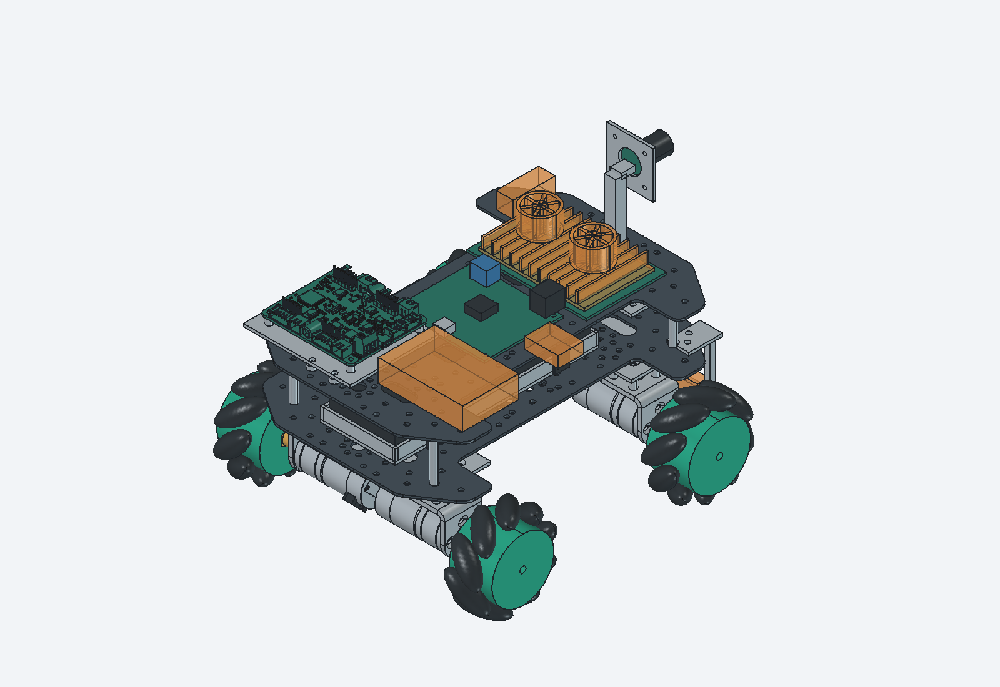
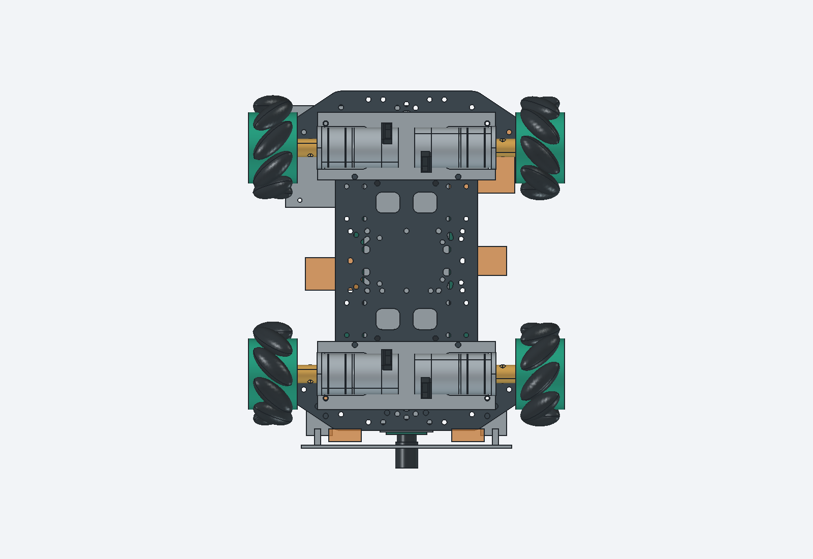
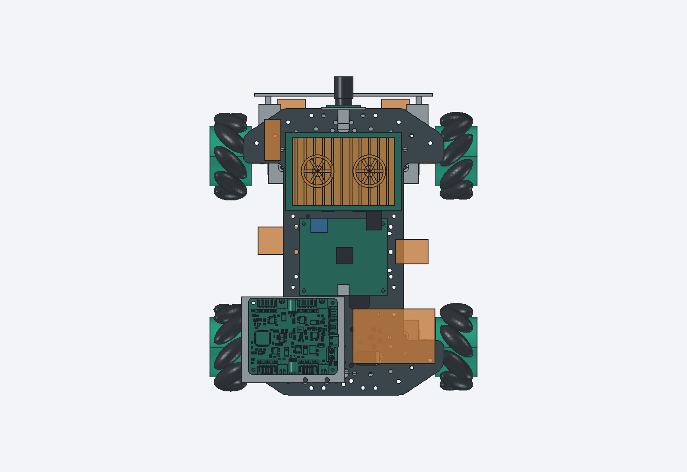

# 当前四驱底盘布局

更新：2026-10-28。上下两层均用T5X板；按用户“允许补孔、尽量少加转接件”的决定修正支承和固定。保留65mm麦轮、310电机、原配四孔架、联轴器、电池和相机的位置。当前是CAD加工设计，尚未制作和实物验收。

[FreeCAD整车](../../03_hardware/01_机械/03_整车布局.FCStd) · [整车STEP](../../03_hardware/01_机械/04_整车布局.step) · [零件库](../../03_hardware/01_机械/02_零件库.FCStd) · [规格与孔位表](../../03_hardware/01_机械/01_建模规格.md#补孔和固定方式) · [修订过程与检查证据](../03_records/03_20261024_机械装配验证.md#资料分组与补孔结构修订2026-10-28)

2026-10-30用户报告四轮与电机已装好，驱动尚未连接；当前控制方案已改为RK40针串口直连驱动。下列CAD及图片仍为2026-10-28结构设计，包含旧电控预留，本次未重建三维模型；其中STM32/专用控制稳压的位置不再是当前安装或采购要求。实物装配不自动沿用CAD的验收结论。

## 当前如何固定

| 部位 | 当前设计 | 仍需核对 |
| --- | --- | --- |
| 两层板 | 各147×210×1.5mm；下板底面高68mm；四根35mm柱用X±50、Y±85原孔，上板底面高104.5mm | 到货版本、柱长、螺纹、防松和承力 |
| 电机架 | 位置不变，前后各加110×42×2mm桥板；桥板沉头螺丝先装，不在槽边硬打16孔 | 材料、工艺、13.75mm隔柱、螺丝长度和受力 |
| 驱动 | PCB中心(-37,-62)，底面高116mm；增加76×63×2mm安装板和5mm隔柱 | V2实物、绝缘、插头、背面器件和曲面参考限制 |
| 电池托盘 | 4脚改到X±18、Y±48板材区域，补螺丝通道 | 螺丝头低于电池支承面，真实出线和刚度 |
| 推板 | 两侧上脚伸入板内并补孔固定，避开层间柱 | 推送载荷；触点准确型号和动作行程 |
| 相机杆 | 原位置保留，上板开8.8mm方孔；底座增至36×14mm双孔固定 | 通道公差、杆刚度、镜头与线缆 |

## 尺寸和验证范围

坐标X向右、Y向前、Z向上，单位mm。当前外廓长233.1×宽195.8×高164.5mm，包括Ø65×30.4mm轮子旋转包络；相对项目250×200×180mm限制，名义余量长16.9、宽4.2、高15.5mm。未知插头、线缆弯曲、变形和公差未计入，尤其需要核对实际宽度。

建出的已知刚体未发现大于0.02mm³的体积交叠。逐孔、支承和文件重开结果见机械记录；这不等于安装、强度或实物通过。驱动原件仍是未封闭曲面，不作实体碰撞或质量合格证明；联轴器与轴、轮孔按接口和坐标核对，真实配合和螺丝长度待核。

主控完整孔图、后续IMU准确型号、散热真实尺寸、供电附件和线束接口仍不齐。橙色表示待核包络，不编造对应板卡的安装孔。走线草案默认隐藏，并从机械整车STEP中排除，避免误当作可加工的真实线束。

## 资料和质量

310电机、支架、联轴器的正式资料放在02_310电机；四路驱动CAD、手册、通信表、固件及完整例程放在03_四路电机驱动。[按部件打开资料](../05_resources/01_资料清单.md#亚博310与新版四路驱动资料)。完整下载包移入temp留存，原件未删除；来源和文件指纹保存在sources.json。

此前1129.0g混合口径小计含两片板，但不含本次新增桥板、安装板及全部紧固件等；不能把371g旧余量当成当前实测结论。加工件定材料和工艺后补齐质量，再称重核≤1.5kg。设计件不计作已购，实际支出仍只看采购台账。
