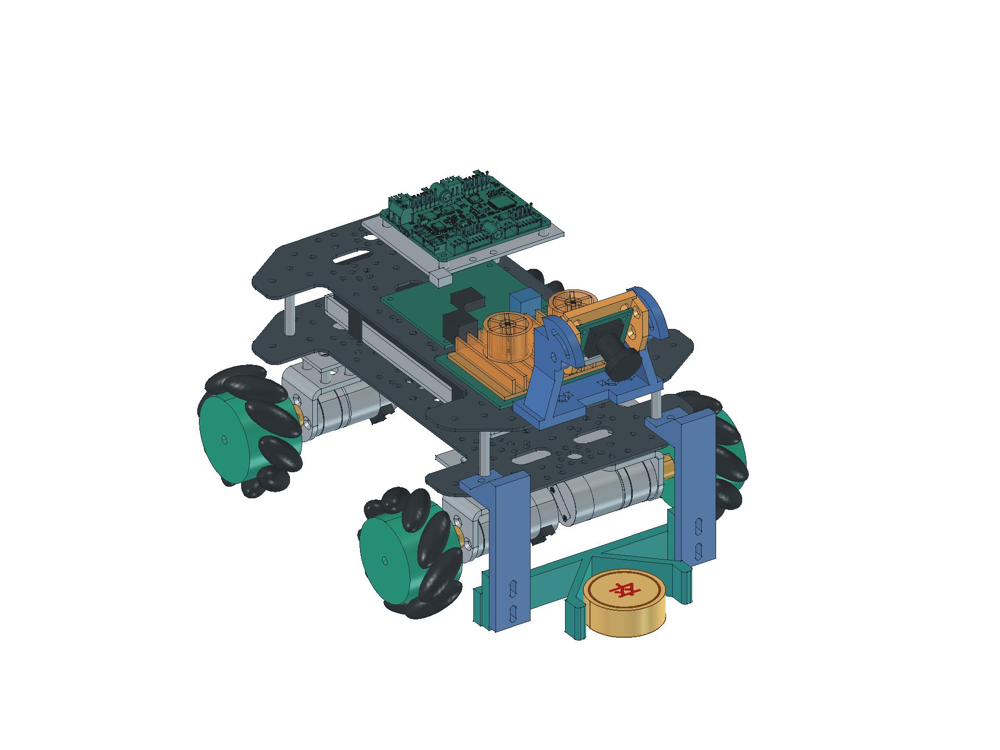

# 当前四驱底盘布局

更新：2026-11-03（补充相机打印支架要求）。上下两层均用T5X板，保留2026-10-28补孔与桥板结构；11-02换入IMX415及V形推铲，11-03将旧相机杆替换为复用上层原孔、可手动俯仰的相机打印支架。当前是CAD试制设计，尚未完成制作和实物验收。

[FreeCAD整车](../../03_hardware/01_机械/03_整车布局.FCStd) · [整车STEP](../../03_hardware/01_机械/04_整车布局.step) · [零件库](../../03_hardware/01_机械/02_零件库.FCStd) · [规格与孔位表](../../03_hardware/01_机械/01_建模规格.md#补孔和固定方式) · [修订过程与检查证据](../03_records/03_20261024_机械装配验证.md#资料分组与补孔结构修订2026-10-28)

上图为2026-11-03的相机打印支架和40×15mm虚拟棋子装配展示；底部旧图保留2026-10-28阶段，按当前表格与正式CAD核对。用户报告四轮与电机已装好，控制方案为RK40针串口直连驱动；CAD中旧STM32/专用控制稳压预留不代表当前采购或安装要求。实物装配不自动沿用CAD检查结论。

## 当前如何固定

| 部位 | 当前设计 | 仍需核对 |
| --- | --- | --- |
| 两层板 | 各147×210×1.5mm；下板底面高68mm；四根35mm柱用X±50、Y±85原孔，上板底面高104.5mm | 到货版本、柱长、螺纹、防松和承力 |
| 电机架 | 位置不变，前后各加110×42×2mm桥板；桥板沉头螺丝先装，不在槽边硬打16孔 | 材料、工艺、13.75mm隔柱、螺丝长度和受力 |
| 驱动 | PCB中心(-37,-62)，底面高116mm；增加76×63×2mm安装板和5mm隔柱 | V2实物、绝缘、插头、背面器件和曲面参考限制 |
| 电池托盘 | 4脚改到X±18、Y±48板材区域，补螺丝通道 | 螺丝头低于电池支承面，真实出线和刚度 |
| V形推铲 | 90°V口、56mm净口、前端短挡边；3件PETG打印，左右双筋、双长孔调高，沿用原4个补孔 | 官方棋子尺寸、打印配合、实际受力和释放；[完整尺寸与打印](./07_前推铲与打印.md) |
| 相机支架 | 旧细杆仅为试排草案；按下述要求改为可调角度的打印支架 | 固定孔、转轴、锁紧、排线和真实视野 |

## 相机支架设计要求

2026-11-03按用户要求，设计能真正固定IMX415的3D打印支架，替换旧细杆草案。结构采用上层四孔固定座、双侧转轴、弧形锁紧槽和相机托架，目标俯仰调节范围0～60°；本节是待实现的设计要求。

设计时核对相机安装孔的对齐、板后净空、原板孔边、整车外廓和排线通道，给出孔位、打印朝向和安装图。试打印后检查孔位与公差、螺丝工具空间和锁紧刚度；装上真实相机后检查近远棋子、遮挡和振动，并重新标定。电脑几何检查、打印装配与真实画面分别核对，任务状态见[开发计划](../01_plans/01_开发计划.md#机械安装)。

## 尺寸和验证范围

坐标X向右、Y向前、Z向上，单位mm。当前20°相机姿态外廓长247×宽195.8×高165.472mm，包括Ø65×30.4mm轮子旋转包络；相对项目250×200×180mm限制，名义余量长3、宽4.2、高14.528mm。未知插头、线缆弯曲、变形和公差未计入，尤其需要核对实际宽度。

建出的已知刚体未发现大于0.02mm³的体积交叠。逐孔、支承和文件重开结果见机械记录；这不等于安装、强度或实物通过。驱动原件仍是未封闭曲面，不作实体碰撞或质量合格证明；联轴器与轴、轮孔按接口和坐标核对，真实配合和螺丝长度待核。

主控完整孔图、后续IMU准确型号、散热真实尺寸、供电附件和线束接口仍不齐。橙色表示待核包络，不编造对应板卡的安装孔。走线草案默认隐藏，并从机械整车STEP中排除，避免误当作可加工的真实线束。

[尺寸与打印图](./07_前推铲与打印.md#尺寸与孔位)用于当前前铲；前面的整车和底部图片保留旧阶段结构，不据其判断新铲尺寸。

## 资料和质量

310电机、支架、联轴器的正式资料放在02_310电机；四路驱动CAD、手册、通信表、固件及完整例程放在03_四路电机驱动。[按部件打开资料](../05_resources/01_资料清单.md#亚博310与新版四路驱动资料)。完整下载包移入temp留存，原件未删除；来源和文件指纹保存在sources.json。

此前1129.0g混合口径小计含两片板，但不含本次新增桥板、安装板及全部紧固件等；不能把371g旧余量当成当前实测结论。加工件定材料和工艺后补齐质量，再称重核≤1.5kg。设计件不计作已购，实际支出仍只看采购台账。
