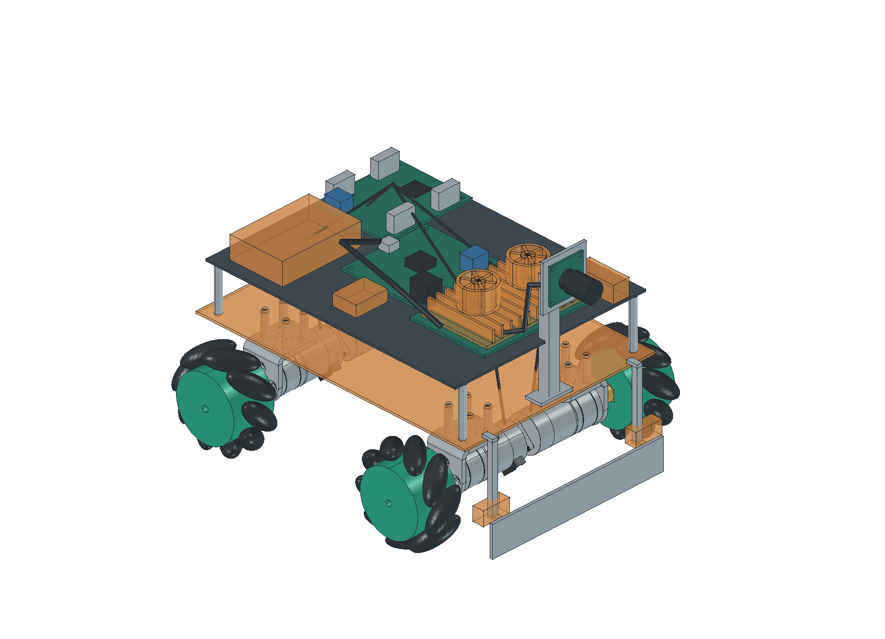
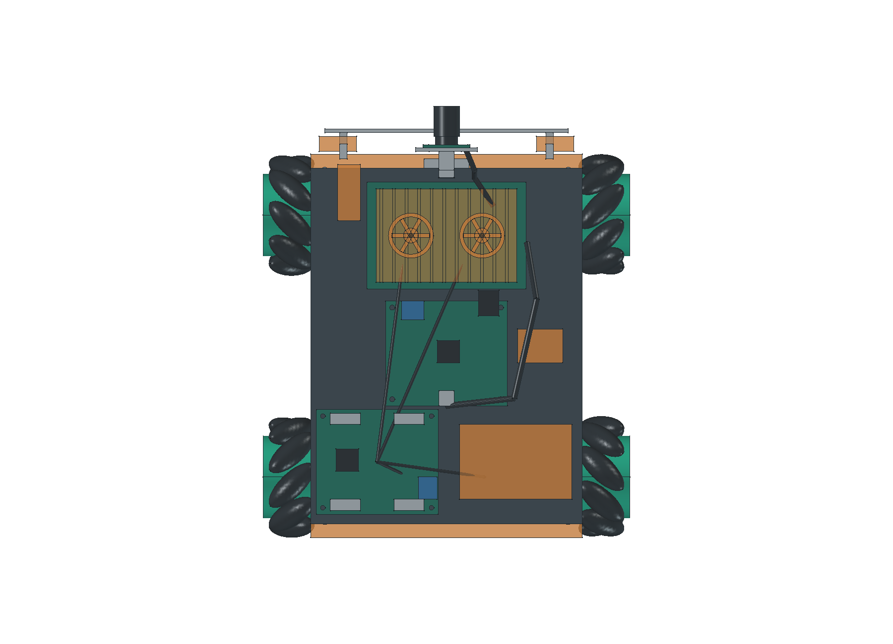
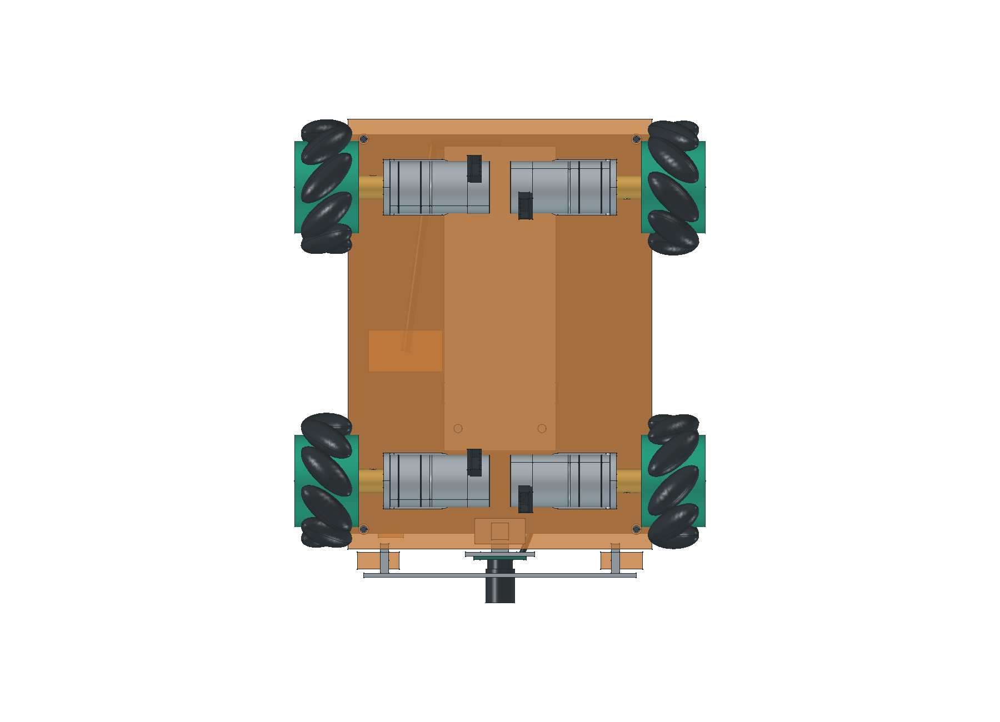

# 当前四驱底盘布局

**2026-10-25模型同步完成：** 已改为亚博YB-MPP01-V1.0 Type-C电源板，放到电控层中段；含接口Y61.72mm、从PCB底面计高13.8mm。当前CAD不再使用UBEC侧边占位；实际插头和线缆空间仍待核。

更新：2026-10-25。按当前[购买清单](../../03_hardware/01_硬件清单.md)重建：65mm尼龙麦轮2左＋2右、3mm六角联轴器、4台MD310Z20_7.4V与原配支架、亚博四路驱动、格氏2S／7200mAh硬壳XT60、泰山派3M及原配双风扇、微雪USB相机、亚博YB-MPP01 Type-C电源板独立5V供电。旧生成模型与旧试装已清理，旧候选唯一用户CAD原件保留在 `temp/旧硬件待删除/`，当前方案只使用本页新模型。

**新购碳板适配（2026-10-25登记）：** 用户已购轮趣T5X四驱加高板2套，先以其中1片作主底板试装，孔位不合时允许补孔或转接，第2片是否装车待布局及称重确定。准确订单与含件见[购买清单](../../03_hardware/01_硬件清单.md)。新购板的外廓、孔图、净重和刚度待到货核对；本文当前CAD不构成新购板免修改安装的证明。

[可编辑FreeCAD工程](../../03_hardware/01_机械/03_整车布局.FCStd) · [整车STEP](../../03_hardware/01_机械/04_整车布局.step) · [零件库](../../03_hardware/01_机械/02_零件库.FCStd) · [逐件规格与自行建模标记](../../03_hardware/01_机械/01_建模规格.md) · [模型打开方法](../03_records/03_20261024_机械装配验证.md#打开模型)

## 布局与尺寸

坐标为X向右、Y向前、Z向上，单位mm。已购T5X四驱碳板暂按145×205×1.5包络表示，只有厚1.5已有商品图依据，长宽和原孔图尚未核实；底面暂离地68；电控层145×190×1.5，底面104。电池沿前后放置，在中间托盘内；主控在前上层，驱动和下位机在后上层，亚博电源板放在电控层中段，坐标中心(0,-4,108)，PCB65×56、含突出接口Y61.72、从PCB底面计高13.8；驱动在后方、主控在前方，插头弯曲空间待核。前推板离地3、宽130、高22；相机板中心离地148，光轴先按水平向前建模，实际机位及下俯角等待拍摄验证。

| 校核项目 | 当前模型结果 | 边界 |
| --- | --- | --- |
| 外廓长×宽×高 | 230.6×195.8×164.5 | 含Ø65轮子完整圆柱旋转包络和建出的线束；未包含未知插头真实突出量 |
| 相对250×200×180限制的余量 | 长19.4、宽4.2、高15.5 | 宽度余量较小，实物接头与公差需复核 |
| 轮子最高包络到下底板 | 3 | 静态设计距离，无变形/跳动实测 |
| 电池本体顶部到电控层 | 5 | 不含绑带、出线；电池尺寸尚待原图及实物核对 |
| 两侧电机后端名义间距 | 10 | 不含插头、线缆弯曲与工具空间 |
| 输出轴进入联轴器名义长度 | 11 | 轴肩、D平面紧定落点及防脱待核 |
| 几何有效性／刚体交叠 | 无无效实体；筛查范围内无体积交叠 | 排除未知SKU及底板包络和线束，不代表动态、强度或实物验收 |

轮端内侧平面为X＝±67.5，轮宽30.4；前后轮轴Y＝±70、Z＝32.5。电机前端面X＝±52.5，联轴器起点X＝±55.5。左前/右后使用P03，右前/左后使用P04，滚子轴的俯视投影组成X形；实物左右命名仍须对照装车方向核验。

当前底板包络上的16个电机架安装孔仅为孔位投影草案，按厂家新版支架14×16孔距推导，直径设计为3.4；另有4个电控层支柱孔。尚未确认这些坐标是否落在已购T5X四驱板的实体材料区域，不能直接发加工；必要时用转接件。厂家支架实购版本、紧固件、绝缘固定、底板刚度均未验收。泰山派孔图仍未知，没有虚构孔位；板卡目前只表示摆放位置，压持／转接固定需要补设计。

## 模型精度与后续使用

310电机与新版支架使用厂家STEP；轮子外廓及9滚子、六角联轴器、驱动孔图和相机外形按厂家规格自行建模。滚子曲面、螺纹、连接器和部分孔深简化。主控只核到85×57，厚度1.6为假设；原配双风扇长宽高、尚无SKU的F407整板、IMU、触点、激光和分电件使用橙色预留包络，不能据此打孔加工。

当前混合口径质量参考为1016.6g（四电机280＋四轮232＋电池330＋主控/散热商品毛重142.6＋亚博电源板32）；加驱动厂标22.4g后为1039.0g。若商品图45g确为单片T5X板本体，再加后为1084.0g，至1500g仅有416.0g分配空间，45g是否含套装附件仍待核。其余联轴器、支架、托盘、上层板、支柱、相机、下位机、传感器和线束仍须计齐；不能称整车实际质量或合规结论。第2片已购板不默认装车。实际订单和支出只在采购台账登记。

逐件已知、假设和待核项集中在[建模规格](../../03_hardware/01_机械/01_建模规格.md)，机器可读参数、来源与哈希、几何结果同目录保存。过程与清理证据见[机械装配验证记录](../03_records/03_20261024_机械装配验证.md)，未完成任务只在[开发计划](../01_plans/01_开发计划.md)勾选维护。
