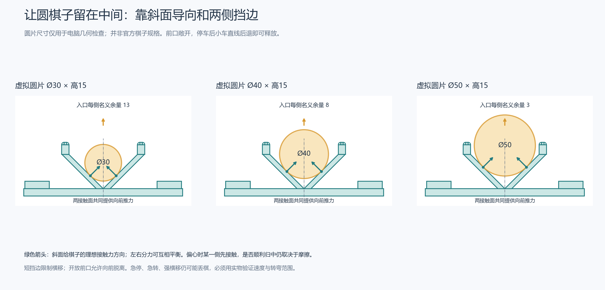
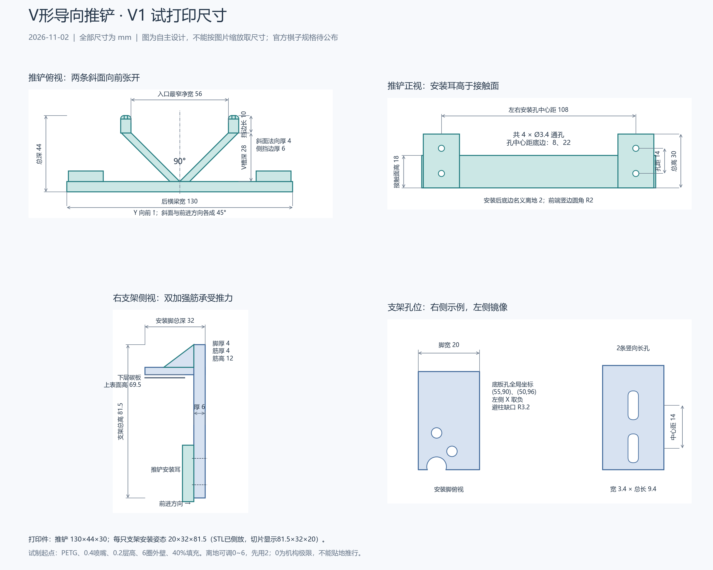

# V形前推铲与打印

更新：2026-11-02，试制V1。用户指出圆棋子可能沿原直推板左右滑走，本版改为**V形竖直导向面＋两侧短挡边＋左右带加强筋的调高支架**。官方棋子直径、厚度等尚未公布，用户目前也没有实物；以下全部是自主试制尺寸。30、40、50mm圆片只是电脑检查样本，不是比赛规格或已验证的适用范围。

## 怎样减少侧滑

从上往下看，两条斜面形成90°开口，每条与前进方向成45°。圆棋子抵住两面时，左右接触力都有向前的分量，横向分量可互相平衡；偏向一侧时，该侧斜面的接触力有把棋子推回中间的分量。前端各延伸一段10mm短挡边，进一步限制横移。能否顺利归中仍与摩擦、初始偏差、车速和路线有关，需要实测。

这里的“斜角”是**俯视图中的导向角**。与棋子接触的面在高度方向保持竖直，不设计伸到棋子底下的坡道，避免把棋子顶起。前方敞开、不做小于棋子直径的收口：到位后，小车直线后退即可把推铲撤走。开放前口仍允许棋子向前脱离，所以急停、急转和过强横移不能靠这件被动结构保证不丢棋。



研究依据与本项目推断分开：Lynch的[多接触推送研究](https://publications.ri.cmu.edu/storage/publications/pub_files/pub2/lynch_kevin_1992_1/lynch_kevin_1992_1.pdf)分析了接触位置和力约束对稳定推送的影响；LaValle的[推送路径说明](https://msl.cs.illinois.edu/~lavalle/planning/node663.html)说明过急转弯会破坏接触。**90°、56mm和本版支架尺寸是本项目选择，来源没有验证这套棋子机构。** 圆弧凹面需要先知道棋子直径，本版先用两条直斜面，便于后续换口宽或换整块前铲。

## 打印文件和模型

2026-11-06已整理[前推铲打印包](../../03_hardware/01_机械/03_打印件/10_前推铲打印包.zip)，可直接转发给打印方。包内有下面三个STL、同一套零件的STEP、打印说明、装配预览和尺寸图；三个STL各打印1件，共3件。STEP用于查看装配或修改尺寸，不需要再额外打印一套。说明已写明毫米、100%比例和建议摆放方向。

本次重新读取三个STL，封闭性、单个连通零件、面朝向、自相交及尺寸检查通过；STEP包含3个有效实体，与当前整车CAD中的前推铲和左右支架逐件一致。打包后核对文件内容与原件一致。模型沿用试制V1，本次没有修改结构；尚未切片验收、实物打印或装车验证。

三个STL分别打印1件，已摆好建议朝向，坐标单位是mm。STL格式本身不保存单位；导入切片软件时选择毫米、100%比例，并逐件核尺寸。

| 文件 | 用途 | 导入切片软件后的外形尺寸 |
| --- | --- | --- |
| [导向推铲](../../03_hardware/01_机械/03_打印件/01_导向推铲.stl) | 两条导向面、挡边、横梁和安装耳为一件 | 130×44×30mm |
| [左支架](../../03_hardware/01_机械/03_打印件/02_左支架.stl) | 左侧安装脚、长孔和双加强筋 | 81.5×32×20mm，已侧放 |
| [右支架](../../03_hardware/01_机械/03_打印件/03_右支架.stl) | 右侧镜像件 | 81.5×32×20mm，已侧放 |

[独立FreeCAD工程](../../03_hardware/01_机械/03_打印件/04_推铲打印工程.FCStd)和[独立STEP](../../03_hardware/01_机械/03_打印件/05_推铲打印工程.step)保存装车姿态，方便查看接触面与安装位置。三件已同步进入[整车工程](../../03_hardware/01_机械/03_整车布局.FCStd)、[整车STEP](../../03_hardware/01_机械/04_整车布局.step)和[零件库](../../03_hardware/01_机械/02_零件库.FCStd)。FreeCAD对象可单独选取；结构参数在[parameters.json](../../03_hardware/01_机械/parameters.json)的D04“前推板及支架”中，修改后须运行脚本重建，不会自动更新已有实体。

已另存[整车推棋装配预览](../../03_hardware/01_机械/05_推棋装配预览.FCStd)，在更新后的整车前方放入直径40mm、高15mm的浅黄色模拟棋子；[整体图](../../05_data/03_results/04_mechanical/20261102_pushing_assembly_iso.png)和[俯视图](../../05_data/03_results/04_mechanical/20261102_pushing_assembly_top.png)可查看前铲与支架装上后的关系。该工程隐藏未定电控、触点、激光占位及示意线束以便观察，原整车工程保持不变；没有把展示棋子纳入打印件或发车外廓。

## 尺寸与孔位



[可编辑尺寸图](../../05_data/03_results/04_mechanical/20261102_pusher_dimensions.svg)和[可编辑原理图](../../05_data/03_results/04_mechanical/20261102_pusher_principle.svg)保留文字与线条。图形为设计生成内容，不是实物照片或测试证据。

| 部位 | 本版尺寸 | 核对方法和作用 |
| --- | --- | --- |
| V形导向面 | 夹角90°，单侧与前进方向45°；法向厚4mm | 用角尺核两面；4mm是垂直于斜面的厚度 |
| 入口与挡边 | 净宽56mm；V槽纵向深28mm；挡边向前长10mm、厚6mm | 量入口内侧，不把外宽当成可容纳直径 |
| 接触面 | 高18mm；前端两处竖边圆角R2mm | 棋子应接触竖直侧面，不骑到下边缘上 |
| 后横梁 | 宽130mm、前后厚6mm、高18mm | 把推力传给两侧安装耳 |
| 推铲安装耳 | 每侧宽20mm、前后厚6mm、总高30mm | 与后方支架贴合；下孔同时穿过横梁 |
| 推铲螺孔 | 共4×Ø3.4mm，轴线沿前后；左右孔中心距108mm；每侧上下距14mm | 以推铲底边为基准，孔中心高8、22mm；M3螺栓通孔，不在塑料里直接攻牙 |
| 左右支架 | 装车姿态各宽20×前后深32×高81.5mm；竖板厚6mm | 两件镜像，各自有两个底板固定点 |
| 安装脚与筋 | 脚厚4mm；每侧两条筋，筋厚4mm、高12mm、前后底长16mm | 加强筋在底板上方，不切断来给螺帽让位 |
| 调高长孔 | 每只2条，宽3.4mm、总长9.4mm，两端半圆R1.7mm；中心距14mm | 螺栓中心可移动6mm；须用大垫片锁紧 |
| 名义离地 | 2mm；机构可调0～6mm | 先设2mm；0mm只表示机构极限，不能贴地推行。实际值须小于棋子最低有效侧壁高度，并大于场地起伏和底盘变形 |
| 避柱缺口 | R3.2mm，按原层间柱中心让位 | 原柱半径2.5mm时名义径向间隙0.7mm，需核实际螺帽 |

56mm指两侧挡边直线段之间的最窄净距，前端R2圆角处略放宽。用卡尺核最窄处，不能只量圆角端部。

坐标沿用整车：底板中心为平面原点，X向右、Y向前、Z从地面向上，单位mm。**这不是让用户按未知实物直接钻孔的指令；先量实物底板和孔槽。**

| 位置 | 右侧 | 左侧 |
| --- | --- | --- |
| 底板两个Ø3.4mm固定孔，X/Y | (55,90)、(50,96) | (-55,90)、(-50,96) |
| 安装脚范围，X/Y | X=44～64，Y=84～116 | X=-64～-44，Y=84～116 |
| 安装脚底面 | Z=69.5，即模型下层板顶面 | 相同 |
| 支架长孔中心，X/Y/Z | X=54；轴线穿Y=110～116；中心Z=11、25 | X=-54，其余相同 |
| 长孔圆弧中心高度 | 下孔Z=8、14；上孔Z=22、28 | 相同 |
| 名义2mm离地时的推铲孔中心 | X=54，Z=10、24 | X=-54，Z=10、24 |

推铲整体范围X=-65～65、Y=98～142、Z=2～32；V槽顶点(0,104)，直斜面终点(±28,132)，挡边到Y=142。推铲修订时整车模型为247×195.8×161.6mm；2026-11-03装入[相机打印支架](./08_相机支架与打印.md)后，当前20°姿态为**247×195.8×165.472mm**，距250×200×180mm上限分别只余3、4.2、14.528mm；尺寸包括既有轮子旋转包络，尚未包含未知插头、真实线缆、螺丝突出和变形。V1图只适用于当前参数，改尺寸后要重新检查全车边界和尺寸图。

旧模型中的P15“前碰撞触点”仍为未定型号的橙色占位盒，原X=±38、Y=108、底面Z=25mm位置已与本版安装耳和支架重叠，不能沿用作实际安装位置。本版不提供触点安装孔；型号和动作方式确定后重新排布。已知实体的交叠筛查原本排除了这类未定包络，不能把该筛查说成所有预留件都已装配通过。

## 打印和安装

材料先用PETG。第一轮可从0.4mm喷嘴、0.2mm层高、6圈外壁、40%填充、上下各6层开始；这些是本项目试制起点，不是强度保证。温度、风扇、热床按所用耗材和打印机建议设置。Prusa的[面向打印的建模说明](https://help.prusa3d.com/article/modeling-with-3d-printing-in-mind_164135)提醒配合间隙取决于设备、材料和方向，承力方向也受打印层影响，因此需要试打印复核。

1. 推铲以底面朝下打印；左右支架以侧面朝下打印，STL已摆好。导向面不要放在支撑接触面上。导入后逐层预览横向小孔，必要时仅对小孔局部加支撑；孔缩和支撑清理后再核Ø3.4，不能靠软件“修复成功”判断尺寸正确。
2. 清除毛刺和首层外扩，打磨两条导向面与挡边，尤其是下边缘。先保持接触面平滑，不粘高摩擦厚胶皮，以免阻碍归中或后退释放。打磨后复量56mm入口，不能明显改变导向角。
3. 先把每只支架用2颗M3螺栓固定到底板。按模型的4mm打印脚、1.5mm板、上下垫片和螺母，先核M3×12mm全牙螺栓，4颗；若实物垫片/螺母不同，按叠层重算，不能让螺栓顶到轮、电机或线束。使用垫片分散碳板受力，确认脚落在实材上。
4. 再装推铲：上排用2颗M3×20mm，下排用2颗M3×25mm全牙螺栓，螺栓从支架前表面穿向车内，后侧用M3螺母固定。名义承压厚度上排12mm、下排18mm，加垫片和螺母后核实际长度。长孔侧每孔配外径至少7mm、厚约1mm的大垫片；螺母侧也加垫片。紧固件数量为模型配套建议，尚未采购或实装验证。
5. 用2mm垫片临时支在推铲底边，左右同时调平再锁紧；取出垫片，在全行程、轻压底盘和慢速转动四轮时核不擦地、不碰轮、不碰安装柱。再量整车外廓；长边仅剩3mm名义余量。

本版三件CAD实心体积约52.95cm³；实际打印质量随填充、外壁、材料和支撑变化，连同螺丝称重后再并入整车1.5kg限制。未做结构仿真、疲劳或碰撞验证。

## 棋子尺寸公布后怎样调整

对直径D的理想圆片，90°V槽内的中心在顶点前方`D/√2`处。当前56mm入口的单侧名义对准余量为`(56-D)/2`：30、40、50mm圆片分别为13、8、3mm。这只是几何入口余量，实际还要扣除翘曲、孔位/安装误差、棋子倒角和视觉定位误差，不能当作自动捕获能力。

正式棋子若过宽，增大入口后应一并核V槽深、挡边长度、车长和相邻棋子干涉；不能只把整个STL按比例缩放，否则底板孔也会跟着错位。棋子较薄时，先根据底部倒角核最低有效接触高度，再降低离地高度或重做前铲；棋子可能从下方穿过时禁止用当前尺寸试推。现在不定义通用适配直径或允许急转的速度。

建议按下面顺序试验，结果继续写入[同一机械记录](../03_records/03_20261024_机械装配验证.md#v形推铲与调高支架2026-11-02)，任务状态统一在[开发计划](../01_plans/01_开发计划.md)。

| 要验证什么 | 输入和观察方式 | 需要保留的结果 |
| --- | --- | --- |
| 入口与释放 | 实际棋子从正中、左右小偏差进入；不驱动车先手推；到位直线退车 | 视频看两侧是否归中、有无爬铲、卡住或被带回，记录实际偏差 |
| 直行侧滑 | 从低速开始，固定距离与同一地面逐级试速 | 记录棋子中心相对推铲的横移、脱出次数、速度和距离 |
| 缓弯与横移修正 | 分别改变弯曲程度和横向修正幅度，一次只改一个条件 | 找到开始失去接触的条件，不把最高车速当作可推送车速 |
| 停车和退出 | 平缓减速到位，再后退；单独测试异常停车 | 记录棋子前冲距离、是否脱离、退车后位置与重新观察结果 |
| 紧固与刚度 | 反复推送后核长孔位置、螺丝、层裂和前端挠度 | 保存前后离地间隙、位置标线和照片；松动或裂纹即改结构 |

## 重建与电脑检查范围

在项目根目录，用本机FreeCAD自带Python生成打印件：

```powershell
& "$env:LOCALAPPDATA\Programs\FreeCAD\bin\python.exe" -X utf8 -B '03_hardware/01_机械/export_pusher.py'
```

更新整车和零件库：

```powershell
& "$env:LOCALAPPDATA\Programs\FreeCAD\bin\python.exe" -X utf8 -B '03_hardware/01_机械/build_models.py'
```

重画V1尺寸及原理图：

```powershell
& "$env:LOCALAPPDATA\Programs\FreeCAD\bin\python.exe" -X utf8 -B '05_data/03_results/04_mechanical/draw_pusher.py'
```

重建会覆盖当前生成模型；有手工编辑时先保存所改部分。结构源码为[pusher_design.py](../../03_hardware/01_机械/pusher_design.py)。[打印件检查结果](../../03_hardware/01_机械/pusher_validation.json)保存三个独立实体、STL封闭边检查、圆片接触和后退退出的抽样几何结果及文件指纹；[整车检查](../../03_hardware/01_机械/validation.json)仍按原范围排除未定包络、未封闭驱动曲面和线束，不能证明实物装配或动态无碰撞。

当前通过范围是**电脑CAD与网格检查**：三个封闭单实体；STL各网格边连接两面；理想圆片30/40/50×15mm不侵入前铲且能接触V面；相对向前退出0～80mm按2mm步长抽查无侵入；0、2、6mm离地位置的推铲与支架互不侵入。没有进行切片软件预览验收、实打、材料强度试验或真实棋子推送。
