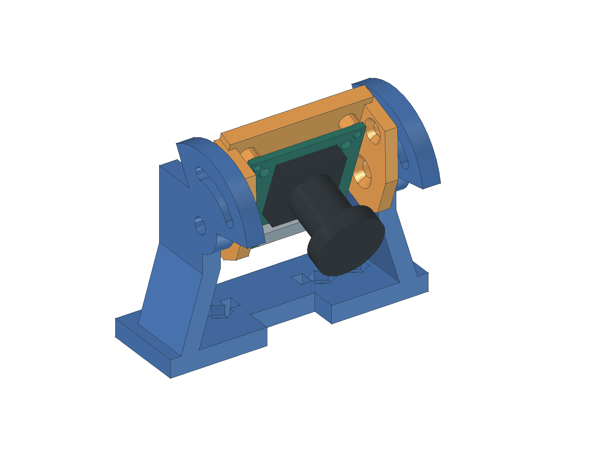
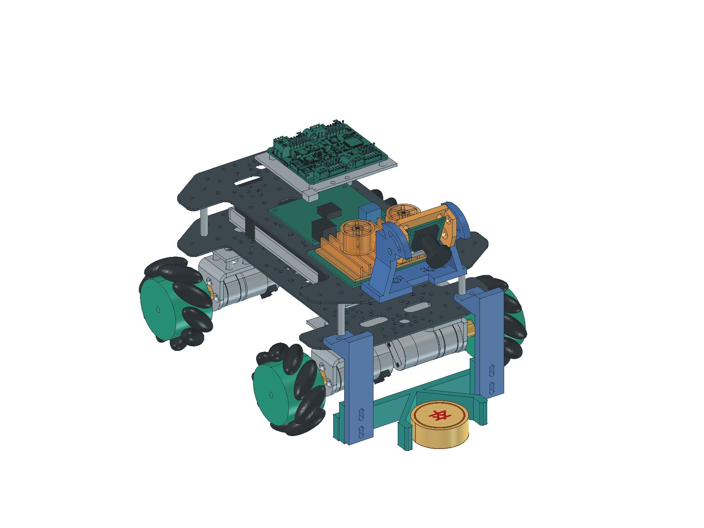
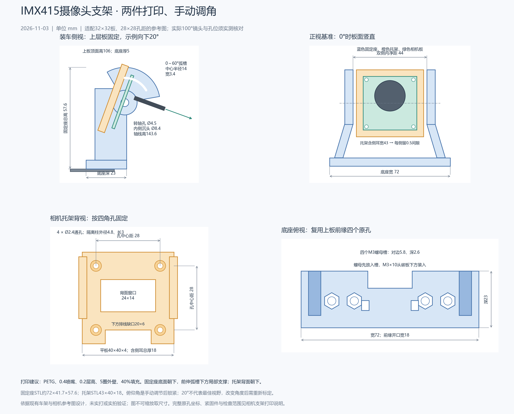

# 摄像头支架与打印

更新：2026-11-03，试制V1。用户澄清“支架”指固定摄像头的部件。本版按现有T5X双层碳板、RK直连IMX415、前方V形推铲和30针长排线设计，替换原8×8细杆、36mm固定板的草案。

## 结构和用途

**蓝色固定座装在上层板前缘，橙色托架固定相机，左右用转轴和弧形长孔调节俯仰。** 相机直接接RK，支架不需要控制线，也没有电机。先松开两侧锁紧螺母，手动把镜头向下转到所需角度，再同时锁紧转轴和弧槽螺母；调角后需要重新标定相机与地面的关系。



[两件分开的装配示意](../../05_data/03_results/04_mechanical/20261103_camera_mount_exploded.png)可看固定座与托架的连接关系；相机参考体随托架一起显示，不属于打印件。

旧立杆从下层板穿过上层板，悬臂较长。本版改为在上层板承力，底面离地106mm、转轴离地143.6mm，相差37.6mm；两侧支撑共同承力。四个底座螺孔复用厂家上板前缘已有Ø3.2mm圆孔，打印底座开Ø3.4mm通孔及螺母槽，避免在原孔槽之间再安排新孔。四孔的实际位置须拿到实物后核对，不能只凭相似外观装配。

## 与现有整车怎样配合



[装车侧视](../../05_data/03_results/04_mechanical/20261103_camera_car_side.png)可看高度、前伸量和推铲关系。当前模型仍以既有整车几何为依据：相机支架上层固定、镜头朝前下方，底盘和推铲位置保留。**20°示例姿态下整车约247×195.8×165.472mm**，相对250×200×180mm限制，名义余量分别为3、4.2、14.528mm；未知真实线束、接头、螺钉突出、变形和公差仍需实物计入。旧电池包络等未实测部分仍沿用原模型，不能把本次相机支架更新当成整车尺寸验收。

原下层相机底座孔在模型中保留，但不再作为本支架安装孔。上层板旧8.8mm立杆通道已从当前加工设计移除，未加工的板不需要再开这个方孔；已加工的实物先核现状，不要求补回。

相机板仍采用用户此前认可的商家同板参考图：**32×32×1.6mm，四角孔距28×28mm、原孔Ø2.2mm**，四角可分离边框必须保留。100°版本镜头的真实外径、总深和净重未实测；当前24.6mm总深、18.3mm前段直径只是参考镜头外形。模型能装上参考板，不代表实物孔位和镜头已经核对。

## 尺寸和孔位



[可编辑尺寸图](../../05_data/03_results/04_mechanical/20261103_camera_mount_dimensions.svg)保留文字和线条；图不可按缩放量尺寸，所有制造尺寸以参数和模型为准。

| 部位 | 本版设计值 | 用途或核对方式 |
| --- | --- | --- |
| 固定座底板 | 72×23×5mm | 底面装在上层碳板顶面，设计高度106mm |
| 固定座完整外形 | 约72×41.696×57.6mm | 包括向前伸出的弧槽；不是只有23mm深 |
| 左右支撑 | 厚5mm，上方内净距44mm | 底部向外错开，给原板固定点和螺母留空间 |
| 托架平板 | 40×40×4mm | 含两侧安装耳后总宽43mm、前后最大厚18mm |
| 转动间隙 | 左右各0.5mm | 44mm内净距容纳43mm托架；打印后实测，不能强塞 |
| 相机固定孔 | 4×Ø2.4mm，中心距28×28mm | 用M2螺丝穿过相机原Ø2.2mm孔和打印托架 |
| 板后隔离 | 四个隔离柱与托架一体，外径4.8mm、长3mm | 不让电路板背面直接压在打印板上 |
| 背面窗口 | 24×14mm | 给背面器件和原镜座紧固件留空；实物突出仍需量 |
| 托架下缺口 | 宽20×高6mm | 留排线及插接操作空间 |
| 转轴 | 左右各1×Ø4.5mm | 配M4螺栓；固定座转轴周围有承压材料 |
| 转轴沉头 | 托架内侧Ø8.4mm，90°锥面 | M4沉头从内侧装入、螺母在固定座外侧；不得随意改为内侧凸头或螺母 |
| 俯仰锁紧 | 固定座两条弧槽，中心半径14mm、宽3.4mm | 设计向下0～60°，不是最佳视场结论 |
| 锁紧沉头 | 托架内侧Ø6.4mm，90°锥面；孔Ø3.4mm | M3沉头从内侧装入，外侧大垫片跨过弧槽再锁紧 |
| 底座螺母槽 | 4处，六角对边5.8mm、深2.6mm | 按M3螺母试制包络；先核实购物料尺寸，螺母放入后再从板底装螺栓 |
| 排线通道 | 底座前缘开口宽18mm，另有两条3×4mm束带槽 | 现有排线示意宽16mm；束带只作轻柔定位，不夹折、不勒紧排线 |

转轴坐标为`(0,111,143.6)`，轴向为左右方向。坐标沿用整车：X向右、Y向前、Z从地面向上，单位mm。

底座孔复用厂家CAD中的四个原孔。左右有约0.14mm的细微不对称，因此**不能只按一个规则孔距重新钻四孔**；先在实物前缘找这四个孔，并用打印件或纸质孔位样板核对。

| 原孔 | X/mm | Y/mm | 原孔径／打印件孔径 |
| --- | --- | --- | --- |
| 左外 | -23.5708 | 99.8374 | 3.2／3.4mm |
| 左内 | -14.4373 | 99.8438 | 3.2／3.4mm |
| 右内 | 14.2927 | 99.8438 | 3.2／3.4mm |
| 右外 | 23.4263 | 99.8374 | 3.2／3.4mm |

这四处以外径7mm、内径3.4mm的承压环核厂家板件，电脑模型中的环下材料覆盖为100%。这说明所选位置没有落在原槽边，不证明碳板能承受任意拧紧力、孔位公差或打印件强度。

## 对自动识别和定位有什么影响

俯仰20°只是方便观察装配的起点。零俯仰时参考镜头轴线高148mm；向下20°后，参考镜头前端轴心约为`(0,133.742,140.005)`mm。镜头是绕转轴转动，不能在所有角度都沿用“镜头高148mm”。实际光学位置要用真实相机标定确定。

相机标称100°尚未确认是水平、垂直还是对角视场，**本次不把它换算成已确认的可视范围**。机位向前看时，紧靠车头、已经进入铲内的棋子可能落在近处盲区；增大向下角度又会改变远处可见范围。0～60°调节用于试验这项取舍，不代表固定一个角度就能兼顾整场定位、远处认字和铲内跟踪。

相机图像进入RK进行检测和定位时，要记录本次固定角度、安装高度及镜头状态。松动或重新调角后，重新核相机与地面的关系、独立检查点误差和棋子顶面高度影响；不能直接套用旧角度的地面映射。先验证能看清、支架不抖，再扩展连续推送。

## 排线怎样放

现有30针长排线继续使用。名义20°姿态下，从相机下侧插座附近向下留弯，穿过支架中间和底座前缘开口，沿底座上方回到RK侧，避开转轴螺丝、散热风扇和主控插头。模型里的折线仅表明通道，**没有定义真实排线的最小弯曲半径，也没有验收全角度长度和弯曲过程**。

安装时先插好并锁住连接器，再缓慢转过所用角度，观察是否拉紧、夹住或磨到打印边。排线应有松弛的弧形余量，不能在插座出口硬折；边缘打磨后再用软垫、胶带或宽松束带轻轻定位。相机两端触点方向、实际长度和板端出图仍按已有接线计划验证。

## 打印与紧固件

| 打印文件 | 数量 | 导入切片软件后的尺寸与朝向 |
| --- | --- | --- |
| [相机固定座STL](../../03_hardware/01_机械/03_打印件/06_相机固定座.stl) | 1 | 约72×41.696×57.6mm，底座平面朝下 |
| [相机俯仰托架STL](../../03_hardware/01_机械/03_打印件/07_相机俯仰托架.stl) | 1 | 43×40×18mm，平整背面朝下，已回到零角度摆放 |

[FreeCAD支架工程](../../03_hardware/01_机械/03_打印件/08_相机支架工程.FCStd)含两个打印件和相机参考体，参考相机不打印。[支架STEP](../../03_hardware/01_机械/03_打印件/09_相机支架工程.step)只含两个支架实体，方便其他CAD软件打开。[整车工程](../../03_hardware/01_机械/03_整车布局.FCStd)、[整车STEP](../../03_hardware/01_机械/04_整车布局.step)及零件库均已换入新支架。

先用PETG试制，起点为0.4mm喷嘴、0.2mm层高、5圈外壁、40%填充、上下各6层；温度和风扇按所用耗材与设备设置。固定座前伸弧槽、转轴承压台的下方需要局部支撑，切片时逐层检查；支撑接触处和横向小孔要清理、复量。托架背面朝下，四个相机孔沿打印高度形成，避免把背面窗口填死。STL不保存物理单位，导入时选mm、100%比例，不要整体缩放来凑孔位。

| 连接位置 | 本版试制紧固件 | 安装方向和要点 |
| --- | --- | --- |
| 固定座与上层碳板 | M3×10螺栓4、M3普通六角螺母4、板底M3垫片4 | 螺母先放入底座上面的六角槽，螺栓从碳板底部装入。先核实际板厚、螺母厚度和露出长度 |
| 两侧转轴 | **90°沉头M4×16**各1，共2；M4外侧垫片2、防松螺母2 | 沉头在托架内侧、螺母在固定座外侧，避免挤占相机板；先装此处，再安装相机板 |
| 弧槽锁紧 | **90°沉头M3×16**各1，共2；外径至少7mm、厚约1mm垫片2，M3防松螺母2 | 沉头在托架内侧，大垫片和螺母在弧槽外侧，松开后调角，调好再锁紧 |
| 相机四角 | M2×12螺丝4、M2螺母4、薄垫片8 | 从相机正面装入，螺母在打印托架背面；设计夹持厚度为打印板4＋隔柱3＋PCB1.6mm，再核实际垫片及螺母 |

以上是试制配套，未下单或实装确认。沉头和螺母槽按本版几何预留，实购物料头径、锥角、螺母厚度不同就先复核；不能把普通凸头螺丝直接替换到内侧。螺丝靠垫片和螺母锁紧，不在塑料里直接攻牙，也不靠用力掰开两侧支撑装相机。

建议安装顺序：先清孔并试放螺母；在未装相机板时把托架放入固定座，穿好两侧沉头转轴和锁紧螺丝；固定座装到上层板四原孔；再用四颗M2装相机板，接排线，选择角度后均匀锁紧。用手轻推镜头检查是否晃动、回弹或转动，但不要靠拧到塑料变形消除松动。

## 已检查什么，还要检查什么

[电脑检查JSON](../../03_hardware/01_机械/camera_mount_validation.json)保存每5°、共13个姿态的结果，包括两个单实体、STL重读封闭、相机M2孔轴、弧槽锁紧孔对应、现有已建刚体之间的体积交叠，以及试制紧固件包络。离散角度检查不等于连续扫掠证明；也没有证明真实打印公差、强度、排线、未建精确接口和真实视野合格。原驱动板为未封闭曲面，未知电控包络、真实螺丝工具和线束不以本次结果验收。

后续试打印与真实相机验证统一在[开发计划](../01_plans/01_开发计划.md)维护，结果追加到[同一机械记录](../03_records/03_20261024_机械装配验证.md#摄像头打印支架2026-11-03)：

1. 核实物板32×32、四角孔28×28、边框完整和镜头外形；用实际底板核四原孔。
2. 试打印后量孔、转动间隙、沉头和螺母槽，记录是否装得下、锁得住；装上相机和排线后缓慢调角。
3. 固定真实角度，在RK看近处、远处、两侧以及铲内棋子，记录盲区、清晰度和推铲遮挡。
4. 慢速直行、横移、缓弯和停车时录画面，检查支架振动、锁紧位移和排线；复测标定与定位误差。

## 重建与来源

修改[parameters.json](../../03_hardware/01_机械/parameters.json)中D05“相机杆与相机安装板”的参数，再重建；名称保留用于既有编号引用，当前实际结构已是本版上层打印支架。

重建整车和零件库：

```powershell
& "$env:LOCALAPPDATA\Programs\FreeCAD\bin\python.exe" -X utf8 -B '03_hardware/01_机械/build_models.py'
```

导出打印件和电脑几何检查：

```powershell
& "$env:LOCALAPPDATA\Programs\FreeCAD\bin\python.exe" -X utf8 -B '03_hardware/01_机械/export_camera_mount.py'
```

更新尺寸图：

```powershell
& "$env:LOCALAPPDATA\Programs\FreeCAD\bin\python.exe" -X utf8 -B '05_data/03_results/04_mechanical/draw_camera_mount.py'
```

重建会覆盖生成的工程和STEP，手工改过的部分先另存。结构源码为[camera_mount_design.py](../../03_hardware/01_机械/camera_mount_design.py)。相机外形沿用已归档商家参考图和此前用户的同板判断，T5X孔位直接取厂家CAD；支架尺寸、0～60°范围和20°示例角度均为本项目设计选择。打印方向和试配原则参考[Prusa建模说明](https://help.prusa3d.com/article/modeling-with-3d-printing-in-mind_164135)，排线不硬折的通用原则参考[树莓派官方相机连接说明](https://www.raspberrypi.com/documentation/accessories/camera.html)，后者不作为本IMX415的电气或尺寸兼容证明。
