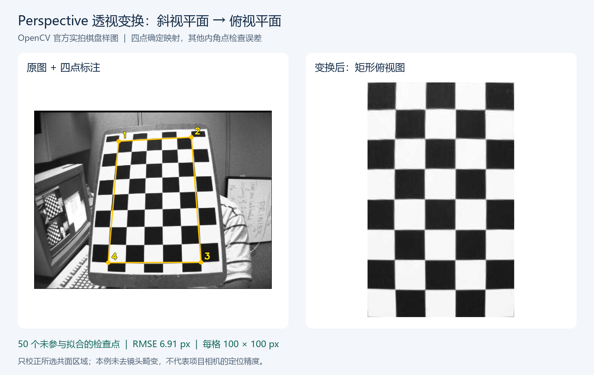
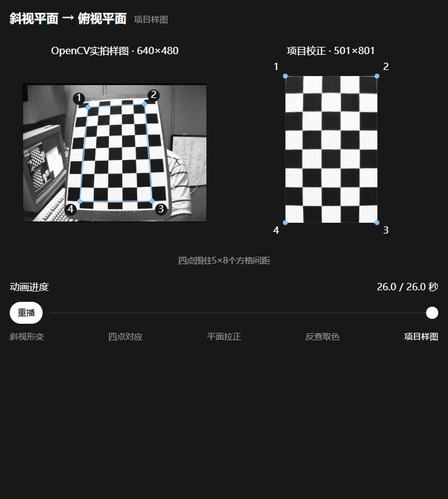

# 2026-10-23 透视变换示例与验证

已完成 Python 四点透视变换示例，使用 OpenCV 官方实拍棋盘照片，展示斜视平面校正为俯视平面的效果。当前完成的是官方样图验证，项目相机实拍、去畸变和实际定位精度仍待验证。



## 原理与本例的四个点

透视变换用一个 3×3 单应矩阵 H 表示两个平面坐标之间的映射：

$$
s\begin{bmatrix}u\\v\\1\end{bmatrix}
= H\begin{bmatrix}x\\y\\1\end{bmatrix}
$$

其中 `(x, y)` 是原图坐标，`(u, v)` 是输出坐标。选择目标平面上四个对应点，将它们映射到矩形四角，就能校正所选区域的透视形变。对应点应围成非退化凸四边形，并保持顺序一致。原理见 [OpenCV 单应教程](https://docs.opencv.org/4.x/d9/dab/tutorial_homography.html)。

本例检测 **6 列 × 9 行内角点**，只取检测网格的四角来求 H。它们围住 **5×8 个方格间距**，不是整张棋盘的外边界；因此输出会裁掉这一区域以外的棋盘边缘和背景。每格设置为 100 像素，输出坐标跨度为 500×800，图像尺寸为 **501×801 像素**。

| 对应点 | 原图坐标，像素 | 输出坐标，像素 |
|---|---|---|
| 1 | (227.372, 82.025) | (0, 0) |
| 2 | (423.467, 70.892) | (500, 0) |
| 3 | (449.496, 407.982) | (500, 800) |
| 4 | (198.553, 408.804) | (0, 800) |

完整程序见 [perspective_demo.py](../../02_programs/01_host/01_perspective/perspective_demo.py)。核心计算是：

```python
# source 和 target 均为按对应顺序排列的四个 float32 二维坐标。
target = np.float32([[0, 0], [500, 0], [500, 800], [0, 800]])
H = cv2.getPerspectiveTransform(source, target)
birdview = cv2.warpPerspective(image, H, (501, 801))
```

`getPerspectiveTransform` 根据四组对应点求 H，`warpPerspective` 用 H 对图像重采样，尺寸参数为 `(宽, 高)`。见 [OpenCV 几何变换 API](https://docs.opencv.org/4.x/da/d54/group__imgproc__transform.html)。输出比例来自已知方格几何；任意照片的四点本身不能确定平面的真实长宽比或毫米尺度。

## 运行方法

在项目根目录运行。需要 Python 3.10 或更新版本，依赖列在 [requirements.txt](../../02_programs/01_host/01_perspective/requirements.txt)；程序只保存结果，不依赖 GUI 窗口。

安装依赖：

```powershell
python -m pip install -r 02_programs/01_host/01_perspective/requirements.txt
```

运行默认实拍样图示例：

```powershell
python -X utf8 02_programs/01_host/01_perspective/perspective_demo.py
```

程序会自动检测棋盘内角点，打印实际四点坐标、H 和检查点误差，保存标注图、俯视图、对比图及 JSON 结果。原始 JPG 不会被修改。

也可跳过棋盘检测，用四点模式运行同一张照片，后续替换 `--input` 和四点即可处理自己的平面图像：

```powershell
python -X utf8 02_programs/01_host/01_perspective/perspective_demo.py --points 227.37207 82.0248 423.46674 70.89233 449.49551 407.98245 198.55322 408.80392 --size 501 801 --output-dir temp/perspective/manual
```

四点依次对应**目标矩形的左上、右上、右下、左下**。`--size` 须按实际平面比例指定；`--input` 使用原图像素坐标。自动棋盘模式还可通过 `--pattern 列数 行数` 指定内角点数。手动四点模式未提供其他检查点，因此程序不报告精度。中文字体可用 `--font 字体文件路径` 指定。

## 结果与验证范围

本次环境：Windows，Python **3.12.14**、OpenCV **4.14.0**（包版本 `4.14.0.94`）、NumPy **2.3.5**、Pillow **12.3.0**。OpenCV 仅安装在项目 `temp/perspective/dependencies/`，本次实际调用的是 Codex 提供的 Python；没有向现有 Python 环境写入依赖。

| 核对项 | 实际结果 |
|---|---|
| 原图 | 640×480 像素，保留未经标注的 JPG 原件 |
| 内角点 | 检测到 54 个，4 个求解 H，其余 50 个检查 |
| 输出 | 501×801 像素，方格坐标间距为 100×100 像素 |
| 检查点 RMSE | **6.9073 输出像素** |
| 检查点最大残差 | **9.5647 输出像素** |

检查值来自 `perspectiveTransform` 映射后的角点与规则网格的差异；完整四点、H、50 个检查点及逐点残差见[结果数据](../../05_data/03_results/02_perspective/20261023_透视变换结果.json)。这些点来自同一张图和同一个检测器，只能检验图内几何一致性，不能视为独立测试集或真实毫米定位精度。

右图已校正整体梯形形变，但内部格线仍有残余弯曲。本例未提供相机内参、未做镜头去畸变，也没有实测棋盘平整度，不能仅凭此结果确定残差来源。项目应用需先进行相机标定和去畸变，再用未参与求解的实测检查点评价误差。

另外完成了程序层面的独立检查：用已知非仿射 H 构造的检查点，恢复映射后的最大偏差为 `1.86×10⁻⁵` 输出像素，残差计算与独立 NumPy 齐次坐标计算一致；交叉、重复、共线、凹形、非有限值及越界等 8 类非法输入均被拒绝。中文路径下的手动四点运行正常，原图哈希保持不变，输出路径覆盖输入的请求会在写入前报错。这些检查验证程序行为，不代表相机实测精度。

本例只重映射选定平面，不能补出被遮挡的信息；棋子顶面与地面高度不同，不宜直接共用地面 H。相机姿态变化后需重新确定映射，对称棋盘的检测方向也不能直接作为比赛场地的固定方向。

## 文件与来源

- [原图](../../05_data/01_raw/01_perspective/20261023_perspective_input_01.jpg)：来自 [OpenCV 4.13.0 的 left12.jpg](https://raw.githubusercontent.com/opencv/opencv/4.13.0/samples/data/left12.jpg)，不是本项目拍摄；按原字节保存，SHA-256 为 `04bdd78b3b507fe0551aa7062a3ffd94846a147ee2bea7fb38082c720bdbe231`。
- [四点标注图](../../05_data/03_results/02_perspective/20261023_perspective_annotated_01.png)、[俯视图](../../05_data/03_results/02_perspective/20261023_perspective_birdview_01.png)、[对比图](../../05_data/03_results/02_perspective/20261023_perspective_comparison_01.png)：由本次 Python 程序输出，标注副本与原图分开保存。
- 样图所在 OpenCV 仓库的 [Apache 2.0 许可证](https://github.com/opencv/opencv/blob/4.13.0/LICENSE)已[随样图保留](../../05_data/01_raw/01_perspective/OpenCV_LICENSE.txt)。

后续用项目相机开展的复核继续追加到本记录，不另建重复的透视变换主记录；任务状态见[开发计划](../01_plans/01_开发计划.md)。

## 2026-10-25 整理后复核

沿用Windows、Codex Python 3.12.14及原隔离依赖，在临时目录重跑，实际四点与H保持一致，50个非拟合检查点RMSE为6.9073、最大误差9.5647输出像素。原图和正式结果未覆盖；复核输出随后清理。

```powershell
python -X utf8 -B 02_programs/01_host/01_perspective/perspective_demo.py --output-dir temp/finalize/perspective
```

## 2026-10-30 原理动画与电脑检查

根据用户要求先核对算法、保存[分镜脚本与原理说明](../02_design/06_透视变换动画脚本.md)，再制作[可离线观看的网页动画](../../02_programs/01_host/01_perspective/web/index.html)。现有代码处理的是“斜视平面→俯视平面”，不是用户最初提到的“平视→仰视”。

双击网页即可观看，点击“播放”或拖动进度条，依次查看斜视形变、四点对应、整个平面的校正、输出像素回原图取色和本项目已有样图。前四段是合成教学网格，渐变只用于解释；末段使用原始OpenCV照片和已有四点坐标，由浏览器实际求H、逆向映射并双线性插值，不是再次生成校正照片。未去镜头畸变，未进行三维重建。



| 核对内容 | 电脑中的实际结果 |
| --- | --- |
| 四点坐标计算 | 四角映射最大数值误差为2.85×10⁻¹³输出像素 |
| 内部点与原OpenCV矩阵对照 | 输出(100,200)、(250,400)、(490,790)三点的差异最大为6.84×10⁻⁶输出像素；仅表示算法计算一致 |
| 回原图取样 | 输出(250,400)反查得到原图约(322.825,222.098)，回代一致；不是相机实测坐标 |
| 双线性插值 | 用已知四个邻近像素混合，实际RGBA为(50,50,25,255)，与手算一致 |
| 浏览器交互 | 播放、暂停、拖动到指定阶段有效；26秒停止并显示“重播”，不自动循环 |
| 布局与主题 | 聊天内版本在320、736像素宽度核对，窄屏两幅图上下排列，无横向溢出；深色和浅色均已查看，修正画布首次取色时机 |
| 页面错误 | 已检查浏览器错误与警告日志，无记录 |
| 原件保留 | 原始JPG的SHA-256仍为04bdd78b3b507fe0551aa7062a3ffd94846a147ee2bea7fb38082c720bdbe231；原Python算法及原结果未改动 |

本次Windows验证使用Codex随附Python和Node.js。生成工具只需要Python标准库；观看独立网页不依赖Python或网络。正式源码在[动画片段](../../02_programs/01_host/01_perspective/web/perspective-transform.html)，重新打包工具为[build_preview.py](../../02_programs/01_host/01_perspective/web/build_preview.py)，操作命令见脚本说明。聊天专属展示副本和独立网页均由同一份片段生成，单个文件约50KB。

文档网站生产构建通过。首次构建发现HTML附件被当作页面地址，已在现有附件处理规则中加入HTML，再次完整构建通过，保留严格的坏链接检查。验证范围为电脑中的教学动画及坐标计算；没有新增项目相机、RK板端或整车实测结论。

同日后续归属调整：用户将本内容作为个人知识分享继续制作，主需求、分镜、网页与制作验收记录归到“自身发展”的 `05_自媒体与抖音/02_脚本与素材/05_计算机视觉知识分享/`。这里保留26秒研究预演与本次原始检查范围，不将后续分享主版的更新重复记入机器人研究记录。
