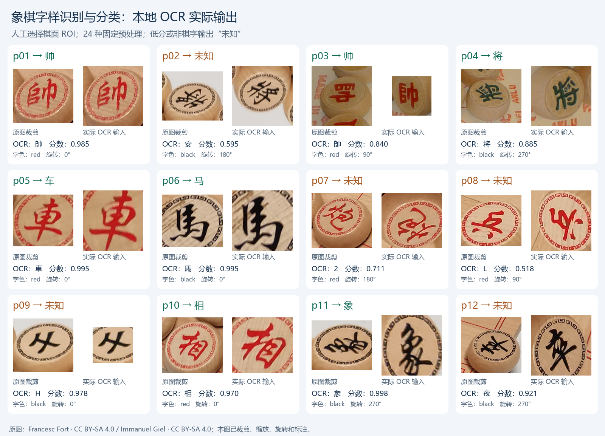
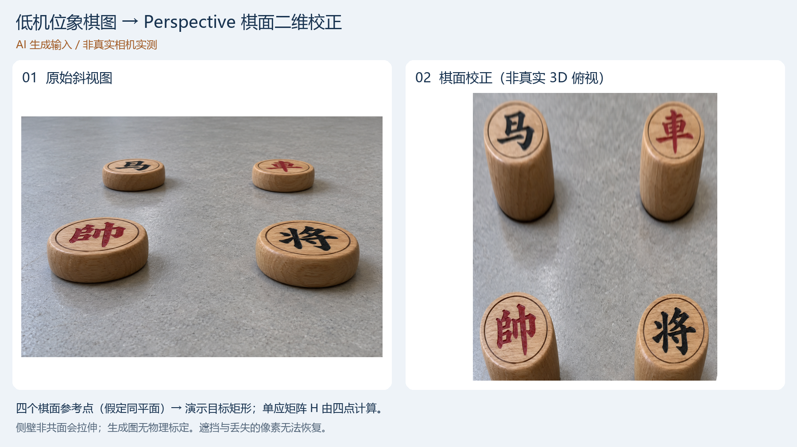
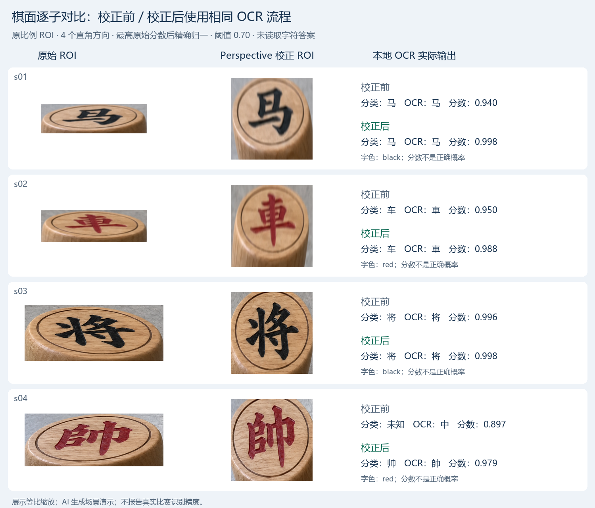

# 2026-10-23 象棋文字识别与分类验证

已找到两张可追溯的真实象棋照片，并完成本地 Python 识别示例。**12 个棋子区域中，7 个字样与字色分类正确，5 个拒识为“未知”；4 个将/帅样本中正确识别 3 个。** 可以识别部分“帥、將”等字样，但当前通用 OCR 还不能稳定覆盖不同象棋字体，暂不具备比赛部署条件。

本次采用人工圈定的棋面区域，只验证“给定棋面后能否读字并分类”。程序不读取人工答案，不利用标准棋局位置猜类别；全图自动找棋子、随机堆放、车载视角与比赛用棋子均未验证。本记录统一保存在 `01_docs/03_records/`，后续复核继续追加到本文件。



## 1. 与比赛要求的对应

已核对本地[第十五届赛题要求原件](../../04_references/01_official/01_第十五届赛题要求.pdf)第 1 页“赛题1：智能车光电象棋对抗”，包括完整正文和场地图。

| 原件要求 | 对本次识别研究的影响 |
|---|---|
| 随机投放 32 枚棋子，红黑各 16 枚 | 需独立识别棋子及字色，不能依赖标准对弈布局 |
| 按棋子等级设置 1–10 分差异化分值 | 先输出身份；原件没有逐子分值表，程序将 `contest_points` 保持为空 |
| 平局依次比较进球数量、“帅/将”归属，再进行金球加赛 | 本次优先检验“帅/将”字样 |
| 全程自主运行，禁止场外遥控与人工干预 | 人工 ROI 只用于本次离线研究，正式系统还需自动检测与自主决策 |
| 发车尺寸不超过 250×200×180 mm | 后续须用实际安装高度与视角验证，不能把桌面照片效果当作车载结果 |

当前原件未给出棋子直径、字体、材质及逐子分数，也没有提供本届比赛棋子的实拍样图。这里的公开照片仅用于方法验证，不认定为比赛指定棋具；原件来源和哈希见[来源清单](../../05_data/01_raw/02_xiangqi/sources.json)。

## 2. 图片、模型与 skill 来源

两张原图均按下载字节保存，仅重命名；裁剪、缩放、旋转和识别标注只作用于派生图。图片和本次图像派生物沿用 **CC BY-SA 4.0**，作者署名和修改说明已写入输出图及[来源清单](../../05_data/01_raw/02_xiangqi/sources.json)。

| 输入 | 原图及作者 | 本地文件 |
|---|---|---|
| 图1 | [Escacs Xinesos.jpg](https://commons.wikimedia.org/wiki/File:Escacs_Xinesos.jpg)，Francesc Fort，2022-11-24，4624×3472 | [原始照片](../../05_data/01_raw/02_xiangqi/20261023_xiangqi_input_01.jpg) |
| 图2 | [Xiangqi 01.jpg](https://commons.wikimedia.org/wiki/File:Xiangqi_01.jpg)，Immanuel Giel，2017-02-03，3072×2304 | [原始照片](../../05_data/01_raw/02_xiangqi/20261023_xiangqi_input_02.jpg) |

两图棋子使用繁体“帥／將”等字形。程序保留 OCR 原始文字，再将“帥→帅、將→将、車→车、馬→马、砲→炮”等归一；第二张图的深绿色棋字在人工评估中按传统黑方归类。CC 许可入口见 [CC BY-SA 4.0](https://creativecommons.org/licenses/by-sa/4.0/)，原始 Commons 元数据见[官方 imageinfo 响应](../../05_data/01_raw/02_xiangqi/commons_imageinfo.json)。

识别采用 [RapidOCR](https://github.com/RapidAI/RapidOCR/tree/v3.10.0) 的 **PP-OCRv6_rec_small.onnx** 通用文字识别权重。本项目没有重新训练或修改权重；其来源、版本、SHA-256、21,234,383 字节大小及上游 PaddleOCR 归属已记入[模型元数据](../../05_data/02_models/01_xiangqi_ocr/metadata.json)，随模型保留 [Apache 2.0 许可证](../../05_data/02_models/01_xiangqi_ocr/LICENSE)及[模型许可说明](../../05_data/02_models/01_xiangqi_ocr/MODEL_LICENSES.md)。只归档实际使用的识别模型。

查找 skill 时找到 PaddleOCR 官方的 [paddleocr-text-recognition](https://github.com/PaddlePaddle/PaddleOCR/blob/main/skills/paddleocr-text-recognition/SKILL.md)。该 skill 当前依赖远程 API 令牌，未安装或调用；本次使用本地 Python 直接推理。`skill-installer` 的官方目录列举请求返回 HTTP 403，因此不能断言其目录没有 OCR 技能。发现记录、候选来源和未采用理由保存在[skill 查找记录](../../05_data/01_raw/02_xiangqi/skill_search.json)。

## 3. 实现方式

正式源码：[识别程序](../../02_programs/01_host/02_xiangqi/recognize_pieces.py)、[独立评估程序](../../02_programs/01_host/02_xiangqi/evaluate_results.py)。

流程为：**原始照片 → 人工 ROI 坐标裁剪 → 固定预处理 → 通用 OCR → 单字精确匹配与繁简归一 → 字色启发式 → 类别或未知**。

- ROI 清单只含 `id / image / bbox`，坐标按原图像素计，右、下边界不包含；见[区域坐标](../../05_data/01_raw/02_xiangqi/regions.json)。
- 每个 ROI 固定尝试 3 种中心裁剪比例、2 种缩放方式和 4 个直角方向，共 24 个候选。先按**完整 OCR 输出的最高原始分数**选候选，再判断是不是棋字，避免只挑已知答案。
- 当前接受阈值为 0.70；低于阈值或输出不是已登记的单个棋字时返回 `unknown`。不把“安、夜、H、2”等强行修正为棋子。
- 字色采用红色通道占比与深色像素对比的简单启发式。它已在这两张样图上调整过，不能视为独立测试集结论；不据此判断球门归属或是否允许争夺。
- 人工真值单独保存在[ground_truth.json](../../05_data/01_raw/02_xiangqi/ground_truth.json)，只由推理结束后的评估程序读取。原始 OCR、选中候选及全部 24 次尝试保存在[predictions.json](../../05_data/03_results/03_xiangqi/predictions.json)。

上述中心裁剪和缩放只是预处理，并未完成相机标定或棋面透视矫正。后续可接入已有[透视变换研究](./01_20261023_透视变换.md)，但需区分棋子顶面与地面高度。

## 4. 实际输出与局限

| ROI | 人工真值 | OCR 原始输出 | 原始分数 | 最终输出 |
|---|---|---|---:|---|
| p01，图1 | 红帥→帅 | 帥 | 0.98460 | 红帅，正确 |
| p02，图1 | 黑將→将 | 安 | 0.59509 | 未知 |
| p03，图2 | 红帥→帅 | 帥 | 0.83988 | 红帅，正确 |
| p04，图2 | 黑將→将 | 将 | 0.88538 | 黑将，正确 |
| p05，图1 | 红車→车 | 車 | 0.99482 | 红车，正确 |
| p06，图1 | 黑馬→马 | 馬 | 0.99477 | 黑马，正确 |
| p07，图1 | 红炮 | 2 | 0.71058 | 未知 |
| p08，图1 | 红兵 | L | 0.51801 | 未知 |
| p09，图1 | 黑士 | H | 0.97790 | 未知 |
| p10，图1 | 红相 | 相 | 0.96994 | 红相，正确 |
| p11，图1 | 黑象 | 象 | 0.99765 | 黑象，正确 |
| p12，图1 | 黑卒 | 夜 | 0.92131 | 未知 |

完整计数及预测/真值文件的哈希见[evaluation.json](../../05_data/03_results/03_xiangqi/evaluation.json)。本次为 **7/12 正确、5/12 拒识，将/帅 3/4 正确**；不是总体 100% 准确，也不是赛事性能指标。两张图和人工挑选的 12 个 ROI 都参与了开发观察，尚无独立测试集。

“士”被读成高分 `H`、“卒”被读成高分“夜”，说明 OCR 分数不能直接解释为识别正确率。当前结果支持继续研究棋面识别，尚不足以让机器人可靠按类别选棋、计分。

整图位置复核：[图1 的 ROI 和模型输出](../../05_data/03_results/03_xiangqi/20261023_xiangqi_annotated_01.png)、[图2 的 ROI 和模型输出](../../05_data/03_results/03_xiangqi/20261023_xiangqi_annotated_02.png)。绿框表示程序接受该结果，橙框表示拒识；是否正确由独立人工标注核对。

## 5. 运行与复核

在项目根目录使用 Python 3.11+。需要中文字体，Windows 使用系统微软雅黑；Linux 可安装 Noto Sans CJK。模型已在正式目录中，默认推理不需要 API 令牌。

安装依赖：

```powershell
python -m pip install -r 02_programs/01_host/02_xiangqi/requirements.txt
```

运行识别并输出逐项 OCR、类别和可视化：

```powershell
python -X utf8 -B 02_programs/01_host/02_xiangqi/recognize_pieces.py
```

推理完成后单独评估：

```powershell
python -X utf8 -B 02_programs/01_host/02_xiangqi/evaluate_results.py
```

本次实际环境为 Windows、Python 3.12.14、RapidOCR 3.10.0、ONNX Runtime 1.31.0、OpenCV 5.0.0、NumPy 2.5.4、Pillow 13.0.0。运行库仅安装在本项目 `temp/xiangqi_recognition/dependencies/`；使用 Codex 提供的 Python 并通过当前进程 `PYTHONPATH` 引用，没有修改现有 Python 安装。12 个 ROI 共 288 次 OCR 候选处理约 4.04 秒，包含首次模型加载，不包含绘图与文件保存，不是车载实时帧率。

另外用不调用神经网络的独立检查验证了：非法/越界 ROI 被拒绝、裁剪不改原图、低分及非棋字拒识、真实最高分候选保留、人工真值不进入推理。原图哈希与来源清单一致；模型哈希与官方注册表一致；所有预计输出路径在写入前检查，避免覆盖输入。

## 6. 文件整理与后续安排

| 位置 | 保存内容 |
|---|---|
| 本记录 | 本次唯一主记录：依据、过程、结果与运行方法 |
| `02_programs/01_host/02_xiangqi/` | 可复用识别/评估源码及依赖清单 |
| `05_data/02_models/01_xiangqi_ocr/` | 实际使用的识别权重、版本/哈希和许可证 |
| `05_data/01_raw/02_xiangqi/` | 原始照片、生成样本、来源元数据、ROI、独立真值和几何配置 |
| `05_data/03_results/03_xiangqi/` | 全部预测与评估、单独的识别标注副本和结果拼图 |
| `temp/xiangqi_recognition/` | 一次性试验、候选预览、日志、依赖与缓存，不作为正式成果入口 |

下一步按[开发计划](../01_plans/01_开发计划.md)推进：获取实际比赛棋具或已确认相近字体的样本，采集多角度、旋转、光照、反光与遮挡；实现随机位置棋子的自动检测，建立按整副棋具/拍摄场次隔离的训练与测试数据，再比较专用红黑 14 类分类器和 OCR 基线。保留“未知”与多帧确认，逐类评估后再考虑上车。

后续同一事项的改进继续追加到本记录；本次没有采购棋具、没有训练专用分类器，也没有完成比赛车辆自主识别验收。

## 7. 低机位生成图透视校正与识别

本节整理已有的低机位模拟演示，输入为 **AI 生成图**，不计入前述真实照片的 12 例统计。输入原图、生成提示词和来源见[生成记录](../../05_data/01_raw/02_xiangqi/generated_oblique_source.json)；四个参考点、人工 ROI 和目标矩形见[几何配置](../../05_data/01_raw/02_xiangqi/generated_oblique_scene.json)。



程序对手工指定的四组棋面参考点调用 `cv2.getPerspectiveTransform` 求解单应矩阵，再通过 `cv2.warpPerspective` 实际计算二维校正图，输出为 1400×1650 像素。校正前后使用相同的 OCR 流程，保留裁剪长宽比例、尝试四个直角方向，以最高原始 OCR 分数选候选后进行棋字匹配与拒识。

| 区域 | 校正前 OCR / 分类 | 校正后 OCR / 分类 |
|---|---|---|
| s01 | 马 / 黑马，0.93993 | 马 / 黑马，0.99798 |
| s02 | 車 / 红车，0.94986 | 車 / 红车，0.98751 |
| s03 | 将 / 黑将，0.99646 | 将 / 黑将，0.99762 |
| s04 | 中 / 未知，0.89716 | 帥 / 红帅，0.97871 |



正式源码见[perspective_recognition.py](../../02_programs/01_host/02_xiangqi/perspective_recognition.py)，全部候选、原始分数、变换矩阵、软件版本和图像哈希见[预测记录](../../05_data/03_results/03_xiangqi/generated_oblique_predictions.json)。在项目根目录运行下列命令，复核输出写入 `temp/xiangqi_oblique/`：

```powershell
python -X utf8 -B 02_programs/01_host/02_xiangqi/perspective_recognition.py --output temp/xiangqi_oblique/predictions.json --images-dir temp/xiangqi_oblique --overwrite
```

四个参考点的回代 RMSE 为 0，只验证拟合控制点的映射计算，不能解释为独立定位精度。目标矩形是人工演示布局；生成提示词中的尺寸、距离与角度不构成实测真值。棋子侧壁、地面和顶面高度不同，单个矩阵不能同时恢复整个物体的真实俯视外形，也不能补全遮挡信息。本演示尚未完成真实相机标定、自动找棋子或比赛精度验证。
