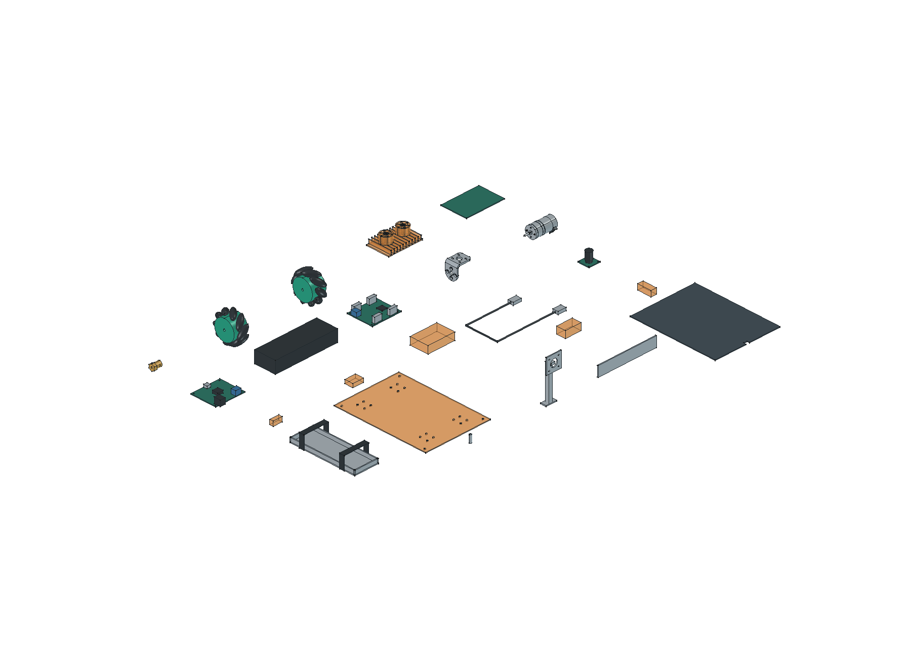
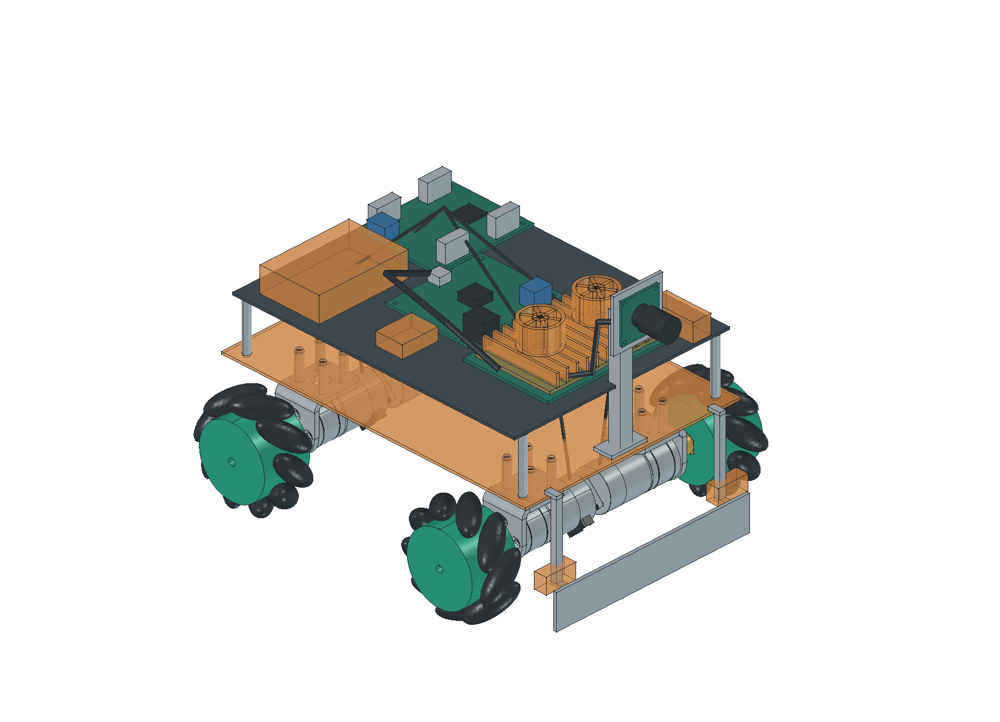

# 当前清单模型与装配校核

日期：2026-10-24开始，2026-10-25同步最新清单。环境：Windows、FreeCAD 1.1.4自带Python 3.11。依据用户要求，按当前硬件与搜索资料建立可复用3D模型，并准备清理先前硬件候选与旧3D模型；先前删除被自动审批拦截，后按用户要求集中移动；本次提交前按新授权清理旧生成文件与临时内容，保留唯一用户CAD原件。本记录为软件几何验证，尚无本车到货测量、加工或装配验收。

## 成果与可观察结果





- [逐件规格与“可自行建模”标记](../../03_hardware/01_机械/01_建模规格.md)：24类需求，23类具有模型，非装车充电器待定型号后按需建模。
- [零件库FreeCAD](../../03_hardware/01_机械/02_零件库.FCStd)、[整车FreeCAD](../../03_hardware/01_机械/03_整车布局.FCStd)、[整车STEP](../../03_hardware/01_机械/04_整车布局.step)：准确4轮、4台310、4个原配支架，已替换正确电池、四路驱动及亚博Type-C电源板；已购T5X四驱板长宽和孔图未知，明确使用布局包络。
- [来源及原件SHA-256](../../03_hardware/01_机械/01_厂家资料/sources.json)、[模型登记与成果SHA-256](../../03_hardware/01_机械/model_inventory.json)、[几何检查结果](../../03_hardware/01_机械/validation.json)。

建模过程：复核当前清单 → 复用310与新版支架厂家STEP → 重新查阅亚博轮/驱动/Type-C电源板、微雪相机及立创资料 → 记录准确规格与未知项 → 按参数生成单件及整车 → 检查实体有效性、外廓与筛查范围内交叠 → 渲染并人工检查 → 按用户后续要求集中旧文件 → 核引用和文档构建。

## 打开模型

打开可编辑工程使用 **FreeCAD**；使用已有的 **SOLIDWORKS** 查看整车时，打开STEP文件。

| 文件 | 打开软件 | 用途 |
| --- | --- | --- |
| [03_整车布局.FCStd](../../03_hardware/01_机械/03_整车布局.FCStd) | FreeCAD | 整车工程，可展开零件树、逐组隐藏和调整位置 |
| [02_零件库.FCStd](../../03_hardware/01_机械/02_零件库.FCStd) | FreeCAD | 查看和复用各类零件 |
| [04_整车布局.step](../../03_hardware/01_机械/04_整车布局.step) | SOLIDWORKS、FreeCAD等CAD软件 | 通用几何交换；不包含完整的FreeCAD工程属性和建模依据 |

### FreeCAD：分两步打开

本机已保留FreeCAD 1.1.4免安装版。下面路径适用于项目当前保存位置。

1. 按 **Win＋R**，清空输入框，**只粘贴下面的程序路径**并回车，先启动FreeCAD：

```text
C:\Users\52400\Desktop\opto-chess-robot-2027\temp\cad-review\freecad\FreeCAD_1.1.4-Windows-x86_64-py311\bin\freecad.exe
```

2. FreeCAD启动后按 **Ctrl＋O**，在“文件名”栏粘贴下面的模型路径，点击“打开”：

```text
C:\Users\52400\Desktop\opto-chess-robot-2027\03_hardware\01_机械\03_整车布局.FCStd
```

查看零件库时，同样按Ctrl＋O，选择同目录的 `02_零件库.FCStd`。打开整车后，可在左侧模型树展开零件组，选中零件后在属性中查看“建模依据”。橙色部分表示待核尺寸包络，具体精度与限制见[建模规格](../../03_hardware/01_机械/01_建模规格.md)。

也可以用资源管理器进入上述 `bin` 文件夹，双击 `freecad.exe`，再从FreeCAD里打开模型。

### SOLIDWORKS：打开STEP

1. 回到SOLIDWORKS，选择 **文件 → 打开**。
2. 文件类型选择 **STEP**；找不到文件时可选“所有文件”。
3. 选择下列文件并打开：

```text
C:\Users\52400\Desktop\opto-chess-robot-2027\03_hardware\01_机械\04_整车布局.step
```

`.FCStd` 是FreeCAD工程格式，在SOLIDWORKS中使用本项目导出的 `.step` 文件。

### 打不开时怎么处理

- **右键“打开方式”只有VS Code等编辑器：** Windows尚未关联 `.FCStd`。按上面的两步方法先启动FreeCAD，再按Ctrl＋O打开模型即可；不需要用代码编辑器打开。
- **出现“位置不可用”或“文件名、目录名或卷标语法不正确”：** 清空原输入，按两步方法重新操作。Win＋R里只放程序路径，模型路径放到FreeCAD的“打开”窗口中，避免把两段路径当成一个文件位置。
- **项目移动到其他文件夹：** 将上述两条路径的项目根目录改成实际位置；不要把界面显示的省略号 `...` 当成真实路径。
- **免安装程序找不到：** 当前软件保存在 `temp/cad-review/freecad/`，清理临时文件时需要保留它。若已移除，可用另行安装的FreeCAD打开正式目录中的 `.FCStd`；正式模型位于 `03_hardware/01_机械/`。

以上为打开方法与路径核对，不表示本车已完成硬件装配验收。

## 几何检查

建模参数、再生成命令及精度限制见[建模规格](../../03_hardware/01_机械/01_建模规格.md)，布局和间隙见[底盘方案](../02_design/04_四驱底盘方案.md)。观察结果为：全部生成实体有效，轮数与电机数均4；完整模型加轮子旋转包络为230.6×195.8×164.5mm；已建刚体筛查未发现体积交叠。外廓采用OpenCascade优化包围盒，避免曲面控制点造成普通包围盒虚大。

厂家STEP保留字节不变；已知尺寸以mm建模。轮子、六角毂、电路器件和线束有简化；未知SKU与底板包络不纳入配套合格判断。整车静态模型未包含真实接头、受力、材料变形、轮子跳动、螺纹牙型及公差。采购状态仍为已付款待到货或未下单，不会因模型生成改成已到货／验收通过。

## 旧成果清理

先前T5X、60/75mm轮、6mm抱紧件、FIT0458等旧候选与旧试装曾整体移动到 `temp/旧硬件待删除/`，当时6028个文件逐个SHA-256一致。此前删除曾被自动审批拦截，移动阶段未删除文件；这是历史操作状态。

2026-10-25等待三个并行窗口结束后，按用户新的提交前清理要求，删除6215个旧生成模型、试装/费用表、重复副本、订单处理备份、下载、预览、临时依赖和一次性脚本，共1,326,896,701字节。旧候选的7份唯一用户CAD原件及历史移动清单保留在原汇集目录，供用户自行处理。当前310电机/支架厂家原件在正式机械资料目录，移除重复副本前再次比对SHA-256一致。

当前采购台账、合同、订单PDF/导出、原始截图、算法原图、模型权重和正式成果保留；清理前对95份当前二进制文件建立SHA-256快照。FreeCAD软件、当前算法隔离依赖与网站依赖继续使用。每个删除目标先解析为本项目内绝对路径，再执行PowerShell的 `Remove-Item -LiteralPath`，并核目标已不存在。删除明细、留存原件哈希和历史移动范围见[清理核对](../../03_hardware/01_机械/cleanup.json)。

推送几何图的[绘图源](../../05_data/03_results/01_design/draw_pushing.py)已归入正式成果目录，清除已停用架构函数并修正输出路径；复跑生成1600×1080图，与正式PNG逐像素一致。系统连接/供电图保留draw.io，模型保留FreeCAD、STEP、参数和源码。来源元数据更新到5笔订单、8项商品、累计实付¥1,605.50；旧分阶段累计金额只保留在对应历史采购条目中。

后续实际测量、修模、加工和装配验收继续更新本记录，待办仍在[开发计划](../01_plans/01_开发计划.md)。

本轮验证：23个单件STEP重新导入并核尺寸、两份FreeCAD重新打开检查、4轮/4电机/4支架计数、来源与成果SHA-256核对、相对Markdown链接检查和Docusaurus构建均已执行；均属于软件/资料检查。

提交前复核结果：259处相对Markdown链接、22份JSON和158项哈希核对通过；23个STEP有效、两份FreeCAD可打开，4轮/4电机/4支架计数正确，原几何外廓不变。采购台账独立检查为5笔不重复订单、8项商品、实付合计¥1,605.50。透视、OCR和生成斜视图复跑结果分别追加在各自记录中。Docusaurus生产构建通过。

供电图只修改计算分支的采购状态：电源板已付款，F2保险仍待购；节点、尺寸和连线不变。最终采用已完整检查的2000×1937 PNG；本机大倍率导出出现内容裁切，未采用有裁切的图片。可编辑draw.io保留完整内容。95份当前二进制中94份保持原SHA-256，1份供电图PNG按本段有意更新，原图、模型、采购凭证及算法正式结果均未丢失。来源及成果引用哈希已同步。

最终构建同时核对了系统接线页和新增导师进度汇报页的实际HTML内容；通过后按临时文件约定清理本轮复核输出、网站build/缓存。网站源码、依赖清单与当前可用依赖保留，执行网站构建命令即可重新生成。
