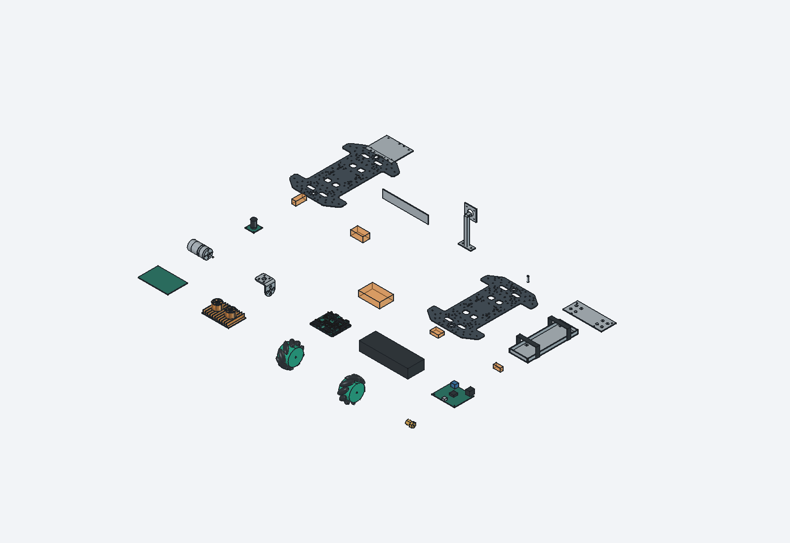
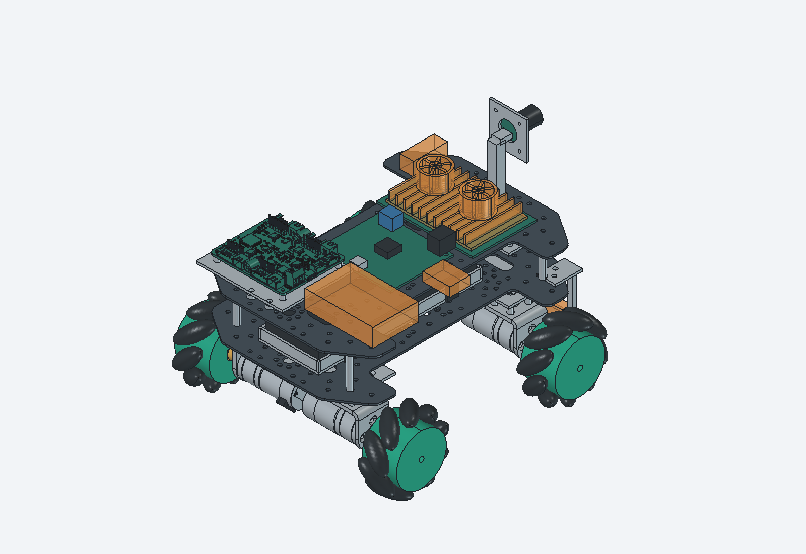
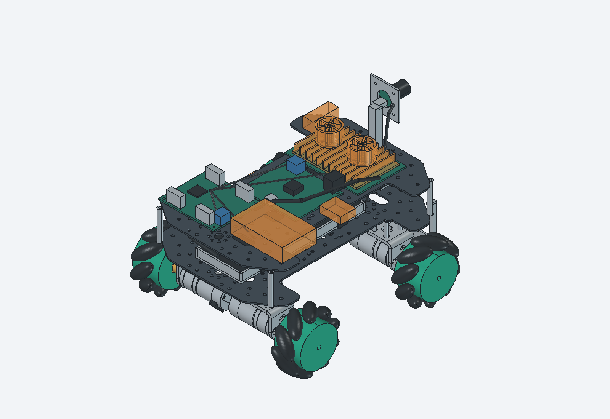
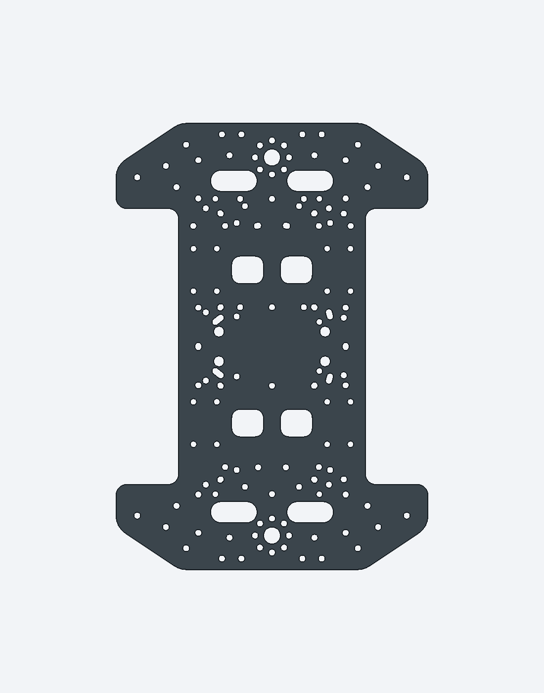
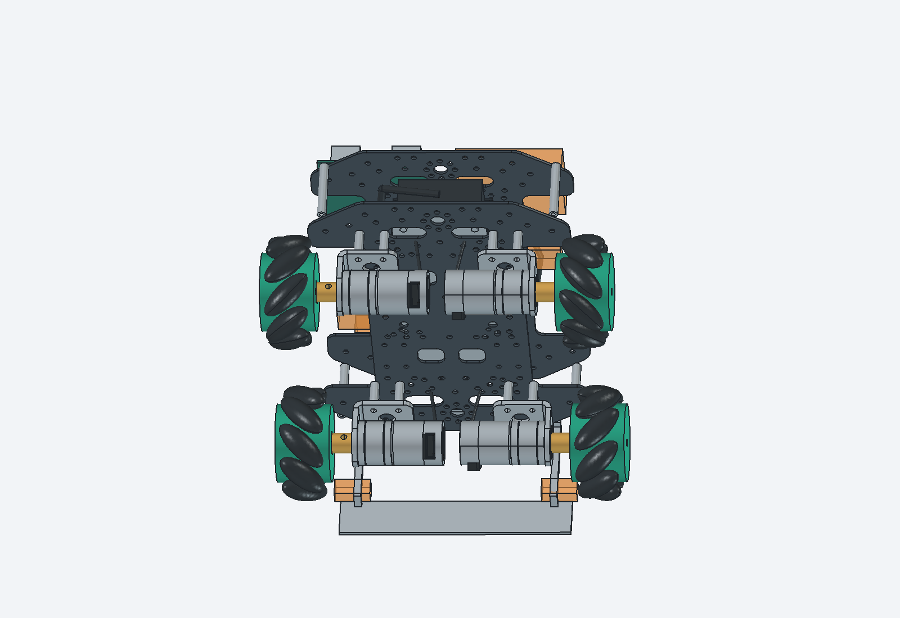
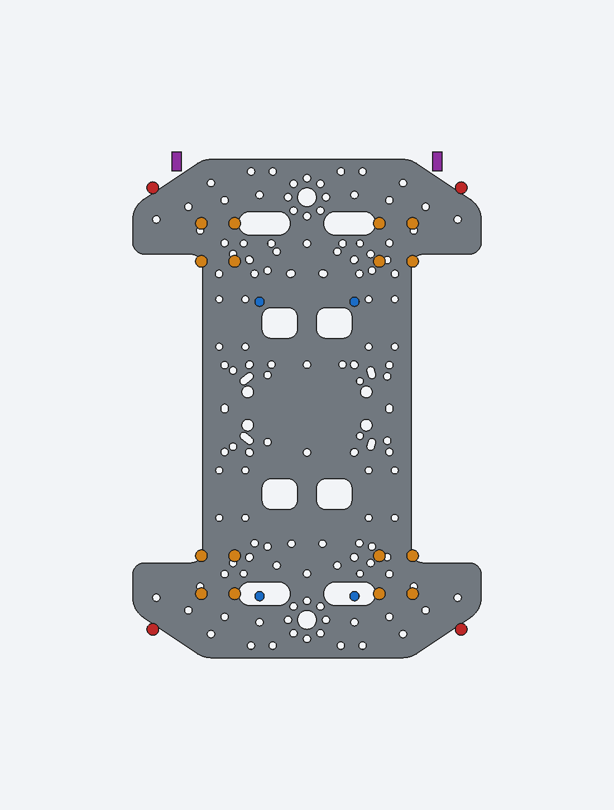
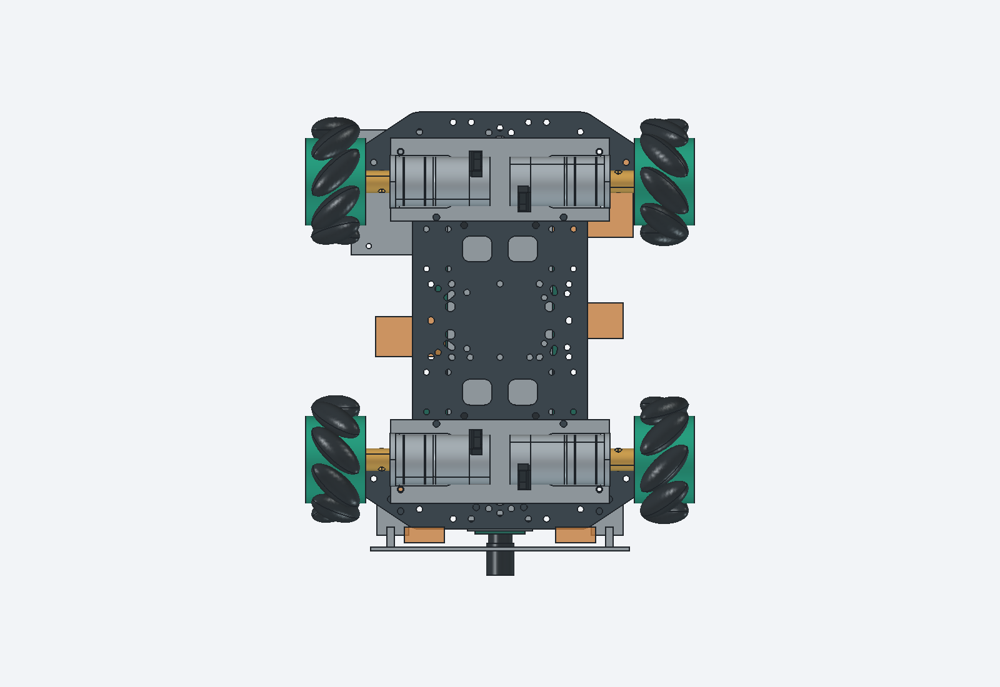
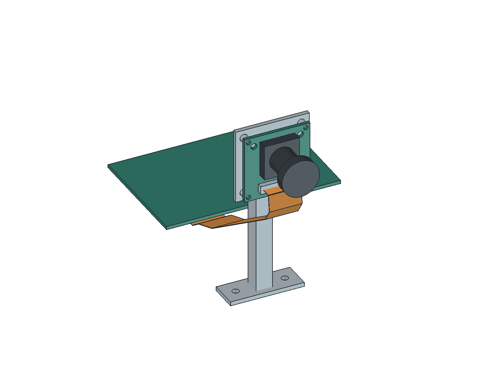
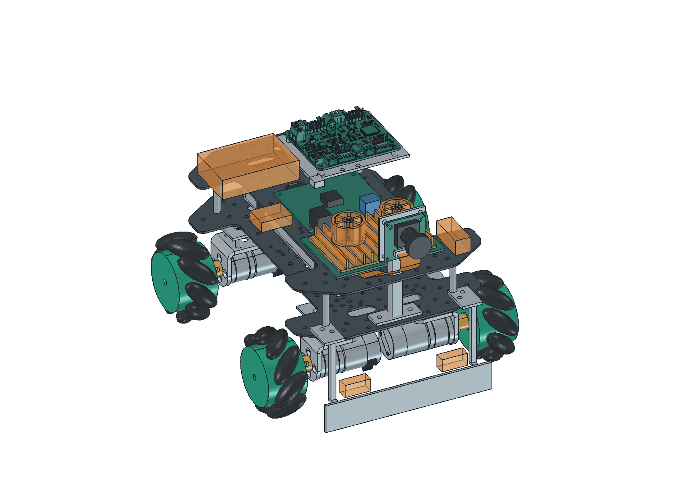
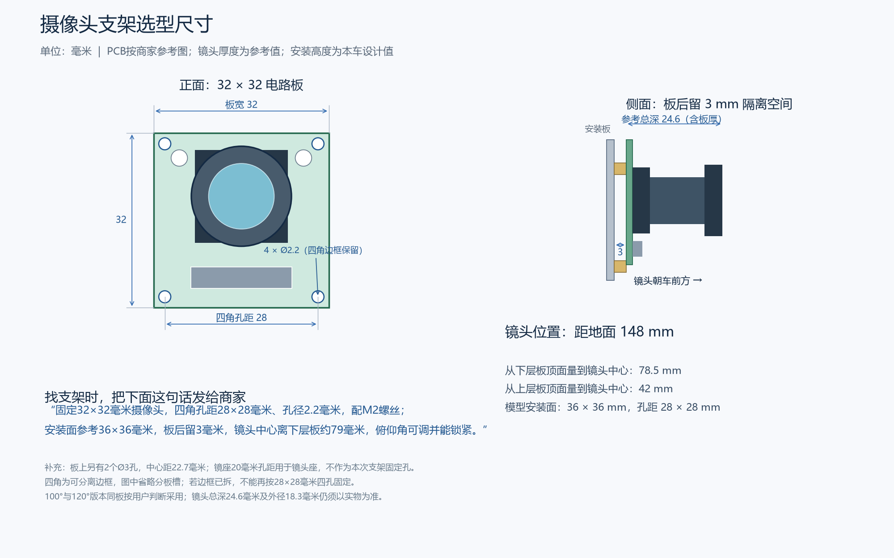

# 当前清单模型与装配校核

日期：2026-10-24开始，2026-10-25同步最新清单，2026-10-27上下层换入真实板件。环境：Windows、FreeCAD 1.1.4自带Python 3.11。依据用户要求，按当前硬件与搜索资料建立可复用3D模型，并准备清理先前硬件候选与旧3D模型；先前删除被自动审批拦截，后按用户要求集中移动；本次提交前按新授权清理旧生成文件与临时内容，保留唯一用户CAD原件。本记录为软件几何验证，尚无本车到货测量、加工或装配验收。

## 成果与可观察结果





- [逐件规格与“可自行建模”标记](../../03_hardware/01_机械/01_建模规格.md)：24类需求，23类具有模型，非装车充电器待定型号后按需建模。
- [零件库FreeCAD](../../03_hardware/01_机械/02_零件库.FCStd)、[整车FreeCAD](../../03_hardware/01_机械/03_整车布局.FCStd)、[整车STEP](../../03_hardware/01_机械/04_整车布局.step)：准确4轮、4台310、4个原配支架；2026-10-27上下两层都换成147×210×1.5mm厂家板件，其余零件几何不变，详见[本次底板更新](#仅替换上下层板2026-10-27)。
- [来源及原件SHA-256](../../03_hardware/01_机械/01_厂家资料/sources.json)、[模型登记与成果SHA-256](../../03_hardware/01_机械/model_inventory.json)、[几何检查结果](../../03_hardware/01_机械/validation.json)。

建模过程：复核当前清单 → 复用310与新版支架厂家STEP → 重新查阅亚博轮/驱动/Type-C电源板、微雪相机及立创资料 → 记录准确规格与未知项 → 按参数生成单件及整车 → 检查实体有效性、外廓与筛查范围内交叠 → 渲染并人工检查 → 按用户后续要求集中旧文件 → 核引用和文档构建。

## 打开模型

打开可编辑工程使用 **FreeCAD**；使用已有的 **SOLIDWORKS** 查看整车时，打开STEP文件。

| 文件 | 打开软件 | 用途 |
| --- | --- | --- |
| [03_整车布局.FCStd](../../03_hardware/01_机械/03_整车布局.FCStd) | FreeCAD | 整车工程，可展开零件树、逐组隐藏和调整位置 |
| [02_零件库.FCStd](../../03_hardware/01_机械/02_零件库.FCStd) | FreeCAD | 查看和复用各类零件 |
| [04_整车布局.step](../../03_hardware/01_机械/04_整车布局.step) | SOLIDWORKS、FreeCAD等CAD软件 | 通用几何交换；不包含完整的FreeCAD工程属性和建模依据 |

### FreeCAD：设置右键打开和双击打开

本机FreeCAD 1.1.4免安装版已于2026-10-27移到Windows当前用户的程序目录 `C:\Users\52400\AppData\Local\Programs\FreeCAD`，不再保存在项目的 `temp/` 中。清理项目临时文件不会删除这里的软件。

1. 在资源管理器中，右键 `03_整车布局.FCStd`，选择 **打开方式 → 选择其他应用**。
2. 向下滚动，点击 **在电脑上选择应用**。
3. 将下面的程序路径粘贴到弹出窗口底部的“文件名”栏，点击“打开”：

```text
C:\Users\52400\AppData\Local\Programs\FreeCAD\bin\freecad.exe
```

4. 回到应用选择窗口，选中FreeCAD，点击 **始终**。以后双击 `.FCStd` 文件即可打开，也可从右键“打开方式”中选择FreeCAD。

按用户要求，“打开方式”由用户手动设置；本次迁移没有修改该设置。若仍指向旧的 `temp/` 路径，按上述步骤重新选择新位置。

### FreeCAD：先启动软件，再打开模型

1. 按 **Win＋R**，清空输入框，**只粘贴下面的程序路径**并回车，先启动FreeCAD：

```text
C:\Users\52400\AppData\Local\Programs\FreeCAD\bin\freecad.exe
```

2. FreeCAD启动后按 **Ctrl＋O**，在“文件名”栏粘贴下面的模型路径，点击“打开”：

```text
C:\Users\52400\Desktop\opto-chess-robot-2027\03_hardware\01_机械\03_整车布局.FCStd
```

查看零件库时，同样按Ctrl＋O，选择同目录的 `02_零件库.FCStd`。打开整车后，可在左侧模型树展开零件组，选中零件后在属性中查看“建模依据”。橙色部分表示待核尺寸包络，具体精度与限制见[建模规格](../../03_hardware/01_机械/01_建模规格.md)。

也可以用资源管理器进入上述 `bin` 文件夹，双击 `freecad.exe`，再从FreeCAD里打开模型。

### SOLIDWORKS：打开STEP

1. 回到SOLIDWORKS，选择 **文件 → 打开**。
2. 文件类型选择 **STEP**；找不到文件时可选“所有文件”。
3. 选择下列文件并打开：

```text
C:\Users\52400\Desktop\opto-chess-robot-2027\03_hardware\01_机械\04_整车布局.step
```

`.FCStd` 是FreeCAD工程格式，在SOLIDWORKS中使用本项目导出的 `.step` 文件。

### 打不开时怎么处理

- **右键“打开方式”只有VS Code等编辑器：** 按上面的“设置右键打开和双击打开”步骤，选择新位置的 `freecad.exe`。也可以先启动FreeCAD，再按Ctrl＋O打开模型。
- **出现“位置不可用”或“文件名、目录名或卷标语法不正确”：** 清空原输入，按两步方法重新操作。Win＋R里只放程序路径，模型路径放到FreeCAD的“打开”窗口中，避免把两段路径当成一个文件位置。
- **项目移动到其他文件夹：** 只需将模型路径的项目根目录改成实际位置，软件路径不随项目移动；不要把界面显示的省略号 `...` 当成真实路径。
- **免安装程序找不到：** 检查新的程序目录 `C:\Users\52400\AppData\Local\Programs\FreeCAD\bin\`，旧的 `temp/cad-review/freecad/` 软件目录已迁出。正式模型仍位于项目的 `03_hardware/01_机械/`。

2026-10-27迁移核对：完整软件目录从项目 `temp/` 移到上述当前用户程序目录，迁移前后均为35,586个文件、2,307,820,372字节，主程序文件指纹一致，旧软件目录已不存在。已从新位置启动FreeCAD，打开 `03_整车布局.FCStd`，界面正常显示整车三维模型和零件树；自带Python也能导入FreeCAD及几何处理模块。“打开方式”由用户手动重新选择，本次未验证新的右键关联；以上仅为电脑上的软件迁移和打开检查，不表示本车已完成硬件装配验收。

## 2026-10-24至25日的几何检查

建模参数、再生成命令及精度限制见[建模规格](../../03_hardware/01_机械/01_建模规格.md)，布局和间隙见[底盘方案](../02_design/04_四驱底盘方案.md)。观察结果为：全部生成实体有效，轮数与电机数均4；完整模型加轮子旋转包络为230.6×195.8×164.5mm；已建刚体筛查未发现体积交叠。外廓采用OpenCascade优化包围盒，避免曲面控制点造成普通包围盒虚大。

厂家STEP保留字节不变；已知尺寸以mm建模。轮子、六角毂、电路器件和线束有简化；未知SKU与底板包络不纳入配套合格判断。整车静态模型未包含真实接头、受力、材料变形、轮子跳动、螺纹牙型及公差。采购状态仍为已付款待到货或未下单，不会因模型生成改成已到货／验收通过。

## 旧成果清理

先前T5X、60/75mm轮、6mm抱紧件、FIT0458等旧候选与旧试装曾整体移动到 `temp/旧硬件待删除/`，当时6028个文件逐个SHA-256一致。此前删除曾被自动审批拦截，移动阶段未删除文件；这是历史操作状态。

2026-10-25等待三个并行窗口结束后，按用户新的提交前清理要求，删除6215个旧生成模型、试装/费用表、重复副本、订单处理备份、下载、预览、临时依赖和一次性脚本，共1,326,896,701字节。旧候选的7份唯一用户CAD原件及历史移动清单保留在原汇集目录，供用户自行处理。当前310电机/支架厂家原件在正式机械资料目录，移除重复副本前再次比对SHA-256一致。

当前采购台账、合同、订单PDF/导出、原始截图、算法原图、模型权重和正式成果保留；清理前对95份当前二进制文件建立SHA-256快照。FreeCAD软件、当前算法隔离依赖与网站依赖继续使用。每个删除目标先解析为本项目内绝对路径，再执行PowerShell的 `Remove-Item -LiteralPath`，并核目标已不存在。删除明细、留存原件哈希和历史移动范围见[清理核对](../../03_hardware/01_机械/cleanup.json)。

推送几何图的[绘图源](../../05_data/03_results/01_design/draw_pushing.py)已归入正式成果目录，清除已停用架构函数并修正输出路径；复跑生成1600×1080图，与正式PNG逐像素一致。系统连接/供电图保留draw.io，模型保留FreeCAD、STEP、参数和源码。来源元数据更新到5笔订单、8项商品、累计实付¥1,605.50；旧分阶段累计金额只保留在对应历史采购条目中。

后续实际测量、修模、加工和装配验收继续更新本记录，待办仍在[开发计划](../01_plans/01_开发计划.md)。

本轮验证：23个单件STEP重新导入并核尺寸、两份FreeCAD重新打开检查、4轮/4电机/4支架计数、来源与成果SHA-256核对、相对Markdown链接检查和Docusaurus构建均已执行；均属于软件/资料检查。

提交前复核结果：259处相对Markdown链接、22份JSON和158项哈希核对通过；23个STEP有效、两份FreeCAD可打开，4轮/4电机/4支架计数正确，原几何外廓不变。采购台账独立检查为5笔不重复订单、8项商品、实付合计¥1,605.50。透视、OCR和生成斜视图复跑结果分别追加在各自记录中。Docusaurus生产构建通过。

供电图只修改计算分支的采购状态：电源板已付款，F2保险仍待购；节点、尺寸和连线不变。最终采用已完整检查的2000×1937 PNG；本机大倍率导出出现内容裁切，未采用有裁切的图片。可编辑draw.io保留完整内容。95份当前二进制中94份保持原SHA-256，1份供电图PNG按本段有意更新，原图、模型、采购凭证及算法正式结果均未丢失。来源及成果引用哈希已同步。

最终构建同时核对了系统接线页和新增导师进度汇报页的实际HTML内容；通过后按临时文件约定清理本轮复核输出、网站build/缓存。网站源码、依赖清单与当前可用依赖保留，执行网站构建命令即可重新生成。

## 仅替换上下层板（2026-10-27）

用户确认本车上下两层都用轮趣T5X同款板子，继续使用之前的麦轮、电机、电控和整车模型，其他暂时不变。本次从用户提供、目录标注2026.06.18的厂家资料包中提取板件；未采用厂家整车的其他硬件或程序。





[独立板件STEP](../../03_hardware/01_机械/01_厂家资料/01_T5X四驱/05_四驱底板.step)来自[厂家整车STEP原件](../../03_hardware/01_机械/01_厂家资料/01_T5X四驱/04_厂家整车原件.stp)中的第21个实体（程序从0计数时编号20）。板件宽147×长210×厚1.5mm，268个面，体积28813.477850mm³；提取、另存STEP后实体仍有效，未缩放、未增删孔槽。厂家整车还含同形状的上层板，本车上下两层各采用1片相同板件。

已更新现有[零件库](../../03_hardware/01_机械/02_零件库.FCStd)、[整车布局](../../03_hardware/01_机械/03_整车布局.FCStd)、[底板单件STEP](../../03_hardware/01_机械/02_零件STEP/D01.step)与[整车STEP](../../03_hardware/01_机械/04_整车布局.step)。两层中心保持X/Y零点，底面分别仍离地68mm和104mm；旧底板占位及假设安装孔、旧上层矩形板及相机杆缺口移除，厂家原孔槽保持原样。参数和生成程序同步改为读取该板件STEP，后续重建不会恢复旧占位板。

**电脑核对结果：** 零件库其余67个、整车其余143个几何对象在替换前后逐件一致；下层板与已建刚体没有大于0.02mm³的体积交叠，上层板与相机杆有1处约59.677mm³的交叠。按用户“其他暂时不变”的要求保留原位，后续安装前处理立杆通道。未知尺寸包络、线束、孔位对准、支柱承力和实物装配不在这一结论内。底板向后比原包络多2.5mm，更新后的模型外廓为长233.1×宽195.8×高164.5mm，宽度余量仍只有4.2mm。完整校核范围与结果见[几何检查JSON](../../03_hardware/01_机械/validation.json)。



**资料去向：** 5份板件来源原件进入厂家资料目录；14份未采用的程序、厂家原配整车视频和附件资料移到 `temp/t5x-intake/未采用原件/`，保留唯一原件；12份两驱专属资料按用户明确要求删除，共207,028,257字节。所有移动和删除均先检查绝对路径位于本项目内，删除前复核文件指纹。保留19份原件的SHA-256均与接收时一致，完整来源及去向保存在[来源登记](../../03_hardware/01_机械/01_厂家资料/sources.json)的T5X资料整理条目。

本次尚未进行到货测量、加工、装配、称重或板端运行；原孔与310支架、支柱、推板的固定仍需核对，不能以无体积交叠代替安装验收。旧图和2026-10-24几何结果保留为此前阶段的证据。

本次最终复核：两份FreeCAD重新打开后，上下两块板均为147×210×1.5mm，底面高度分别68mm、104mm；其余210个对象剔除显示用三角网格缓存后，按实体几何逐件对比一致。21份未改动的单件STEP与原文件字节一致，两个更新板件STEP和整车STEP重新导入均有效，整车含158个实体，4轮、4台电机、4个支架计数正确；生成程序的两个板件分支均读取真实板件。19份留存原件、21项来源文件指纹及285处本地链接核对通过；文档网站生产构建通过。这些检查均为电脑上的文件和几何核对，不构成实物安装验收。

## 安装可行性复查与新增厂家CAD（2026-10-27）

**当前模型不能直接按原位置装成实车。** 本次检查了零件体积交叠，还逐点核对了支柱端面是否落在板材上、螺丝是否能穿过原孔、推板连接件是否真正接触底板。上次“底板没有体积交叠”的结论只检查相撞，没有证明固定位置正确；本节补齐安装检查。全过程未移动板子、电机、轮子、支柱、托盘、相机或其他电控的位置。

| 必须处理的地方 | 当前模型中的证据 | 为什么原位置不能直接用 |
| --- | --- | --- |
| 4根上下层连接柱 | 中心在X=±65、Y=±93mm，离板材最近约1.94mm；端面仅约8.2%碰到板边，两层相同 | 螺丝中心在板外，不能靠原位钻孔解决；要移到板内合适孔位或增加转接结构 |
| 4个310支架的16个上板固定点 | 对全部16处用直径3mm通道检查，均被板材挡住至少约一半；没有一处形成可直接穿M3螺丝的现成通道 | 原支架孔位是为旧矩形板布置的；部分点还贴近镂空边缘，不能直接照旧孔表加工 |
| 推板两侧承力连接件 | 与底板最近仍有约1.109mm间隙，接触面积为0 | 图上看着接近，实际没有接到底板，推力传不进车架 |
| 相机立杆 | 穿过真实上层板，交叠约59.677mm³ | 原上层板预留的缺口已不存在，需要后续改变立杆通道或固定方式 |
| 电池托盘 | 位于X=±20、Y=-79mm的两个支脚完全落在镂空区，只有另一侧两个脚接触板材 | 托盘当前支承不完整，须跨槽支撑、改脚位或改托盘固定 |
| 电路板固定 | 多块板底离上层板2.5mm但没有各自的固定柱；驱动板4个安装孔中有2个下方没有板材，分别距板材约22mm、4mm | 悬空摆放不能替代固定；需绝缘支柱与转接。新版驱动CAD的背面器件距上层板最近仅约0.728mm，绝缘和公差余量仍待核 |



图中圆点与矩形按当前真实坐标绘制：**红色**为4根层间支柱端面，**橙色**为16个电机架上板固定点，**蓝色**为4个托盘支脚，**紫色**为推板连接件上端。灰色是厂家原板形和孔槽。彩色标记只用于显示当前固定位置，不代表已打孔或补强。

另有两类尚未定案的内容：碰撞触点的占位块与推板连接件重叠，准确型号确定后需重新安排；当前线束只是折线路径示意，存在穿过板材、电池或其他器件的线段，不能直接照图布线。套装60mm柱也不能直接替换模型中的34.5mm层间净距，两者相差25.5mm。以上不是已完成的实物接线或强度验证。

### 新增CAD和资料采用范围

用户补充的310资料包中，电机STEP、四孔支架STEP、尺寸图和支架PDF与现有原件的SHA-256相同，继续沿用原件。本次只更新两个对应部分：

- **3mm六角联轴器：** 从[厂家原件](../../03_hardware/01_机械/01_厂家资料/02_310电机/03_3mm六角联轴器.STEP)替换4个简化件，并更新零件库和单件STEP；不移动轴线，18mm全长、12mm六角对边和6mm六角段对齐当前轮孔。仅转换坐标并绕轴转30°，未缩放或改孔。CAD的Ø3孔段长6mm，较深段Ø3.5；原12mm插深口径不能当作全程Ø3的证明，实际插深和轮侧螺丝仍需到货核对。
- **四路驱动：** [V2厂家原件](../../03_hardware/01_机械/01_厂家资料/03_四路电机驱动/01_四路驱动_V2.STEP)替换原简化板和接插件，PCB中心及108mm底面高度保留。原件为3602个面、888个壳、0个实体，其中885个壳未封闭；保留为曲面参考，不补造体积，也不宣称通过实体干涉或质量检查。

10份已完整的核心CAD、DOCX、PDF和寄存器Excel已归档，[按部件打开资料](../05_resources/01_资料清单.md#亚博310与新版四路驱动资料)。原文件名、归档路径和文件指纹统一保存到[来源S11](../../03_hardware/01_机械/01_厂家资料/sources.json)。电机、支架、联轴器和驱动的模型对象增加了CAD来源路径与资料路径属性；重新建模程序也同步读取厂家文件。48mm普通轮、两孔支架和旧版驱动没有替换当前配置。

原资料包中有百度网盘正在占用的下载临时文件，整体目录暂未移动或删除。当前只复制采用10份已完整文件，复制前后均核对源与正式副本的文件指纹一致；正式模型和文档不依赖未完成下载。其他资料的后续整理列入开发计划。

本次检查属于Windows电脑上的CAD资料和安装几何审查。封闭实体有效不等于安装成立；曲面参考显示正常也不等于实体有效。联轴器与轮孔按接口尺寸、轴线和坐标核对，重合面的布尔交运算没有作为配合公差的证明；驱动板曲面不参加体积交叠合格判断。待改事项集中在开发计划，尚未加工、装配、称重或上车验证。

新增CAD最终核对：两份FreeCAD重新打开，零件库其余61个、整车其余134个对象剔除显示缓存后的几何保持一致；4轮、4台电机和4个支架计数不变。联轴器STEP重新导入为1个有效实体，驱动STEP重新导入仍是3602个面、0个实体；整车STEP可读取，包含151个实体及曲面参考，不能据此认定安装通过。31项来源文件指纹和305处本地链接核对通过；文档网站构建通过。几何原件、坐标、检查范围及安装问题统一保存在validation.json，模型未进行实物验收。

## 资料分组与补孔结构修订（2026-10-28）

用户明确同意“允许补孔，尽量少加转接件”。本轮先将正式资料按310电机和四路驱动分开管理，再修订前一节发现的固定问题；本节为电脑上的CAD设计与几何检查，不是加工、实物装配或上车验证。

### 两类资料放在哪里

- [310电机参数](../../03_hardware/01_机械/01_厂家资料/02_310电机/04_电机参数.docx)：同目录集中电机STEP、四孔支架、3mm六角联轴器和尺寸原件，共6份，不再与驱动板资料混放。
- [四路驱动简介](../../03_hardware/01_机械/01_厂家资料/03_四路电机驱动/03_驱动简介.pdf)：同目录集中V2 CAD、尺寸、控制说明、两种通信寄存器表、例程PDF、更新说明、厂家固件和[完整STM32串口工程](../../03_hardware/01_机械/01_厂家资料/03_四路电机驱动/12_STM32串口工程.zip)，共12份。只归档，未烧写厂家固件或编译厂家例程。
- 两个完整下载包已无下载临时文件，分别移至项目temp/yahboom-intake下的“310电机完整原包”和“四路驱动完整原包”。共22,115个文件、10,071,551,846字节，移动前后逐个比较SHA-256文件指纹一致，未删除原件。历史版本、其他平台教程、48mm轮及两孔架只留存原包，不改为本车实购配置。

正式资料链接、参数、生成程序及模型对象来源路径均已更新；各原件指纹保持不变，来源登记仍统一在[sources.json](../../03_hardware/01_机械/01_厂家资料/sources.json)。完整原包的逐文件移动清单在temp/mechanical-20261028/original_manifest.json，正式模型和资料不依赖原包才能打开。

### 本次结构怎样改

| 前次问题 | 当前CAD修订 | 实物边界 |
| --- | --- | --- |
| 层间柱中心在板外 | 四根柱移到原孔X±50、Y±85，净高35mm；下板底面68、上板底面104.5mm | 套装60mm柱不可直接替换；长度、螺纹、防松和材料待定 |
| 电机架孔靠近原槽边 | 保留电机和轮轴位置，增加前、后110×42×2mm桥板各1片，承接16个固定点；隔柱改高13.75mm | 桥板沉头螺丝先装，再夹到底板；加工尺寸、受力和螺钉长度待核 |
| 推板连接件悬空 | 上脚向板内延伸，两侧各2处补孔固定，并绕开层间柱 | 真实推送载荷与紧固待验 |
| 相机杆穿上板 | 原位置开8.8mm方形通道，底座改双孔36×14mm | 名义单边0.4mm，需核公差、杆刚度和线缆 |
| 托盘2脚落槽 | 4脚移到X±18、Y±48的板材区域，补螺丝通道和沉头 | 放电池前装螺丝，不能让头部顶电池；刚度待验 |
| 驱动两孔无支承、背面净空小 | 增76×63×2mm安装板，4根5mm隔柱承接PCB，PCB底面抬至116mm | 厂家驱动曲面未封闭，仍不作为实体碰撞/质量/强度证明 |


本轮新增2片电机桥板、1片驱动安装板，未把设计件登记为已购或计入实际付款。下板14处、上板4处圆形补孔，共18处；层间柱复用原孔，相机杆通道另算。加工坐标见[当前孔位表](../../03_hardware/01_机械/01_建模规格.md#补孔和固定方式)，厂家原始STEP内容不改写。



### 已核对与尚未完成

46处固定截面的螺丝通道检查通过，检查范围内支承环的板材覆盖比例最小约97.66%；这只说明当前几何中有材料承接，不代表材料强度或螺栓预紧合格。相机杆与上板体积交叠为0，单边设计间隙0.4mm；驱动背面参考曲面到安装板最近约3.228mm。建出的已知刚体未发现大于0.02mm³的体积交叠。

电机、四孔支架、四轮、联轴器、电池与相机几何和原位置逐件对比保留；两份模型、修改后的单件STEP及整车STEP已重新打开检查。当前25类模型、4轮、4台电机、4个支架和2片电机桥板；整车STEP包含142个实体与驱动曲面参考，走线草案默认隐藏并从机械STEP排除。外廓仍长233.1×宽195.8×高164.5mm，未知接头和公差仍不在此结论内。

主控孔图、下位机和IMU准确SKU、触点动作、散热真实尺寸、供电附件及线束仍需补齐。不能对橙色包络打孔加工；本次只将触点占位移开推板连接件，未完成真实触点设计。新件的材料、孔边受力、沉头工艺、螺纹长度、绝缘、加工和称重仍列入开发计划，不把电脑检查写成机械验收通过。

复现：在项目根目录使用本机FreeCAD自带Python，运行以下独立命令。会覆盖当前生成工程，请先保存手工CAD修改。

```powershell
& "$env:LOCALAPPDATA\Programs\FreeCAD\bin\python.exe" -X utf8 '03_hardware/01_机械/build_models.py'
```

生成程序、参数、来源和当前检查结果均保存在正式机械目录；本轮临时扫描脚本、前一版模型快照、原包移动清单位于temp/mechanical-20261028。当前任务状态见开发计划。

本轮文档与完整性复核：34项正式来源文件指纹、325处本地相对链接及当前模型成果指纹通过；Docusaurus生产构建通过。完整参考工程ZIP逐条CRC检查通过并包含USER/USART.uvprojx，未编译或烧写。当前模型共有25类导出件，文件可读与孔通道核对不代表实物安装或强度验收。

## 2026-10-30 缓存与中间文件清理

环境为Windows和项目当前文件夹。本次只整理电脑上的文件并检查资料完整性；当前CAD、发票和采购台账等已有修改随本次提交保存，不据此增加实物安装或功能验收结论。

已删除旧模型对照快照、网页缓存、PDF/Word检查预览、订单处理中间副本、一次性扫描/整理脚本、日志和Python运行缓存，共601个文件、125,235,509字节。网站构建输出和缓存另在构建检查通过后清理，明细持续写入[清理登记](../../03_hardware/01_机械/cleanup.json)。每个删除目标先解析为本项目内的绝对路径，再用PowerShell的 `Remove-Item -LiteralPath` 删除；清理范围避开保留原件。

以下内容继续保留：当前模型与源码、原始图片、采购凭证、厂家完整下载包、T5X未采用的唯一原件、7份旧候选唯一CAD，以及原包逐文件清单。FreeCAD已迁入C盘用户程序目录，项目内仅剩的空软件目录已移除；旧文件关联备份和迁移结果仍留存。D盘报销Word、发票和压缩包仅比较文件指纹，未修改。

## 采购与相机选型同步（2026-10-30）

当前采购台账保留4笔订单、7项商品，合计1,443.50元；已有报销材料对应同一范围。车载相机待重新选型，先确认可以用螺丝可靠固定，并配齐支架和线缆，再核对RK接口、清晰度和机位。

按用户要求同步清单、开发计划、方案、来源登记及系统连接图，将对应的停用资料和临时副本从项目移入可恢复的回收站。台账其余单元格与格式逐项核对一致，剩余采购凭证的文件指纹核对通过。未指定替代型号，未进行相机装车或RK采集验证。

历史记录中 `temp/mechanical-20261028` 的扫描脚本和前一版快照、其他接入目录的临时预览在本轮删除；`original_manifest.json`、`intake_manifest.json` 和 `core_manifest.json` 等原件来源清单保留。当前可重建的网站与算法依赖继续可用，Python运行缓存可以在下次运行时自动生成。

清理前已对134份正式原件及成果保存文件指纹，清理后再次逐份比较；不以“文件夹删成功”代替原件完整性检查。源码、算法输入及正式结果未因清理而修改，本轮不重复运行识别算法，也不重新生成CAD。网站按下面命令重新构建，以核对现有文档可生成、链接可解析：

```powershell
npm --prefix 06_website run build
```

最终核对：134份正式原件及成果的内容未改变；本次共核对223项文件指纹、336处本地链接和22份JSON，均通过。厂家完整原包22,115份文件仍在，逐项文件大小与原移动清单一致；5份厂家资料只做了目录移动，内容与上次Git提交逐字节一致。网站生产构建通过后，清理网站输出、编译缓存和本轮复核目录；连同前述中间文件，本轮共清理889个文件、766468373字节。此结论仅覆盖电脑资料、文件和文档构建，不代表实物或板端测试。

## 摄像头到货、建模与支架尺寸（2026-11-02）

### 本次采用的尺寸及模型

用户确认IMX415摄像头已到货，并认为100°和120°版本使用同一块电路板，只更换镜头。本轮按这一判断采用[商家参考图纸](../../04_references/04_datasheets/02_IMX415_120度模组图纸.pdf)的板形和孔位；未把用户判断登记为实测，也没有把120°镜头的2.1mm焦距套给100°版本。

已更新[零件库](../../03_hardware/01_机械/02_零件库.FCStd)、[整车布局](../../03_hardware/01_机械/03_整车布局.FCStd)、[整车STEP](../../03_hardware/01_机械/04_整车布局.step)、IMX415和支架单件STEP、参数及重建程序。旧25×25mm USB相机已替换，旧单件STEP移到本轮temp备份，当前正式目录只保留新相机。相机板厚、孔位、镜头、插座及排线均在CAD对象属性中区分参考图尺寸、设计值和待核内容。



图中绿色竖板为相机，绿色横板为RK，灰色为支架草案，橙色薄带是MIPI排线通道。RK背面插座坐标暂按示意位置排布，排线的真实插头、弯曲半径和电气映射尚未建成。橙色通道默认可见，保存在FreeCAD中；不混入机械实体STEP。



本次只修改相机、相机固定面和排线路径；电池、控制板等其余几何沿用上一版，部分仍是历史占位，不能据本图认定其与最新实物一致。准确状态以购买清单、计划和各实测记录为准。

### 发给支架商家的参数



尺寸图保留[可编辑SVG](../../05_data/03_results/04_mechanical/20261102_camera_mount_dimensions.svg)。电路板32×32×1.6mm；四角孔中心距28×28mm、4×Ø2.2mm，拟用M2螺钉。上方另有2×Ø3mm圆孔，中心距22.7mm；镜头座的20mm孔距不作为本次支架固定孔。四角位于可分离边框，须保留并核实未损坏，模型没有重建分板槽。

相机的长×宽×前后总深暂为32×32×约24.6mm；24.6mm是图纸从PCB背面到镜头最前端的总深，包含1.6mm板厚。18.3mm前端直径、24.6mm总深仅是120°镜头参考包络，100°镜头以实物为准；尽量按板孔固定，夹镜头的架子须另外核外径。

支架固定面按36×36×2mm试排、孔距28×28mm、Ø2.4mm间隙孔，板后加3mm绝缘隔柱，安装板开背面窗口。镜头中心离地148mm，从下层板顶面量78.5mm，从上层板顶面量42mm。这是有效安装高度，不等于商品标称杆长；选择俯仰角可调并可锁紧的支架，最终角度通过近处和远处棋子的真实画面确定。

下层固定底座草案36×14×2mm，双孔中心距24mm、Ø3.4mm。支架总宽36mm、车身前后方向占用22mm、底面到顶端高92.1mm，包含立杆、连接臂、安装板和隔柱，不含摄像头。该草案尚未选材料或验刚度，也没有完成俯仰调节结构。

### 相机排线与参考图版本核对

[立创官方摄像头教程](https://wiki.lckfb.com/zh-hans/tspi-3-rk3576/system-usage/ubuntu24-usage/mipi-camera.html)以IMX415为例，说明主板有三个摄像头接口。型号相同仍要核具体模组线序。本次检查的[官方开源工程](https://wiki.lckfb.com/zh-hans/tspi-3-rk3576/open-source-hardware/)为公开V1.4的MIPI_CSI页，[原理图原图](../../03_hardware/01_机械/01_厂家资料/04_RK摄像头接口原理图.webp)已归档；实际板版本尚待核对。

| 供电或地 | RK公开图 | 商家相机图 | 简单反序后的问题 |
| --- | --- | --- | --- |
| 1.8V | RK第25脚 | 相机第4脚 | RK25会接到相机6，而相机6是地 |
| 1.2V | RK第27、30脚 | 相机第3脚 | RK27会接相机4的1.8V；RK28的地会接相机3的1.2V |
| 2.8V | RK第24、29脚 | 相机第7脚 | 仅其中一路反序可对应，不能据此认定整条线匹配 |

表格是两份参考图的对比，不是实物测量。**用户随后补充：“U接口排线是可以接的，它是30针的那种长线。”** 当前改为采用用户已有、用户确认可以连接的30针长排线；不因参考图差异断定现有线不兼容，也不预设另加转接板。排线实际长度及两端触点方向尚未登记，参考图版本对应关系待核；本轮没有上电或采集真实相机，连接可用的用户确认与板端出图分别记录。模型只更新连接说明，固定尺寸和已检查的路线几何不变。

### 电脑核对范围

适用环境：Windows、FreeCAD 1.1.4及其自带Python；尺寸图由本机辅助程序生成，原始商家PDF未改。重建仍使用正式程序：

```powershell
& "$env:LOCALAPPDATA\Programs\FreeCAD\bin\python.exe" -X utf8 '03_hardware/01_机械/build_models.py'
```

本轮一次性检查脚本及日志已在2026-11-02提交前清理。正式检查结果保存在[validation.json](../../03_hardware/01_机械/validation.json)的camera_update_20261102；旧支承检查单独标注为2026-10-28历史结果。两份FreeCAD工程可重新打开，相机与支架STEP及整车STEP可重新导入；相机板为32×32×1.6mm、板后间隙3mm，四个固定孔轴线没有板材或隔柱堵塞。除相机、支架及线束外，136个原有几何对象的面/边/实体数量、体积、面积和边界一致。

当前模型外廓长238.6×宽195.8×高161.6mm，检查范围内刚体无大于0.02mm³的静态体积交叠。相机排线通道长约76.2mm，只是路线长度，未含真实插接、转接、弯曲和松弛量，不能据此购买同长度排线。尚未完成真实支架选型、螺钉装配、刚度、总重、线序确认、板端出图或棋子识别验收。

本轮最终核对：相机排线与已建刚体的非插接体积交叠为0；排线进入示意插座的3.52mm³重叠仅表达连接意图，不是实际插接深度。四个固定孔轴线、两份工程和三份受影响STEP已核对；文档网站生产构建通过。未改几何的单件STEP保留原文件内容，自动保存备份集中移入本轮temp目录。原始PDF、厂家CAD和采购凭证保持不变。

## 2026-11-02 缓存与中间文件清理

适用环境：Windows、Node.js 24.15.0、Codex随附Python 3.12。按用户要求，在本次提交前清理项目中间文件。先核对正式源码、可编辑系统图、模型、原始照片和采购凭证，再把45处旧快照、网页缓存、检查预览、一次性脚本、临时作图依赖及网站构建缓存移入Windows回收站，共4,457个文件、620,964,496字节（约592 MiB）。批量永久删除命令被自动审批以“blocked by policy”拒绝，随后采用可恢复的回收站方式；没有永久删除这些内容。

所有清理目标均先解析为本项目`temp/`内的绝对路径。保留厂家完整原包、唯一旧CAD、T5X未采用原件、原件来源清单、FreeCAD设置备份、尚未归档的唯一参考图片及I²C参考源码；网站和算法示例依赖、串口助手配置继续保留。临时目录中的共享运行库链接随目录移入回收站，链接指向的项目外运行库仍在原处。

清理后，409份正式文件的内容与清理前一致；22,194份受保护文件的大小未变，其中22,115份厂家原包与原件清单一致。当前来源与成果的135项文件指纹、本地文档的455处文件链接核对通过，历史版本的指纹保持原样。另将待提交文本的换行统一为Git要求的格式，并更新受影响的当前文件指纹，避免上传后出现核对不一致。

文档网站构建命令：

```powershell
npm --prefix 06_website run build
```

透视变换示例在电脑离线复跑，50个非拟合检查点的均方根误差为6.907输出像素、最大误差为9.565输出像素，与已有记录一致。动画网页重新生成后内容一致，两段网页动画脚本及两份Python源码的语法检查通过。检查产生的临时结果和最终网站构建缓存也在收尾时移入回收站，不计入上述既有缓存统计。具体范围见[清理登记](../../03_hardware/01_机械/cleanup.json)的`cache_cleanup_20261102`。

本次验证范围仅为电脑离线示例、源码语法、文档构建及文件完整性；未新增CAD几何复测、RK板端运行或真实硬件验收结论。
