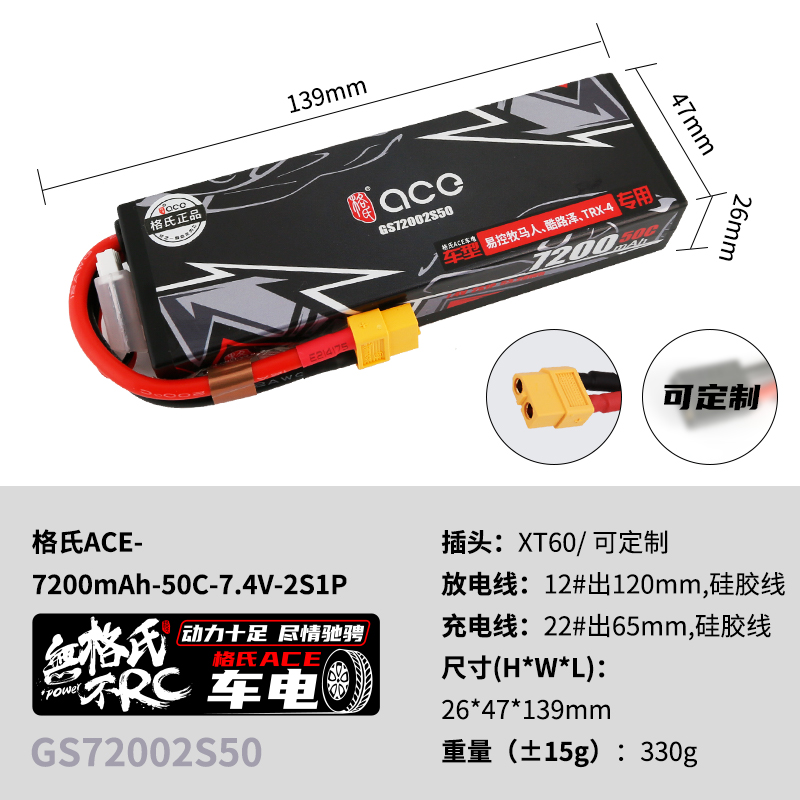
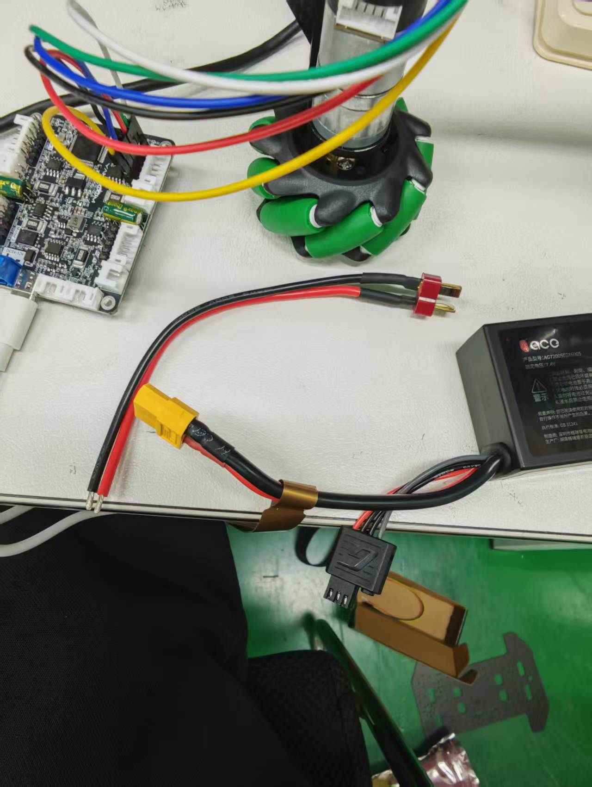
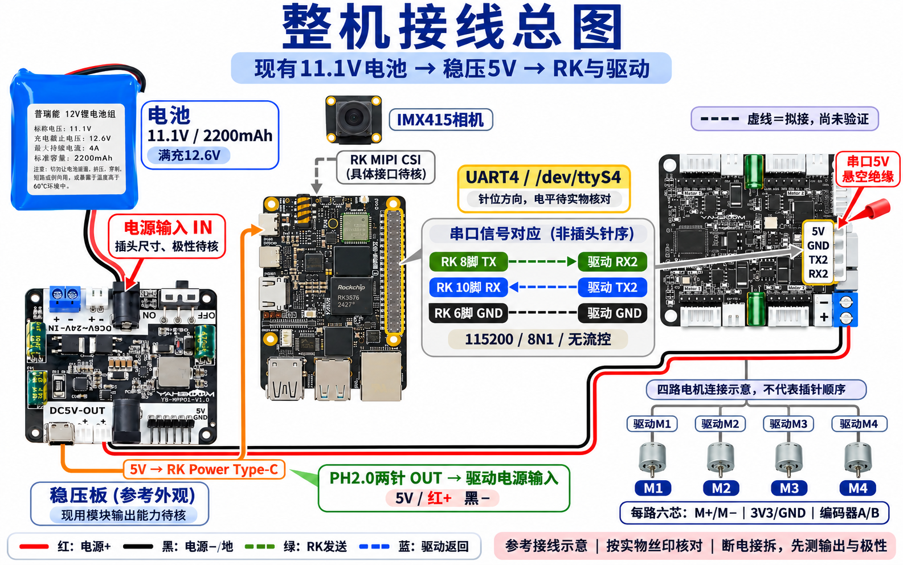
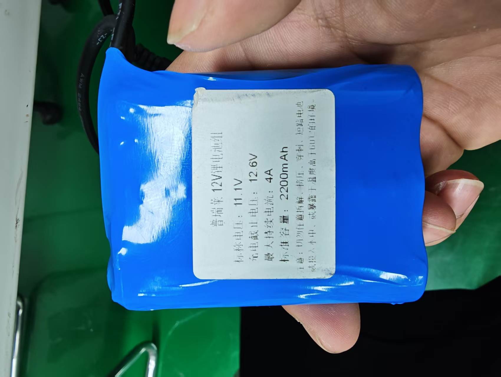

# 底盘串口调试

日期：2026-10-30开始。适用环境：Windows电脑，通过USB数据线连接亚博四路电机驱动板Type-C口；电脑已识别`USB-SERIAL CH340K (COM20)`，已提供厂家UartAssist 5.0.3。此阶段未接RK，驱动返回固件版本为1.7.3。操作流程统一见[底盘串口接线与首轮测试](../02_design/05_底盘串口接线与测试.md)，任务勾选见[开发计划](../01_plans/01_开发计划.md#2-电脑单轮调试泰山派40针串口直连驱动与首轮测试)。

现用电池为普瑞莱11.1V／2200mAh，铭牌与实拍见[最终使用电池确认](#最终使用电池确认)。

## 首次查询配置

来源：用户在聊天中粘贴的真实返回文字，尚无截图或收发日志文件。此前用户确认USB已接、灯亮，电池和电机未接驱动；本次没有补充接线变化，不据此推定已经接好电机或动力。

复现命令如下；发送窗口的原始日志未提供。

```text
$read_flash#
```

用户提供的驱动返回原文：

```text
read_flash:OK!
Motor_Version:1.7.3
Motor_type:1
Dead_Zone:1600
Pulse_Line:11
Pulse_Phase:30
wheel_diameter:67.000
P:0.800	 I:0.060	 D:0.500
```

结论：本次电脑经USB查询配置得到有效回复，可确认这一次命令查询和返回成功。当前设置仍与本车310电机和65mm轮不同；不能据此声称电机接线、编码器反馈、转轮、停车或RK40针串口已验证。

| 设置 | 本次实际返回 | 本车拟用值 |
| --- | --- | --- |
| 电机类型 | 1，520类型 | 2，310类型，按编码器A→A、B→B接法 |
| 编码器磁环线数 | 11 | 13 |
| 减速比 | 30 | 20，即1:20 |
| 轮径 | 67.000mm | 65mm |

首次查询后，安排只配置上述四项并再次查询；死区1600和调速参数P=0.800、I=0.060、D=0.500保留。后续实际读回如下。

## 参数修改后的读回确认

来源：用户粘贴的UartAssist收发日志，电脑时间为2026-10-30 12:17:34。以下保留实际发送命令及驱动返回，四条参数写入命令各自的应答未单独提供。

```text
[2026-10-30 12:17:34.771]# SEND ASCII>
$read_flash#

[2026-10-30 12:17:34.846]# RECV ASCII>
read_flash:OK!
Motor_Version:1.7.3
Motor_type:2
Dead_Zone:1600
Pulse_Line:13
Pulse_Phase:20
wheel_diameter:65.000
P:0.800	 I:0.060	 D:0.500
```

结论：本车310类型2、13线、1:20减速比、65mm轮径均已读回正确；死区和调速参数保持原值。仅确认配置修改后的查询结果，尚未进行断电重启保持验证，也无电压、编码器、转轮或停车结果。

下一步核对实物驱动板丝印和电机六芯线两端。接拆线前断开USB和动力电源，先接第1路单台电机；电机动力与编码器不能混接。核对动力极性、绝缘及停机手段后，再执行操作流程中的电压查询、零输出手动转轮和短时低速测试。

## 仅USB供电时尝试转轮，无动作和新回包

用户已确认电机接线正确，但未提供接线照片或测量。2026-10-30 12:19:58至12:20:37粘贴的日志如下；用户明确补充：当时仍然只接USB、没有接电池，电机不转，接收区也没有任何新内容。

```text
[2026-10-30 12:19:58.333]# SEND ASCII>
$pwm:0,0,0,0#

[2026-10-30 12:20:03.881]# SEND ASCII>
$read_vol#

[2026-10-30 12:20:22.659]# SEND ASCII>
$upload:1,0,1#

[2026-10-30 12:20:28.855]# SEND ASCII>
$spd:50,0,0,0#

[2026-10-30 12:20:37.419]# SEND ASCII>
$spd:0,0,0,0#
```

判断：缺少动力供电足以解释电机不转，不能据此判断电机或驱动损坏。日志中的SEND只证明软件记录了发送操作，不证明驱动执行。速度命令按厂家说明没有确认回包；此前只接USB的配置查询已成功，因此电压查询和上传没有新回复的原因仍待确认，不能把所有现象都归因于未接电池。

当前排查顺序：保持无转动目标，先发送零PWM，再重复已验证可用的配置查询，确认COM20、115200/8N1、ASCII、接收显示开启，保存实际回包。若配置查询也不回复，先排查串口状态和USB，不继续发运动命令。恢复查询后，在断开USB和动力的状态下核对2S电池动力端子极性、保险/开关及板底绝缘；四轮架空固定后，重新上电、零输出、查询配置与实际电压，确认有有效回复才恢复短时单轮测试。

本次启动与停止发送相隔约8.6秒，但电机实际未转。后续接通动力后，提前准备可单击发送的停车命令，首轮只短时运行约1秒；软件窗口关闭、拔USB和发送记录不能代替实物停车观察。尚无真实动力供电、电压、编码器、运动或停车验收结果。

## 重新拔插USB后查询恢复

用户先报告重复配置查询仍没有回复，随后重新拔插USB，并提供以下真实日志：

```text
[2026-10-30 12:23:06.891]# SEND ASCII>
$read_flash#

[2026-10-30 12:23:06.962]# RECV ASCII>
read_flash:OK!
Motor_Version:1.7.3
Motor_type:2
Dead_Zone:1600
Pulse_Line:13
Pulse_Phase:20
wheel_diameter:65.000
P:0.800	 I:0.060	 D:0.500
```

结论：本次USB重连后，配置查询恢复回复，310类型2、13线、1:20和65mm轮径仍正确；死区和调速参数未变。只能确认这次重连恢复，尚无证据区分先前是串口软件状态、USB连接还是驱动控制程序状态异常；未确认故障根因，也未完成连续通信可靠性验收。

后续按用户已确认的电机接线继续，不重复要求确认同一接线。当前最后明确的动力状态仍是未接电池。下一步关闭串口、断开USB及动力，在四轮架空、极性和停机手段已核对后接2S电池动力电源，再接USB、打开实际识别的端口。先零PWM，查询实际动力电压；未收到电压回包时用配置查询区分单条命令问题与整体通信中断，不继续发送转动指令。

## 当前电机接M3，USB供电下电压回复3.9V

用户补充实际接的是驱动第3路电机M3，因此后续单轮测试改为第三个速度参数；此前`$spd:50,0,0,0#`控制M1，即使具备动力电源也不会让M3转动。记录这一通道差异，不据此替代动力供电排查。

随后用户报告电压回复3.9V，并再次明确当前仍只接USB、没有接电池。本项是用户口述的读数，未提供电压回复的原始帧或时间，不生成示例帧冒充实际返回。它表明用户已观察到电压查询有回复，但没有电池接入，不能将3.9V认作电池电压、据此判断电池损坏，或据此认定动力供电正常。当前没有证据确定这个读数由板上哪一路电压或电源路径产生。

当前下一步：四轮架空固定，关闭串口并拔掉USB；核对已购7.4V/2S电池、驱动动力端子正负极及可切断动力手段后接动力电源，再接USB并打开实际串口。先发送零PWM，再查询电压并与电池实际电压核对；满充2S电池约8.4V。动力电压确认后，M3低速正转使用`$spd:0,0,50,0#`，全零速度停车，反转使用第三项-50；每次短时测试并观察实际停车。以上为后续操作安排，尚无真实转轮或停车结果。

## 已收到反馈截图，动力插头和输入输出仍待核对

用户提供[串口助手原始截图](../../05_data/01_raw/04_hardware/20261030_motor_uart_01.png)，已按原文件归档，文件指纹及来源见[登记](../../05_data/01_raw/04_hardware/sources.json)。截图可见COM20、115200、8数据位、无校验、1停止位、无流控，ASCII收发；接收区持续出现MAll总计数以及MSPD四路零轮速。它证明截图时已有反馈数据，不能证明编码器通道与实际轮子一一对应，也不能证明电机已运行或动力已接。

截图的发送框是M3第三项-50的非零速度命令；这只说明输入框内容，不能判断是否点击发送。接电前先将发送框改成零PWM并发送，然后关闭串口、拔掉USB，保持电池未接，避免接电时误发运动目标。

用户确认准备使用已购7.4V/2S电池，但尚不清楚电源输入、输出和稳压板接法。当前不再按“动力极性已核实”推进：需要实际电池插头、驱动动力端子和现有供电线照片，确认是否已有XT60主取电及配电/保护连接。采购记录中电池为XT60，驱动附带T插至裸线，不能当作可直接对插的整套线束。

电源关系沿用[系统规划第6.1节](../02_design/03_系统规划.md#61-电池降压板驱动到底怎么接)：电池经保护、开关和分电后，一支路接驱动DC5V～12V动力输入，另一支路接稳压板IN+/IN−，稳压板5V输出供RK。驱动动力不经过5V稳压板。当前仅测电脑与电机，不接RK，先核清动力支路；驱动辅助5V/3V3不是电池输入，电池小平衡插头也不用来给电机供电。未提供实物电源照片前，不按商品图左右位置指示用户上电。

## 按用户指定商品页核对电池插头

用户给出[京东商品10051546999619](https://item.jd.com/10051546999619.html)，并说明商品图与当前电池实物相同。桌面网页工具未能读取，浏览器工具打开也超时；随后通过公开移动版页面成功读取商品规格。页面的SKU对应信息明确为7200mAh、50C、7.4V、2S硬壳、满电8.4V、XT60插头，与采购记录一致。商品合集含多种电压和插头，未采用默认展示的其他规格主图。



图片为商家原图，未改动；来源、对应SKU和文件指纹追加在[同一登记](../../05_data/01_raw/04_hardware/sources.json)，网页缓存留在temp/motor-power。图中黄色XT60是两根粗红黑线连接的主放电口，端面为插孔；与之配对的取电线应为金属插针端。壳体旁白色小插头是平衡检测和充电辅助口，不接电机驱动动力输入。充电时按配套2S平衡充电器说明使用接口，不能把小平衡口当作电机电源。

给用户的具体接法：保持电池和USB断开，取与电池XT60配对的成品取电线，动力支路正极经保险/开关接驱动板DC5V～12V端子的“+”，负极接同一电源端子的“−”。优先使用已压好端头的红黑线；松开夹线螺丝、插入端头、拧紧并轻拉核牢固，最后才对插电池。接线按端子和插壳实际正负标识核对，不按照片上下位置猜极性，不剪电池原线或将裸线塞入电池插孔。当前单轮动力线按既有16AWG、10–20cm设计预算核配，不把该预算写成已完成线束温升验收。

现有采购资料显示驱动附线为红色T插至红黑裸线，与黄色XT60不能直接对插；是否已有合适XT60取电线、保险和开关仍待用户核实现物。缺少时先补成品线束，稳压板不能用来替代匹配插头。当前电机动力支路仍不经5V稳压，稳压板保留给RK计算支路。只完成商品图、型号和接法核对，尚无动力接通、电压读回或电机运行结果。

## 实物确认电池XT60与现有T插线不匹配



用户实拍已按原文件归档，来源与文件指纹追加在[同一登记](../../05_data/01_raw/04_hardware/sources.json)。可见电池粗红黑线连接黄色XT60，另一根独立红黑供电线末端为红色T插，线的另一端是裸露线头；两种插头没有对接，不能直接配对。下方细线黑壳小插头不用于电机动力，本次未核其具体充电接口型号。驱动仍接USB，左侧蓝色电源端子只拍到局部，正负丝印不能完整辨认。

当前缺口按照片更新为：尚未看到与电池配对的XT60成品取电线及保险/开关。沿用正式分电方案，优先补XT60金属插针端至红黑线的成品取电总成，端头预压好；主取电线按既有14AWG设计预算核配，避免仅为使用赠送T插线增加一层转接。图中T插线暂留备用，不剪电池原线、不将裸线塞进电池插孔。

取得线束后的功能接法仍是电池XT60→保险/开关→驱动DC5V～12V动力输入，红正黑负，不经过5V稳压。先断开USB并保持电池未接，在实物“+／−”标识清楚时压接电源端子；这张照片不足以指定某个上下/左右孔为正极。若用户看不清丝印，只需补蓝色电源端子附近一张近照，不再重复要求整套电池或电机照片。当前只是现物配线核对，尚未接通动力或转轮。

## 厂家原配线可以保留，需匹配电池端插头

用户再次提供同一实拍和[用户红框标注版本](../../05_data/01_raw/04_hardware/20261030_power_connectors_marked_01.png)，指出该电源线一端已剥线、一端为红色插头。同一JPG与已有原件指纹一致，不重复保存；PNG框选图按用户原文件另存，来源追加在同一登记。

澄清：这确实是驱动厂家附带的电源线。它的剥线端可以接驱动板的蓝色动力输入端子，红正黑负；插头端是红色T插，电池主输出则是黄色XT60，电池端接口不匹配。圈内是两组摆在一起的线，不能因为交叉重叠就判断已经连接。此前建议换成XT60成品取电线是一种配线方式，不代表原配T插线没有用途。

若本轮电脑单轮台架希望保留原配线，可在电池与原配T插之间增加匹配方向的成品转接头：XT60金属插针端接电池，T插金属插孔端接原配线的外露扁插片。常见商品名为“XT60公转T插母”，仍须以触点形状和正负极核对，不能买反向版本。[厂家同方向转接头](https://genstattu.com/xt60-male-to-deans-t-female-adapter/)型号GEAX6M2TF可作方向参考；本次只核对类型，不认定用户已采购或已实测该转接头的电流、压降和温升。动力保险/开关仍按原流程落实，电池最后对插。

正式整车仍沿用XT60主取电、保险/开关和分电两支路方案；本段是保留现有T插线的单轮台架配接办法，不自动增加整车采购或实际支出。

## 当前一块电池只先供电机驱动与RK

用户提出一块电池如何同时供多个设备，并进一步明确当前两处是“降压给RK”和“直接给电机驱动”。本次据此统一接法解释：在降压板前设置正负分电，一支路以电池电压供四路电机驱动，另一支路经已购降压板输出5V给RK。当前降压后只有RK一个直接供电点，不额外假定第二块5V驱动板，不增加另一块降压板。

唯一正式接线定义、简图和配套范围更新在[系统规划第6.1节](../02_design/03_系统规划.md#当前先给哪两处供电)。待配件仍需作为完整两支路线束统一核对，包含取电、保护/开关、正负分电、两支路端子线及RK的5A短C-C线；充电器是独立充电工具。此处只记录用户确认的使用范围和接法整理，尚未采购新增配套、连接整套动力或进行实物供电验收。

## 现有11.1V电池与稳压板接口标注

2026-10-30用户提供手边电池实拍，标签为11.1V、满充12.6V、最大持续4A、2200mAh，并决定先由同一块稳压板的5V输出同时给驱动和RK做轻载测试。当前按用户选定接法绘图：电池已有圆头，在尺寸和极性匹配后接稳压板输入；稳压板白色两针OUT口以PH2.0-2P插头转红黑线，压入驱动板标有DC5V～12V的蓝色电源端子，红正黑负；RK仍用Type-C输出。稳压板输出圆孔不接线，图片只保留当前接法说明。



2026-11-04按用户要求更新原图，增加RK、UART4收发/共地、相机及四路电机功能连接，沿用原文件入口。图中白色两针OUT仍用配套PH2.0插头引出红黑线接驱动蓝色端子；串口拟接用虚线，5V脚悬空绝缘。现用模块能力待核，已移除旧图的5A保证；本次仅核对说明图，没有操作板卡或接通通信。

图片为厂家照片经图像编辑工具添加说明的接线示意，不是本车实际接线或通电照片。完整接法及适用条件统一见[系统规划的本轮轻载试验](../02_design/03_系统规划.md#现有111v电池的5v轻载试验接法2026-10-30)。厂家未修改原图与电池实拍独立归档，来源及文件指纹见[同一登记](../../05_data/01_raw/04_hardware/sources.json)。后续用户报告的通电、M3转动情况见本记录下文；稳压输出测量、RK启动、原始反馈及四轮带载仍按实际证据分别核对，接线图本身不作为硬件验证通过的依据。

## 重新选择易接线、易充电的小电池

本段记录此前的小电池资料比较。

2026-10-30用户当时要求重新选择电池，明确容量2000～2550mAh可以接受。当时主推荐为亚博7.4V／2000mAh带保护电池＋同商品组8.4V／2A原配充电器，候选图片来源和文件指纹已登记；当前使用决定见[最终使用电池](../../03_hardware/01_硬件清单.md#最终使用电池)。公开移动页确认店铺为亚博智能官方旗舰店；价格要求登录，未取得准确价格，不用商品组起价冒充组合总价。

电池商品图为红色T插主输出和独立圆形充电口，可沿用用户手边驱动T插线，充电用同商品组圆口原配充电器。厂家2000mAh资料列额定15A、最大20A、约67×37×22mm与115g；只作资料选型，未实测输出、压降或温升。轮趣E226C 2550mAh外壳款的[厂家发布图](https://www.bilibili.com/video/BV1UAMqzsEpW/)标注最大持续6A；考虑四轮启动与RK支路余量，本轮未选它。

小容量组合标称14.8Wh，不再套用原7200mAh的一小时预算。按电池端平均40W、预留20%能量举例约18分钟，降压板输入≥7.0V条件可能缩短可用时间，真实续航未测。整车仍须匹配主取电、保护/开关、正负分电和RK的5A短C-C线；只完成电池与充电器推荐，不宣称整车配线齐套或可直接上电。旧电池不剪线，原采购付款保留，未执行退换、追加购买或实物供电。

## 用户报告驱动板、稳压板已通电，开始准备单轮测试

2026-10-30用户在聊天中报告：“驱动板和稳压都接通了电源”，串口也已连接，希望开始电机测试。本次没有提供新的接线照片、稳压输出测量或串口原始日志，只登记用户报告的连接状态；不据此判定极性、电压、供电能力或RK启动已通过。

按最近确定的11.1V电池经稳压板输出5V的轻载接法继续，电机通道沿用此前确认的M3。先将车轮架空固定，关闭串口助手循环发送，准备可直接发送的停车命令及可切断动力的操作。依次发送零PWM、电压查询和配置查询，命令见[统一操作流程](../02_design/05_底盘串口接线与测试.md#先查询再配置最后短时转轮)。本次应核对稳压后的驱动输入约5V，并以万用表测量比较；配置应读回类型2、13线、减速比20、65mm轮径，正确时无需再次写入参数。

电压、配置确认后再检查M3编码器通道及短时正反转、停车。当前没有本轮真实回包、转轮或停车结果，未勾选硬件验证通过；此前USB单独供电的3.9V读数不沿用为本轮供电证据。

## M3首次转动，用户报告速度很慢

2026-10-30，在上一轮给出M3目标50的速度命令后，用户报告“转是转了，但是速度非常慢”，并询问50的单位。此处登记用户观察到电机转动；未提供发送日志、动作视频或轮速反馈，不推定实际速度等于目标50，也不推定停车、反转和其他通道已通过。

厂家[串口示例说明](https://www.yahboom.net/study/MD310/14033/)及已归档`12_STM32串口工程/USER/main.c`第3～4行将电机速度标为mm/s，即毫米每秒。`$spd:0,0,50,0#`的第三项是M3的目标轮缘线速度50mm/s，相当于5cm/s。按已配置轮径65mm计算，轮周长约204.2mm，目标对应约14.7转/分钟、4.08秒一圈；这是计算值，不是实测转速，也不等于麦轮整车的行驶速度。

当前先核停车是否确实停止，再保持轮子架空检查轮速反馈的第三项；对照目标50与实际反馈，之后可逐级试100、200并在每次短测后停车。仍需补充本次驱动输入电压、配置和反馈原始日志；不能仅凭“看起来慢”判断供电不足或电机异常。

## 最终使用电池确认

2026-10-30，用户确定使用**普瑞莱12V锂电池组**作为车载电池。原照片文件指纹一致，沿用同一实拍。



| 照片标签项目 | 已确认内容 |
| --- | --- |
| 标签名称 | 普瑞莱12V锂电池组；未见独立型号编号 |
| 标称电压 | 11.1V |
| 充电截止电压 | 12.6V |
| 标称容量 | 2200mAh |
| 最大持续电流 | 4A；这是电池端标签值，不是稳压后5V端的额定电流 |

原照片来源及文件指纹见[同一图片登记](../../05_data/01_raw/04_hardware/sources.json)。本次完成标签抄录与用户使用决定登记；没有新增电压、电流、温升、续航或四轮带载测量。实物尺寸、重量、接口尺寸和极性、保护功能、匹配充电器以及旧小车电源模块的型号和输出能力仍待核对。

当前继续按[11.1V电池经旧小车电源模块输出5V的轻载接法](../02_design/03_系统规划.md#现有111v电池的5v轻载试验接法2026-10-30)安排单轮检查；现用电源模块型号仍待核；厂家接口示意只作参考，不表示现物型号已经确认，也不将其5A参数移用于旧模块。原2S电池直接供310动力的接法不用于本块电池。用户已报告M3转动，实际轮速、停车、RK启动和四轮带载仍按真实证据分别验收。

## RK串口选择与接线准备（2026-11-04）

**本节前半保存12时的接线准备，当时尚未连接。** 16时续做中用户确认已接线，板B已实际发送两次只查询指令，接收均为0字节；当前结果见下文[两网口区分与实际查询](#两网口区分与板b实际查询2026-11-04)。用户另报告相机换了接口，没有要求恢复相机工作台。本轮目标仍为取得一次不改变配置的查询及对应真实回复，运动及参数写入不在本轮范围。

### 已有成果与本次环境

电脑USB的真实配置查询结果沿用上文，最近读回固件1.7.3、类型2、13线、减速比20、轮径65mm；不将它套用为RK40针已通过。初次盘点时没有RK电机串口C程序，续做时已补齐，见下文。相机的SSH/SCP与板端原生GCC流程可复用；厂家示例会改参数及转轮，不能直接运行。配置查询回复是多行文本，不以 `#` 结束，接收程序须与电压帧分开识别。

板端操作前已联系“接管RK3576并推进SN100移植”窗口，获其划定的一次低开销只读盘点窗口。使用专用主机别名 `rk3576-board-b` 与 `C:/Users/52400/.ssh/known_hosts_rk3576_board_b` 严格核对SSH指纹 `SHA256:S4ihaw0V/Z8w7v3VlJOQEFLEH3Hp6nr3KjiUTxanwPg`；进入后先核硬件序列号，再读取信息。没有打开串口、设置波特率、发送字节、改设备树或启停服务。结束后已把结果交回并释放窗口；后续打开UART或发送查询仍先协调。

| 核对项 | 2026-11-04 12:08:07（板端北京时间）实际读取 |
| --- | --- |
| 板卡 | 板B，序列号 `8314b1e8ffd0321f`，型号报告为泰山派3M RK3576 |
| 内核、启动号 | `6.1.99-rt36-tspi`；`0eb94389-f120-42ad-9042-9c21d96a1481` |
| UART4节点 | `/dev/ttyS4` → `/sys/firmware/devicetree/base/serial@2ad70000`；设备树别名 `serial4` 同地址 |
| 当前复用 | pin88＝GPIO2_D0、pin89＝GPIO2_D1，均由 `2ad70000.serial` 使用，功能 `uart4`、组 `uart4m0-xfer` |
| 当前占用 | 遍历进程打开文件未见 `ttyS4`；仅见蓝牙进程占 `ttyS6`、登录程序占 `ttyFIQ0`。这是当时快照，不承诺以后一直空闲 |
| 系统登录 | 内核命令行为 `console=ttyFIQ0`，运行中的串口登录服务也是 `serial-getty@ttyFIQ0` |
| 原有程序 | 主控PID5008、上位机PID669382、图像处理PID139148仍存在，启动计数和执行文件指纹与协调依据一致 |
| 相机工作台 | 检查前后均为 `MainPID=0`、`inactive/dead`，未重新启动 |

原样保存的[只读输出](../../05_data/01_raw/04_hardware/20261104_board_b_uart_inventory_01.txt)及[来源与SHA-256](../../05_data/01_raw/04_hardware/sources.json)可复核。Windows管道在脚本末尾带入一个回车字符，远端报告 `sh: 64: \r: not found`，SSH实际退出码为127；前述读取及末尾进程/服务状态已返回。保留这个过程错误，没有把本次命令记成正常退出或串口通信通过，也未为此重复操作板卡。

本次读取的关键命令如下，均为已协调后的板端只读检查，不是查询电机驱动的指令：

```bash
tr -d '\000\r\n' < /proc/device-tree/serial-number
```

```bash
readlink -f /sys/class/tty/ttyS4/device/of_node
```

```bash
cat /proc/cmdline
```

```bash
cat /proc/tty/driver/serial
```

```bash
cat /sys/kernel/debug/pinctrl/pinctrl-rockchip-pinctrl/pinmux-pins
```

### 现在选哪一组，接线还缺什么

优先选择 **UART4，对应 `/dev/ttyS4`**。本地[泰山派规格书](../../04_references/04_datasheets/01_泰山派3M_RK3576_规格书.pdf)第8页已目视核对如下针表，与板端GPIO复用相符；实物版本和针1方向尚未核实。

| RK40针物理位置 | 资料中的功能 | 电平及方向核实后拟接驱动 |
| --- | --- | --- |
| 8 | UART4_TX_M0 / GPIO2_D0，RK发送 | RX2，驱动接收 |
| 10 | UART4_RX_M0 / GPIO2_D1，RK接收 | TX2，驱动发送 |
| 6 | GND，信号地 | GND |

这张表是待实物对应的接线方案，不是已接好的事实。规格书电源脚标有3.3V，但没有给8/10信号脚电平及容限；厂家现有简介中的5V/3.3V也指电源输出，不能据此证明TX2/RX2耐压。当前缺RK版本/40针方向、驱动实际接口丝印及两端逻辑电平依据。下一步只补RK40针与版本、驱动TX2/RX2附近的清晰实物近照，再按对应版本核电平；资料不明确时测空闲电平并继续核耐压，未确认前不接通。驱动插头5V不接RK。

**截至12时准备阶段的TX、RX及解析结果均为无。** 当时用户报告信号线未接，查询程序随后完成准备。下文16时新增真实板端发送证据，不用此前电脑USB回包冒充本轮结果；仍按[统一设计](../02_design/05_底盘串口接线与测试.md#本轮只查询2026-11-04)取得真实回复后收尾。

2026-11-04补充：用户要求将各类接线画在一张图中，已更新上面的总图及[生成说明](../../05_data/03_results/01_design/04_稳压板接线示意.json)，保留原始参考图片和指纹；这是电脑上的图示整理，不增加硬件验证结论。

### C查询程序与连接检查（续）

2026-11-04用户要求继续后，已完成[C源码](../../02_programs/01_host/04_motor_uart/motor_query.c)、[GCC构建入口](../../02_programs/01_host/04_motor_uart/Makefile)和[上传脚本](../../02_programs/01_host/04_motor_uart/deploy_query.ps1)。当前程序只接受板B、显式指定的 `/dev/ttyS4` 和两种只查询模式，不提供任意原始指令入口。运行前核序列号、节点映射和进程占用，关闭串口回显与流控；原有内部回环未关闭时拒绝发送。先单独保存发送前残留数据，获得100毫秒无新数据的间隔后再发一条查询；没有这个间隔时停止，不发送上传开关。

每次运行须使用新的日志目录，分别保存 `tx.bin`、`rx.bin`、`before_rx.bin` 和 `session.log`。终端显示实际写入内核的TX、接收的RX文本/十六进制及解析字段；超时或仅有发送回显不能通过。默认接收3秒、最多10秒，没有自动重发；退出时恢复RK原串口格式，不发送驱动参数或停车命令。

验证范围：在电脑的 `RK3576-Build-22.04` 环境用 `aarch64-linux-gnu-gcc 11.4.0` 完成ARM64交叉编译，`-Wall -Wextra -Wpedantic -Werror` 及GCC静态分析无报错；产物已核为AArch64 Linux ELF。上传脚本通过PowerShell语法检查，未执行。临时解析检查源码也已交叉编译，但没有在电脑或模拟器运行。**尚未完成板端原生编译、解析检查运行或真实驱动通信。** [原始构建输出](../../05_data/01_raw/04_hardware/20261104_motor_query_build_01.txt)按原文件归档，来源及指纹见[登记](../../05_data/01_raw/04_hardware/sources.json)。

已重新与“接管RK3576并推进SN100移植”窗口协调：SN100后续转板A，板B留给小车，可以在本任务授权内准备专用目录、原生C编译和帮助/缺参检查。实际连接时 `192.168.100.123` 返回 `SHA256:xLQv5sqzTRvKbfD2fNQQLYjCbPN6WOXgkXEoUqV8Yy4`，与板B固定指纹不符，严格检查在SSH认证前拒绝，真实退出255，远程准备命令未执行。协调窗口随后确认该IP现在是板A，不能换信任记录或在A代跑。板B此前的Wi-Fi地址 `192.168.3.59` 连接也超时，SSH退出255。两份原始输出：[有线身份不符](../../05_data/01_raw/04_hardware/20261104_motor_query_ssh_identity_01.txt)、[旧Wi-Fi地址超时](../../05_data/01_raw/04_hardware/20261104_motor_query_wifi_01.txt)。未上传文件，没有启停任何板端服务，也没有打开UART。

板B接入网络后，在电脑项目根目录调用上传脚本；先将下列地址占位文字替换成板B实际地址。脚本沿用严格SSH和SCP，每次远程命令先核板B序列号，在板B项目 `temp/` 下新建本次目录，只原生编译和检查帮助/缺参拒绝，不自动查询驱动。

```powershell
.\02_programs\01_host\04_motor_uart\deploy_query.ps1 -BoardHost '板B实际IP地址'
```

脚本内部在上传的源码目录使用以下GCC构建入口：

```bash
make CC=gcc BUILD_DIR=build
```

硬件接线、电平和当时占用确认后，在脚本输出的板端源码目录手动执行以下一条配置查询。日志目录必须尚不存在；没有接好之前不执行。`config`只发送 `$read_flash#`，需要改查电压时用 `voltage`，每次仍只选一种。

```bash
./build/motor-query --port /dev/ttyS4 --query config --log-dir /root/opto-chess-robot-2027/temp/motor-uart-run-01 --timeout-ms 3000
```

以上是续做前的网络阻塞情况，16时已通过USB网口的本地IPv6地址连接板B，结果如下。

## 两网口区分与板B实际查询（2026-11-04）

**本节先保存16:21与16:23的两次无回复，再记录16:49接USB辅助供电后的成功查询。** 用户确认UART4接线为RK8脚TX→驱动RX2、RK10脚RX←驱动TX2、RK6脚GND→GND，驱动5V不接RK。接线近照和线路连续性尚未独立核对；后续一次真实配置查询已验证当前收发链路，具体条件见[成功结果](#usb辅助供电后配置查询通过)。

### 两个网口如何分别连接

电脑自带网口和USB网口分别连接两块RK；两板有线地址都为 `192.168.100.123/24`。普通IPv4连接实际走自带网口；严格使用板B指纹时会拒绝。随后使用已有的板A可信SSH记录，只读取唯一硬件序列号，确认该入口为板A，没有向板A上传或执行查询程序。

| 对象 | 本次读取结果 |
| --- | --- |
| 电脑自带网口 | `以太网`，网口编号9，电脑地址 `192.168.100.200/24`，连接板A |
| 板A身份 | 序列号 `3bf8222fe1417f6a`；SSH指纹 `SHA256:xLQv5sqzTRvKbfD2fNQQLYjCbPN6WOXgkXEoUqV8Yy4` |
| 电脑USB网口 | `以太网 2`，网口编号7，自动地址 `169.254.232.74/16`，没有到板B的同网段IPv4地址 |
| 板B本次专用入口 | `fe80::f4ff:fbff:fe6c:79a1%7`；末尾 `%7` 指定从电脑USB网口连接 |
| 板B身份 | 序列号 `8314b1e8ffd0321f`；严格核对SSH指纹 `SHA256:S4ihaw0V/Z8w7v3VlJOQEFLEH3Hp6nr3KjiUTxanwPg` |
| 板B本次启动号 | `ccddb46f-25cd-452c-a086-5ceb3ce36d50`，与12时记录不同，不套用旧进程号或占用结论 |
| 板B串口 | `/dev/ttyS4` → `serial@2ad70000`；pin88/89仍为 `uart4m0-xfer`，程序执行前未见端口占用 |
| 相机服务 | 操作前后均为 `MainPID=0`、`failed/failed`，没有启动或停止它；已有图像处理进程457仍在 |

已重新与“接管RK3576并推进SN100移植”窗口协调，对方确认SN100已转A，当前没有板B操作。这里只核板B身份并操作本轮查询程序，没有改变电脑或板卡IP。IPv6地址加网口编号可在两板IPv4相同时分别连接；换USB口、换网卡或网络配置后，应重新读取网口编号、对端地址并核身份，不能把 `%7` 当作永久固定值。

原始证据：[电脑两网口快照](../../05_data/01_raw/04_hardware/20261104_motor_uart_network_01.json)、[板A序列号](../../05_data/01_raw/04_hardware/20261104_motor_uart_board_a_identity_01.log)、[板B身份和地址](../../05_data/01_raw/04_hardware/20261104_motor_uart_board_b_link_01.log)。来源及文件指纹统一见[登记](../../05_data/01_raw/04_hardware/sources.json)。

### 原生编译与操作命令

[上传脚本](../../02_programs/01_host/04_motor_uart/deploy_query.ps1)已支持带网口编号的IPv6地址，SCP传输使用方括号包住IPv6。第一次上板编译成功，但环境没有 `file` 命令，后续检查因此中断，实际SSH退出127，当次没有打开UART；保留[首次输出](../../05_data/01_raw/04_hardware/20261104_motor_uart_native_build_attempt_01.log)。改用GCC配套的 `readelf -h` 后，完整上传流程通过。

电脑项目根目录的实际上传命令：

```powershell
.\02_programs\01_host\04_motor_uart\deploy_query.ps1 -BoardHost 'fe80::f4ff:fbff:fe6c:79a1%7'
```

板B使用GCC `13.3.0-6ubuntu2~24.04.1`，开启 `-Wall -Wextra -Wpedantic -Werror` 原生编译通过；程序头显示AArch64、ELF64。帮助正常返回，缺少必需查询参数时退出2，这两项不打开UART。完整[构建输出](../../05_data/01_raw/04_hardware/20261104_motor_uart_native_build_01.log)已保存。源码文件指纹仍为 `494fdcbfdbc68f02ead8e412189aa2343f58b83d7805b3c556150ed98cc74d20`，本次板端可执行文件指纹为 `d2ed1fb8640119485818af75fc4a325431f7f0ccfc0282eaf0c11622c25ca25f`。

板端源码目录为 `/root/opto-chess-robot-2027/temp/motor-uart-query-20261104_162122_24d05248`。脚本在该目录执行的编译命令：

```bash
make CC=gcc BUILD_DIR=build
```

以下为已经执行过的两次查询，每次只发一条、均无额外换行和自动重发。保留命令用于复核，不要求无条件重复执行；每次新测应使用尚不存在的日志目录。

```bash
./build/motor-query --port /dev/ttyS4 --query config --log-dir /root/opto-chess-robot-2027/temp/motor-uart-query-20261104_162122_24d05248/run-config-01 --timeout-ms 3000
```

```bash
./build/motor-query --port /dev/ttyS4 --query voltage --log-dir /root/opto-chess-robot-2027/temp/motor-uart-query-20261104_162122_24d05248/run-voltage-01 --timeout-ms 3000
```

### 实际发送、接收和判断

格式均为115200、8数据位、无校验、1停止位、无流控、无本地回显。查询前内部回环标志已关闭，分别先取得100毫秒无新数据的间隔；没有将发送前数据算作回复。

| 板端北京时间 | RK→驱动：实际写入串口 | 驱动→RK：原始接收 | 解析与退出码 |
| --- | --- | --- | --- |
| 16:21:51 | `$read_flash#`，12字节；`24 72 65 61 64 5F 66 6C 61 73 68 23` | 3秒内0字节 | 无配置可解析，退出3 |
| 16:23:22 | `$read_vol#`，10字节；`24 72 65 61 64 5F 76 6F 6C 23` | 3秒内0字节 | 无电压可解析，退出3 |

第一次后读取UART4计数为 `tx:12 rx:0`，两次后为 `tx:22 rx:0`。引脚复用及计数原始返回见[串口状态](../../05_data/01_raw/04_hardware/20261104_motor_uart_pin_status_01.log)和[电压查询完整SSH返回](../../05_data/01_raw/04_hardware/20261104_motor_uart_voltage_ssh_01.log)。这证明软件和内核已接收发送请求，不代表示波器已测到RK插针上的正确波形，也不能证明指令已到驱动。

- 配置查询：[板端原始日志](../../05_data/01_raw/04_hardware/20261104_motor_uart_config_session.log)、[TX原始字节](../../05_data/01_raw/04_hardware/20261104_motor_uart_config_tx.bin)、[RX原始字节](../../05_data/01_raw/04_hardware/20261104_motor_uart_config_rx.bin)、[含身份与指纹的SSH输出](../../05_data/01_raw/04_hardware/20261104_motor_uart_config_ssh_01.log)。
- 电压查询：[板端原始日志](../../05_data/01_raw/04_hardware/20261104_motor_uart_voltage_session.log)、[TX原始字节](../../05_data/01_raw/04_hardware/20261104_motor_uart_voltage_tx.bin)、[RX原始字节](../../05_data/01_raw/04_hardware/20261104_motor_uart_voltage_rx.bin)。

板端日志及TX/RX经SCP原样下载，文件指纹与板端一致；两个RX文件为真实0字节接收结果，并非占位文件。发送前残留同为0字节，留在板端日志目录，不重复归档。未发送转轮、零PWM、反馈开关或参数写入命令。

下一步按下文新增灯态先核供电，再取得RK40针和驱动四针串口接线两端的清晰近照，核准排针方向、插针位置与接触；按需要用万用表核共地、线的连续性及两端TX空闲电压，并查电平兼容依据。接拆前双方断电；尚不能由“灯亮但无回复”判定线接反、驱动损坏或串口损坏。若接线仍无误，再做与驱动断开的RK外接回环，区分RK收发线路与驱动一侧；该检查待实际安排，不预记通过。

### 电池供电时仅红灯亮、绿灯不亮

2026-11-04用户在本聊天补充：“使用这个电池供电的时候，只有红灯亮着，绿灯不亮。”随后按上一轮要求测量驱动蓝色电源输入端，报告 **4.98V**；再测3V3对GND，报告 **约2V**。接上电脑串口后又报告恢复 **约3.3V**，经追问确认是电脑USB数据线直接接驱动Type-C口，并非USB转串口小板。这些均为用户口述的万用表读数，没有测量照片、启动波形或独立测点复核；没有确认接USB时外部电源和所有负载的具体状态，不能写成已完成两种电源的独立对照。用户未补充本次USB接入后的绿灯节奏。

[厂家固件说明](https://www.yahboom.net/study/Quad-MD-Module/15475)及本地[原件](../../03_hardware/01_机械/01_厂家资料/03_四路电机驱动/10_固件更新说明.pdf)将重启后的“红灯常亮、绿灯3秒2闪”作为烧录成功的确认现象。资料没有把“仅红灯亮、绿灯灭”定义为某一种确定故障，不能据此判定欠压、固件损坏或电池损坏。红灯亮本身也不足以证明控制芯片已正常供电并启动。

当前优先排查供电路径，这是结合灯态变化和查询无回复作出的排查判断，尚未确定根因。按现有记录，电池为标称11.1V，经旧小车模块输出约5V给驱动；[厂家简介](https://www.yahboom.net/study/Quad-MD-Module/13988)列推荐输入5～12V，现有接法处于范围下端。用户已按万用表直流电压档、黑表笔接输入“−”、红表笔接输入“+”的要求报告4.98V；它接近5V，不能仅凭与5V相差0.02V判定欠压，也不能代替板内控制电源与启动瞬间电压的核查。

3V3测量按直流电压档、黑表笔接 `GND`、红表笔接 `3V3` 的要求进行，用户报告约2V，明显低于该输出的标称3.3V；这条线索与绿灯不闪、查询无回复相符，但尚不能确定是否为板内稳压路径、外接负载、输入瞬态或测点问题。接电脑USB后用户报告恢复约3.3V，随后RK查询成功，见下文；不能只凭这个结果判定某个芯片损坏，也不把提高输入电压作为已验证的修复。

下一步先做驱动板独立供电检查：断电后断开电脑USB、RK信号线和四路电机接头，只保留现有电池经模块输出约5V的输入；重新上电，测输入端与3V3对GND。若3V3恢复，可进一步逐项接回外接线定位负载影响；若仍约2V，继续查板自身的外部供电路径，并在外接状态相同的条件下对照仅USB。此步骤尚未执行，不预记通过；不提高动力电压，不发送运动指令。

### USB辅助供电后配置查询通过

**验证范围：板B通过UART4与驱动通信，驱动Type-C接电脑USB辅助供电；本次一次配置查询已打通。** 这不是电脑COM口查询：电脑仅提供用户确认的USB连接条件，命令由RK的C程序通过 `/dev/ttyS4` 发送，真实回复也由该节点接收。未在电脑串口助手发送命令。

本次旧的板B USB网口IPv6地址连接失败，SSH退出255，远程命令未执行；随后改用相机记录中已有的Wi-Fi `192.168.3.59`。严格核板B专用SSH指纹后，实读序列号 `8314b1e8ffd0321f`，启动号为 `bf6d49fb-3e9b-4557-84db-d12331a81373`，与前一次不同，不沿用旧进程和串口计数。程序文件指纹仍为 `d2ed1fb8640119485818af75fc4a325431f7f0ccfc0282eaf0c11622c25ca25f`；未改源码、串口接法、驱动配置或启停相机服务。

板端北京时间 **16:49:30**，在原源码目录执行以下一次查询；115200/8N1，无流控、无本地回显，内部回环标志关闭，发送前残留0字节：

```bash
./build/motor-query --port /dev/ttyS4 --query config --log-dir /root/opto-chess-robot-2027/temp/motor-uart-query-20261104_162122_24d05248/run-config-usb-01 --timeout-ms 3000
```

实际RK→驱动为12字节，没有附加换行：

```text
$read_flash#
```

发送原字节为 `24 72 65 61 64 5F 66 6C 61 73 68 23`。实际驱动→RK为150字节，下面按行显示正文；原始文件保留每行CR/LF及末行制表符和空格：

```text
read_flash:OK!
Motor_Version:1.7.3
Motor_type:2
Dead_Zone:1600
Pulse_Line:13
Pulse_Phase:20
wheel_diameter:65.000
P:0.800 I:0.060 D:0.500
```

解析结果与原文一致：固件1.7.3、类型2、死区1600、线数13、减速比20、轮径65mm，调速参数P=0.8、I=0.06、D=0.5。程序及SSH实际退出均为0；判断通过依据是实际命令、150字节原始回复及对应字段解析，并非仅看退出码。

原件：[板端日志](../../05_data/01_raw/04_hardware/20261104_motor_uart_usb_config_session.log)、[TX](../../05_data/01_raw/04_hardware/20261104_motor_uart_usb_config_tx.bin)、[RX](../../05_data/01_raw/04_hardware/20261104_motor_uart_usb_config_rx.bin)、[完整SSH输出](../../05_data/01_raw/04_hardware/20261104_motor_uart_usb_config_ssh_01.log)。三份板端原始文件经SCP下载，已核对文件指纹与板端一致；来源、指纹及USB条件见[同一登记](../../05_data/01_raw/04_hardware/sources.json)。

本轮最小查询链路到此收尾，没有发送电机动作、参数写入、反馈开关或零PWM。当前证据更支持优先检查驱动外部供电路径和外接负载，但没有完整电路图及独立驱动板测量，不能确定具体稳压器或保护器件的原因。USB辅助供电成功不代表纯电池供电、长期稳定性或四轮运动通过；用户本轮继续反馈的供电问题保留在本记录和原计划，不自动扩展到动作测试。

## 更换网络后的串口复测（2026-11-05） {#uart-recheck-20261105}

**实际结果：北京时间2026-11-05 18:37，板B经UART4发送一次配置查询，驱动返回150字节完整配置，串口查询通过。** 本次只查询，未发送运动、停车、反馈开关或参数写入命令；驱动当前是否接电脑USB、外部供电接法及实际电压未重新确认，不能据此认定电池独立供电问题已经解决。

### 网口连接与板卡身份

用户报告换了Wi-Fi环境，但板B有网线连接。最初电脑自带网口未连接，旧有线地址与Wi-Fi地址均登录超时，没有执行串口查询。复查时USB网卡重新出现，随后“以太网2”恢复1Gbps；没有修改电脑或板卡网络配置。

| 核对项 | 实际结果 |
| --- | --- |
| 本次电脑网口 | Realtek USB GbE，以太网2，网口编号6，1Gbps |
| 板B专用入口 | `fe80::f4ff:fbff:fe6c:79a1%6`，末尾编号按本次电脑网口确定 |
| 板B身份 | 序列号 `8314b1e8ffd0321f`；严格核对SSH指纹 `SHA256:S4ihaw0V/Z8w7v3VlJOQEFLEH3Hp6nr3KjiUTxanwPg` |
| 板端网络 | `end0`在线、IPv4为 `192.168.100.123/24`；`wlan0`为 `DORMANT`，未取得地址 |
| 本次启动号 | `dd11b905-8dc6-4377-9333-f4e1e28df64d` |
| 串口与占用 | `/dev/ttyS4`映射 `serial@2ad70000`，发送前未见占用，UART4计数为发送0、接收0 |
| 原程序 | 源码与本地一致，可执行文件指纹仍为 `d2ed1fb8640119485818af75fc4a325431f7f0ccfc0282eaf0c11622c25ca25f`，直接复用，未重新编译 |
| 相机服务 | 读取为 `MainPID=0`、`failed/failed`，本次未操作该服务 |

板端时钟不准：盘点显示2026-10-12 15:46，查询日志也使用这个旧日期。原始日志保留原样，本次采集时间按电脑北京时间 `2026-11-05T18:37:41.2127277+08:00` 登记，没有调整板端时钟。身份和状态原始输出见[板B盘点](../../05_data/01_raw/04_hardware/20261105_motor_uart_board_b_inventory_01.log)。

### 实际命令与回复

在原板端源码目录 `/root/opto-chess-robot-2027/temp/motor-uart-query-20261104_162122_24d05248`，核对身份及程序指纹后执行一次：

```bash
./build/motor-query --port /dev/ttyS4 --query config --log-dir /root/opto-chess-robot-2027/temp/motor-uart-query-20261104_162122_24d05248/run-config-20261105_183741_a32483c3 --timeout-ms 3000
```

使用115200、8数据位、无校验、1停止位，无流控、无本地回显；内部回环标志关闭，发送前残留0字节。RK→驱动实际发送12字节，不附加换行：

```text
$read_flash#
```

原字节为 `24 72 65 61 64 5F 66 6C 61 73 68 23`。驱动→RK实际接收150字节，以下按行显示正文，原件保留回车、换行、制表符及空格：

```text
read_flash:OK!
Motor_Version:1.7.3
Motor_type:2
Dead_Zone:1600
Pulse_Line:13
Pulse_Phase:20
wheel_diameter:65.000
P:0.800 I:0.060 D:0.500
```

解析得到固件1.7.3、类型2、死区1600、13线、减速比20、轮径65mm及P=0.8、I=0.06、D=0.5，与原配置一致。UART4计数变为发送12、接收150，程序和SSH退出均为0；通过依据为这次实际收发及原文字段解析。

原始证据：[板端日志](../../05_data/01_raw/04_hardware/20261105_motor_uart_config_session.log)、[TX原始字节](../../05_data/01_raw/04_hardware/20261105_motor_uart_config_tx.bin)、[RX原始字节](../../05_data/01_raw/04_hardware/20261105_motor_uart_config_rx.bin)、[完整SSH输出](../../05_data/01_raw/04_hardware/20261105_motor_uart_config_ssh_01.log)。板端日志及TX/RX经SCP下载，逐份核对SHA-256文件指纹一致；来源、时钟差异和验证范围登记在[同一来源文件](../../05_data/01_raw/04_hardware/sources.json)。

## 相机网页前后控制与不转排查（2026-11-05） {#web-motion-20261105}

本轮用户要求在现有相机网页点击按钮，经RK串口让车先实现前进、后退，并确认四个电机都已接好。本轮沿用板B，严格核SSH主机指纹及序列号 `8314b1e8ffd0321f`，通过电脑固定热点地址 `192.168.137.16` 部署；UART4为 `/dev/ttyS4`，部署前无人占用。真实非零动作均由用户在网页点击，助手没有自动启动真实电机。

### 最初指令已发出，用户报告四轮不转

网页已接入“读取驱动、前进一下、后退一下、停止输出”、架空确认、各轮方向和收发记录。初始前进发送 `$spd:50,50,50,50#`，后退发送 `$spd:-50,-50,-50,-50#`，500毫秒后由RK独立计时线程发送零速度与零PWM。用户报告四轮完全不动。

读取板端日志确认用户19:43～19:44的前后命令与随后归零均已发出，配置查询也收到固件1.7.3、类型2、13线、减速比20、轮径65mm的完整回复。[首次真实发送与回包日志](../../05_data/01_raw/04_hardware/20261105_web_motion_journal_01.log)说明网页和双向串口已通；运动指令按[厂家协议](https://www.yahboom.net/study/MD310/14039/)不返回成功确认，不能由发送日志认定电机执行。

### 独立供电下电压查询与轮速反馈

为独占串口，短暂停相机服务，复用原C查询程序只发送 `$read_vol#`，退出后恢复相机。真实收到16字节：

```text
$Battery:7.1V#\r\n
```

`\r\n`表示末尾回车和换行，原字节在文件中保留。用户确认此时驱动未接电脑USB，电池经稳压板给驱动，万用表静止实测约7V。因此本轮已取得**当前约7V独立供电下的配置、电压查询成功证据**；此前约5V时3V3约2V的根因、启动瞬态与四轮带载供电能力没有据此验收。

原件：[电压查询日志](../../05_data/01_raw/04_hardware/20261105_web_motion_voltage_session.log)、[RK发送字节](../../05_data/01_raw/04_hardware/20261105_web_motion_voltage_tx.bin)、[驱动接收字节](../../05_data/01_raw/04_hardware/20261105_web_motion_voltage_rx.bin)。逐份比较板端与下载文件指纹一致。

随后每次动作前短暂开启 `$upload:1,0,1#`，约1.2秒后关闭；不写入驱动保存参数。网页显示真实轮速、当次各轮速度峰值及反馈组数。再次试转用户仍报告完全不动，所采轮速大部分为零，仅第3路出现过一个很小的负向脉冲；当次汇总22组，第3路速度绝对值峰值19.6毫米/秒，其余为零，不能作为持续转轮通过。[该轮真实反馈原件](../../05_data/01_raw/04_hardware/20261105_web_motion_feedback_01.log)保留完整编码器与轮速帧。

### 单轮直接输出起转通过与四轮抖动对照

先增加第3路直接输出检查，发送 `$pwm:0,0,300,0#`、500毫秒后归零，绕开依赖编码器的速度调节。用户报告仍完全不动，收到21组零轮速。300档不足以判断动力输出是否有故障；未据此认定驱动或电机损坏。

结合已读回的起转补偿1600，改为第3路 `$pwm:0,0,1800,0#`、300毫秒后归零，仍由用户在架空确认后点击。用户明确回复“有转动，随后停下”；驱动记录第3路非零轮速，其他三路峰值为零，最后四路均回零。此处证明**第3路网页启动及正常计时停车**；驱动计算的速度数值没有用外部测速仪复核，不作为准确车速。

随后曾将前后按钮改成直接输出1800档、每次300毫秒，以已成功的单轮条件对照四轮；初始四路同号，逐路方向可在停止时调整。PWM表示输出强度，不保证准确速度或距离。50毫米/秒目标为何没有起转，以及驱动补偿值在具体固件中的作用仍待后续细查，本轮未修改PID、死区、电机类型等保存参数。

该对照阶段的初始前进帧：

```text
$pwm:1800,1800,1800,1800#
```

该对照阶段的初始后退帧：

```text
$pwm:-1800,-1800,-1800,-1800#
```

到时依次发送零速度和零PWM；运行中拒绝再次启动或直接反向，正常停止后拒绝延迟的旧请求，串口发送错误后拒绝继续启动。收发各保留八条，避免高频反馈挤掉刚发送的指令。软件归零仍依赖RK及串口工作，未验收独立失联保护。

用户报告四轮仍不转，随后补充“有抖动”；供电后来改为用户报告8.2V，四轮仍只抖动。真实日志中，四轮启动后回包出现乱码及中断，第3路累计计数从约4267回到约−5；RK相机服务未重启。这支持优先排查驱动启动时掉压、重启或干扰的推断，但没有启动瞬态测量，未确定故障根因。[四轮对照原始日志](../../05_data/01_raw/04_hardware/20261105_web_motion_four_wheel_01.log)按板端原字节归档。

### 按用户要求改为慢速、较长时间，架空前后通过

用户要求“缓慢一些、移动时间长一些”。最终前后按钮采用轮速调节，目标依次20→40→60毫米/秒，相邻档间隔约200毫秒；默认运行2秒，网页可选1/2/3秒，时间均包含起步过程。保留独立计时归零；增加启动后250毫秒缺少有效轮速回报时尝试归零、撤销可启动状态并提示排查。较快的直接输出单轮按钮移除，旧 `test_m3` 请求返回400。

最终前进依次发送20、40、60的四路同号速度帧；后退依次为−20、−40、−60。到时发送零速度与零PWM。板端虚拟串口逐条核对缓升、所选时间、手动停止、正常退出归零和反馈中断归零，最终[慢速版原生构建及检查](../../05_data/01_raw/04_hardware/20261105_web_motion_slow_build_01.log)通过，无编译警告；这些虚拟串口反馈仍是模拟输入。

**实车阶段结果：用户先确认“能缓慢转动，随后停止”，再确认“后退四轮都反转，随后停止”。** [真实慢速收发日志](../../05_data/01_raw/04_hardware/20261105_web_motion_slow_journal_01.log)记录前后各档目标、非零轮速、随后零输出；[最终运动状态](../../05_data/01_raw/04_hardware/20261105_web_motion_slow_status_01.json)为已停止、四路当前速度均为零、46组反馈、无错误，各轮当次绝对值峰值117.8毫米/秒。目标60与瞬时峰值不相同，不能声称已经准确稳速，也不将驱动计算值当作外部测速结果。

最终相机进程为6344，服务无自动重启；[相机状态原件](../../05_data/01_raw/04_hardware/20261105_web_motion_slow_camera_01.json)仍为720p、新鲜图像、目标10帧/秒。用户动作反馈与串口日志共同证明**架空条件下网页慢速前进、后退与正常停车的基础链路**。未验收地面前后位移、长期带载、独立失联保护，较快直接输出阶段的异常也未被后来的成功覆盖。

用户随后提出网页选择速度和更长时间、是否可以运行中调节，并明确“先规划一下”。已把启动前参数选择、运行中调速、范围候选和分档验收写入[现有开发计划](../01_plans/01_开发计划.md#motion-controls-plan)；这次没有继续实现或部署新的参数范围，当前程序仍保持上述已验证基线。

### 源码、编译、部署与回退

正式源码：[运动控制](../../02_programs/01_host/03_camera/motor_control.c)、[网页控制](../../02_programs/01_host/03_camera/web/motion.js)、[RK虚拟串口检查](../../02_programs/01_host/03_camera/diagnostics/motor_control_check.c)、[服务配置](../../02_programs/01_host/03_camera/config/opto-camera.service)。完整网页操作见[统一设计说明](../02_design/05_底盘串口接线与测试.md#web-motion)。

电脑通过严格核指纹的SSH/SCP上传到板B `/root/opto-chess-robot-2027/temp/web-motion-20261105/03_camera`；在该目录由RK原生GCC执行：

```bash
make CC=gcc BUILD_DIR=../build all motor-check
```

板端虚拟串口检查使用 `/dev/pts/*`，没有打开真实UART4；逐条显示具体字节，核对前后、单轮、归零、命令回显/截断拒绝、延迟请求拒绝、重复点击拒绝、轮速解析和正常退出归零：

```bash
../build/motor-control-check
```

板端原生编译无警告；没有运行Windows或WSL板端程序测试。完整构建和检查输出见[构建记录](../../05_data/01_raw/04_hardware/20261105_web_motion_build_01.log)。相机初始化约3秒，前一轮只等2秒的立即访问失败，随后接口正常、未自动重启；后续部署改为等待接口就绪，不把这次过早访问当作相机故障。

二进制与网页安装到原 `/opt/opto-camera`，服务新增 `--motor-port /dev/ttyS4`，只重启 `opto-camera.service`。原720p／目标10帧每秒／JPEG质量85的参数文件指纹未变，恢复后仍有新鲜图像。首次替换前已归档受影响的相机目录和服务文件，[部署原始输出](../../05_data/01_raw/04_hardware/20261105_web_motion_deploy_01.log)保留原进程1936、新进程3072和配置文件指纹。

回退包：[板B相机更新前](../../07_backups/04_网页运动/01_板B相机更新前.tar.gz)，范围和原始指纹见[回退说明](../../07_backups/04_网页运动/02_回退说明.json)。回退只恢复相机自身的程序、网页、源码和服务，不撤回无线网络、相机地址插件、内核或其他业务设置；恢复前同样先核板B身份，并确认现场电机已停止。解包后执行服务定义重新加载和相机服务重启；相机临时照片会清空。


## 网页参数选择与布局改版（2026-11-05） {#web-motion-controls-20261105}

用户同意实施前述规划，要求布局更好看，并随后要求进一步扩大速度范围。采用Anthropic官方[frontend-design技能](https://github.com/anthropics/skills/tree/main/skills/frontend-design)，已安装到个人永久技能目录 `C:/Users/52400/.codex/skills/frontend-design/`，没有放入项目temp。按相机画面与车轮控制的实际用途整理层次：画面在左、控制在右，深蓝底与浅青操作色，停止按钮使用独立红色，四轮反馈按车轮位置排列，方向和原始串口记录折叠。不加载外部字体或新增前端运行框架。

板B起初未开机，用户接通后，通过固定热点 `192.168.137.16`、专用SSH指纹和序列号 `8314b1e8ffd0321f` 重新核对。所有程序检查在RK上进行；电脑只编辑、检查JS语法与HTML结构，没有运行板端程序替代实测。网页与服务部署前确认没有正在运行的运动任务，并归档本次受影响的相机目录。

### 最终操作与实现范围

- 速度可用滑杆或数字框选择2～30厘米/秒，默认6；时间1～10秒，默认3。速度上限按用户追加要求从15扩大到30，默认值保持低档。
- 前后共用本次参数；运行时间包含起步。每约200毫秒向目标增减最多2厘米/秒，最后一步钳到目标，避免超过所选值。短时间、高目标可能尚未升到目标就结束。
- 参数区在运行中标“下一次参数”。单独点击“应用当前速度”才改变本次目标，速度缓变，原截止时间、方向和反馈窗口不变。时间输入的变化仅对下一次启动生效，没有给当前动作续时的按钮。
- 运行中显示剩余时间、当前目标、按车轮位置排列的实际反馈；停止按钮始终可点，也支持Esc。保留原有迟到请求、重复启动、运行中直接反向和反馈中断处理。
- 允许范围由RK返回，RK独立检查完整整数、上下限和步长。运行中调速只接受action、generation、speed_mm_s三项，拒绝附带时间或方向。只改动网页和相机自身程序，没有改驱动PID、死区、固件或其他保存参数。

程序：[控制区样式](../../02_programs/01_host/03_camera/web/motion.css)、[页面](../../02_programs/01_host/03_camera/web/index.html)、[操作脚本](../../02_programs/01_host/03_camera/web/motion.js)、[RK运动控制](../../02_programs/01_host/03_camera/motor_control.c)。单位、范围和接口的唯一正式定义见[设计说明](../02_design/05_底盘串口接线与测试.md#web-motion)。

### 验证证据与边界

| 检查 | 实际结果与范围 |
| --- | --- |
| RK原生GCC编译 | 最终版本无警告，二进制指纹 `7a38b38543101b6f696dd41d2119b57d03799e24ad8ac42631311cedcb6fe627`；源码和网页上传前后指纹核对一致 |
| RK虚拟串口 | 核具体缓升/降速帧、非整档目标钳位、1秒/3秒截止、10秒上限接收、30厘米/秒上限接收、非法参数拒绝、旧请求拒绝、运行中调速不续时、反馈中断和正常退出归零；输入为模拟驱动，不代表实车 |
| 用户现场确认 | 对页面布局、运行中调速与原定时间停车的检查，用户回复“布局正常，变速后按原定时间停止”；这是用户报告，未补造截图或独立外部测速 |
| 本轮真实日志 | 可独立核对20:35:18～20:35:23的前进，以及20:35:25～20:35:30的后退，各由20毫米/秒逐步升到250毫米/秒，再归零；最后保留96组回报、四轮当前零速，各轮当次绝对值峰值274.9毫米/秒，非外部测速值 |
| 相机回归 | 最终服务PID 2927、无自动重启，仍为720p、目标10帧每秒、新鲜图像；原camera.ini指纹未变 |
| 自动外观检查 | 浏览器工具无法可靠确认当前Windows浏览器网址，安全检查停止了自动操作，未绕过；布局由用户打开真实页面确认。窄屏CSS已实现，窄屏现场逐项核对仍待完成 |

原始证据：[最终构建与虚拟串口检查](../../05_data/01_raw/04_hardware/20261105_web_motion_controls_build_01.log)、[首次改版部署输出](../../05_data/01_raw/04_hardware/20261105_web_motion_controls_deploy_01.log)、[真实UART4日志](../../05_data/01_raw/04_hardware/20261105_web_motion_controls_journal_01.log)、[最终运动状态](../../05_data/01_raw/04_hardware/20261105_web_motion_controls_status_01.json)、[相机状态](../../05_data/01_raw/04_hardware/20261105_web_motion_controls_camera_01.json)。日志和HTTP原件从板端直接下载，逐份比较文件指纹一致；来源登记在[同一来源清单](../../05_data/01_raw/04_hardware/sources.json)。

检查问题中曾给出“6到8厘米/秒、最初8秒”的操作建议。归档日志中的具体动作是25厘米/秒、前后各约5秒，因此不把建议值另写成一次独立实测；运行中不续时的精确前后比较由RK虚拟串口检查证明，用户现场报告保留原范围。其余速度、10秒完整运行、准确轮速/车身速度、地面位移、长期带载及独立失联保护继续留在[开发计划](../01_plans/01_开发计划.md#motion-controls-plan)。

回退包：[参数改版前的慢速版本](../../07_backups/04_网页运动/03_参数改版前.tar.gz)，只含本次会替换的 `/opt/opto-camera`，原二进制为此前已验证版本 `a95c5bc1ca293fcfb8fd0f872d68189596908e54de8441ea48b4f200fba42079`。包的指纹和恢复范围见[参数改版回退说明](../../07_backups/04_网页运动/04_参数改版回退.json)。本轮未改服务定义、网络、相机地址、3A服务或内核；归档包沿用Git LFS。

用户还询问麦克纳姆轮能否横移。依据[厂家原理说明](https://www.yahboom.net/study/RASPBOT-V2/12113/)，正确安装、独立控制的四轮可左右平移和旋转。该次参数改版结束时网页仍只实现前后；随后用户要求“把左右加上”，接入与试转见下节。

## 网页左移与右移（2026-11-05） {#web-motion-lateral-20261105}

按用户要求，在原工作台前后按钮下增加左移、右移和方向箭头，保留深蓝/浅青样式。左右以车头为准，表示保持车头朝向的平移；四向共用原速度、时间、缓慢起步、运行中调速和停车机制。运行中不能换方向，先停止再选择。轮序、轮组和接口的唯一正式定义更新在[控制设计](../02_design/05_底盘串口接线与测试.md#web-motion)，没有改驱动保存参数。

### RK检查和部署

严格核对板B专用SSH指纹和序列号 `8314b1e8ffd0321f`。原生GCC无警告编译，新增左右具体速度帧、各轮接线方向校正、左右调速保持方向和原截止时间的检查，连同原前后、非法参数、旧请求、运行中换向拒绝、反馈中断和退出归零检查全部通过。左右1秒自动停止检查实际分别为1027.5和1029.3毫秒，包含接口调用开销；输入来自Linux虚拟串口，不连接真实电机。

本轮板端源码位置为 `/root/opto-chess-robot-2027/temp/web-motion-lateral-20261105/03_camera`。在该目录编译：

```bash
make CC=gcc BUILD_DIR=../build all motor-check
```

运行虚拟串口检查：

```bash
../build/motor-control-check
```

部署前确认没有运动任务，只替换相机自身二进制、运动源码和网页；新二进制指纹为 `31c3a4226066d2715ab2e3c4acfa214ce877af8f9aa0926b36845e177547aa3c`，源码与网页上传前后逐份一致。服务PID 4192、无自动重启，720p/预览目标10帧每秒/JPEG质量85的新鲜图像正常，camera.ini指纹保持不变。服务启动之初HTTP尚未监听，待相机初始化后已确认页面和状态接口恢复，未另改配置。

### 真实轮组与停车

用户刷新网页、读取驱动后现场回复：**“两次轮组相反，都能自动停止”。** 原始UART4日志同时记录：

| 真实动作 | 实际发送与收到的内容 |
| --- | --- |
| 左移，20:48:46～20:48:49 | 从 `$spd:-20,20,20,-20#` 缓升至 `$spd:-60,60,60,-60#`；一组真实回报为 `$MSPD:-78.54,58.90,78.54,-78.54#` |
| 右移，20:48:51～20:48:54 | 从 `$spd:20,-20,-20,20#` 缓升至 `$spd:60,-60,-60,60#`；一组真实回报为 `$MSPD:39.27,-58.90,-58.90,19.63#` |
| 两次结束 | 均发送 `$spd:0,0,0,0#` 和 `$pwm:0,0,0,0#`，随后关闭临时回报；最终已停止、无错误、四路最近轮速为零 |

实际选择为6厘米/秒、3秒；检查问题建议的2秒没有另算一次实测。右移最终保留63组回报、各轮绝对值峰值98.2毫米/秒；上述回报是瞬时采样，未做外部测速，不能据此声称准确稳速。截至上述架空测试，完成的是网页→RK→驱动→架空轮组及停车；当时地面是否左右平移、车头是否偏转，以及跑偏、距离、带载和独立失联保护仍待验。后续四向实际移动的用户确认见下节。

原件：[GCC构建与虚拟串口检查](../../05_data/01_raw/04_hardware/20261105_web_motion_lateral_build_01.log)、[部署和服务核对](../../05_data/01_raw/04_hardware/20261105_web_motion_lateral_deploy_01.log)、[真实UART4收发](../../05_data/01_raw/04_hardware/20261105_web_motion_lateral_journal_01.log)、[最终运动状态](../../05_data/01_raw/04_hardware/20261105_web_motion_lateral_status_01.json)、[相机状态](../../05_data/01_raw/04_hardware/20261105_web_motion_lateral_camera_01.json)。均从板端直接下载并比较文件指纹，来源登记在[原清单](../../05_data/01_raw/04_hardware/sources.json)。

回退只恢复相机自身程序、源码和网页：[横移接入前版本](../../07_backups/04_网页运动/05_横移接入前.tar.gz)、[回退范围与文件指纹](../../07_backups/04_网页运动/06_横移回退.json)。原二进制为上一节已验证的参数版本；服务定义、无线网络、内核、相机地址、3A服务和驱动保存参数均未修改。备份包沿用Git LFS。

## 四向实际移动的用户确认（2026-11-05） {#ground-motion-confirmation-20261105}

在讨论下一步落地运动验证时，用户补充：**“这些都可以了，前后左右移动都是可以的”。** 本次据此按用户现场报告登记前进、后退、左移、右移的基础实际移动已打通；不再重复安排“车身能否按四个方向移动”的基础检查。

适用对象沿用本轮小车板B和网页四向控制。本次只更新进度，没有连接RK、执行运动或修改程序；用户未提供这次动作的速度、时间、供电读数、位移测量、视频或新收发日志，不把前面架空试转的6厘米/秒、3秒沿用为这次地面动作参数。

本项确认范围为四向基本移动；设定距离与实测位移的误差、跑偏、朝向变化、长期带载和独立失联停车仍分别保留待验证。此前供电异常的原始证据及未查明原因继续保留，不由本次移动成功推定已查清。下一阶段建议实现“走指定距离”，任务及完成标准更新在[同一开发计划](../01_plans/01_开发计划.md#2-电脑单轮调试泰山派40针串口直连驱动与首轮测试)。
