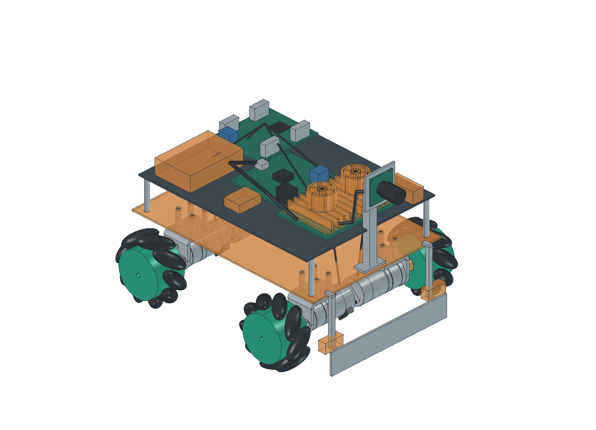
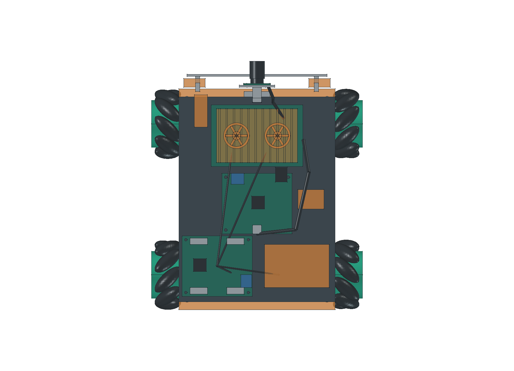
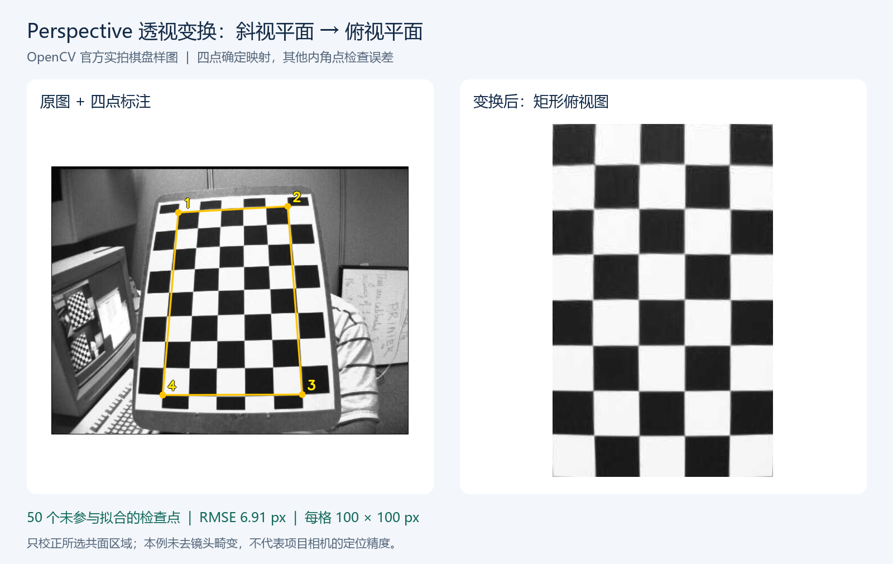

# 采购、建模与透视变换

进度截至：2026-10-25，供下次向导师汇报使用。

本阶段主要完成了核心硬件采购、整车3D布局和Perspective透视变换示例，接下来需要到货试装，确认实际装配和接线效果。

## 一、已经购买的硬件

| 已购内容 | 型号与数量 | 实付金额 |
| --- | --- | ---: |
| 主控与散热 | 泰山派3M RK3576，4GB＋64GB，1块；原配双风扇散热套件1套 | ¥936.00 |
| 轮系与驱动 | 65mm尼龙麦克纳姆轮4个（2左＋2右）及3mm六角联轴器；310编码器电机＋支架4套；四路编码器电机驱动1套 | ¥363.80 |
| 电池 | 格氏7.4V／2S／7200mAh硬壳电池，XT60接口，1块 | ¥162.00 |
| 底板 | 轮趣T5X四驱碳纤维加高板2套，每套1片板 | ¥80.00 |
| 主控电源 | 亚博机器人稳压电源扩展板，Type-C输出，1块 | ¥63.70 |
| **合计** | **5笔付款订单，8项商品** | **¥1,605.50** |

以上均已付款，到货与验收待确认；相机、STM32下位机、传感器及部分供电附件和线束尚未配齐。详细型号和订单见[购买清单](../../03_hardware/01_硬件清单.md)。

## 二、目前3D布局画成的样子

按当前硬件清单建立了23类零件模型，并组合成四麦轮整车布局：下层布置四台电机和电池，上层布置主控、驱动、下位机与电源板，前部预留相机支架和推板。

### 整体效果

### 俯视布局

当前模型外廓约为 **230.6×195.8×164.5mm（长×宽×高）**。部分零件按已知尺寸简化，橙色部分表示待核尺寸的预留模型；底板孔位、真实插头和线缆弯曲空间还需要实物确认。图中的相机、下位机等也包含尚未购买的部件。

模型可打开旋转查看：[FreeCAD工程](../../03_hardware/01_机械/03_整车布局.FCStd) · [STEP文件（可用SOLIDWORKS打开）](../../03_hardware/01_机械/04_整车布局.step)。建模依据见[装配校核记录](../03_records/03_20261024_机械装配验证.md)。

**目前主要难点：** 虽然已有整体模型，但还不确定这些部件实际装在一起后的效果，部分位置可能需要修改；尤其是板卡接口朝向、插头插拔和走线空间，可能造成接线困难。希望老师重点指导布局是否合理、接线空间是否足够，以及哪些位置应先调整再加工。下一步先用到货实物试排，再修正模型和接线安排，任务状态继续维护在[开发计划](../01_plans/01_开发计划.md)。

## 三、Perspective透视变换效果

已使用Python和OpenCV完成四点透视变换，将斜视的棋盘平面校正为俯视效果，前后对比如下。

左侧为原图及四点标注，右侧为校正后的矩形区域。本例使用OpenCV官方实拍样图，项目相机效果仍待验证；实现与结果见[透视变换记录](../03_records/01_20261023_透视变换.md)。
