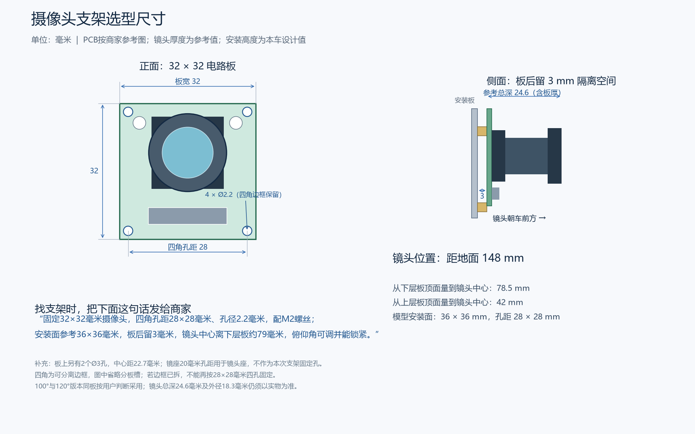
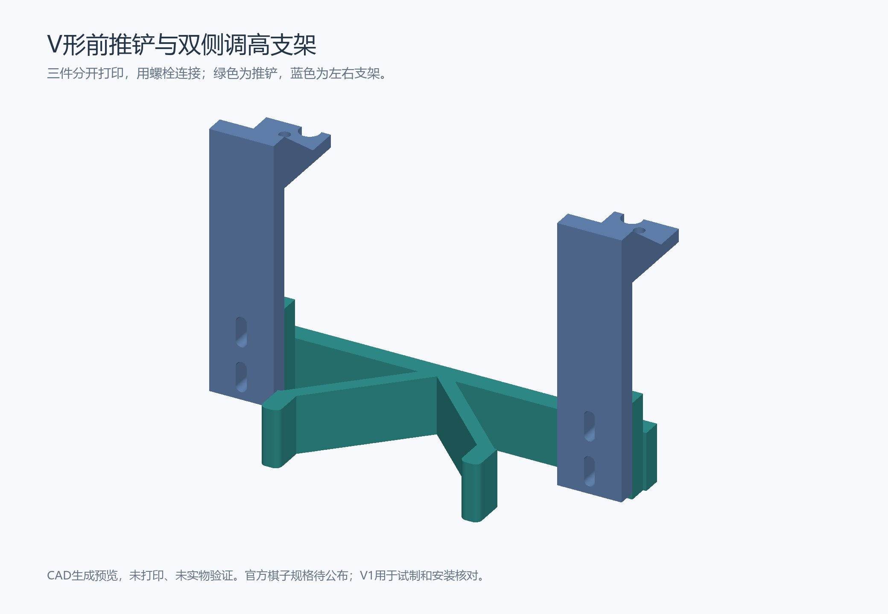
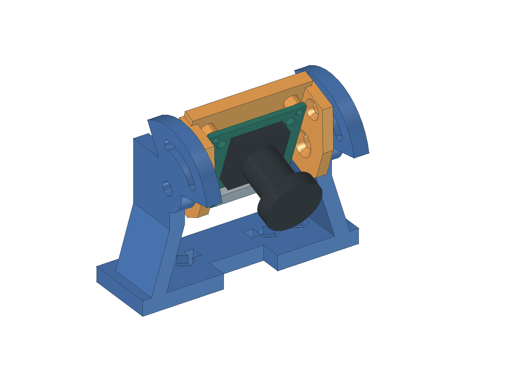

# 当前硬件建模规格

更新：2026-11-02（相机和固定面修订；其余几何沿用2026-10-28）。以[购买清单](../01_硬件清单.md)为准，覆盖已付款、已选未买与尚未锁SKU的装车需求。**“可以自行建模”指自己建立3D几何，不代表能自行制造电机、电池或电路板。**

**已建：25类零件的STEP、可编辑零件库与整车布局；另1类充电器为非装车件，不编造整机几何。** 310电机、新版支架、3mm六角联轴器及T5X四驱板复用厂家实体STEP；四路驱动板采用厂家V2曲面CAD参考，原件未封闭成实体，不能据此宣称体积干涉检查通过。其余依尺寸建立简化模型、自主结构草案或有标识的预留包络。2026-10-28按用户“允许补孔、尽量少加转接件”的决定修订固定结构，新增2片电机桥板和1片驱动安装板；电机、轮轴、电池、相机位置保留。厂家原件不修改，补孔只体现在当前加工设计模型中。橙色为待定包络；未知孔位不打孔。

[零件库](./02_零件库.FCStd) · [整车布局](./03_整车布局.FCStd) · [整车STEP](./04_整车布局.step) · [单件STEP登记](./model_inventory.json) · [参数](./parameters.json) · [生成程序](./build_models.py) · [校核结果](./validation.json)

## 清单与建模状态

| 编号 | 当前部件 | 数量 | 当前模型与采购边界 |
| --- | --- | ---: | --- |
| P01 | [泰山派3M RK3576 4G+64G C54110287](./02_零件STEP/P01_泰山派3M RK3576 4G+64G C54110287.step) | 1 | 尺寸简化；已付款，未确认到货 |
| P02 | [泰山派原配双风扇套件 C55160086](./02_零件STEP/P02_泰山派原配双风扇套件 C55160086.step) | 1 | 预留包络；已付款，未确认到货 |
| P03 | [65mm尼龙麦轮_左](./02_零件STEP/P03_65mm尼龙麦轮_左.step) | 2 | 尺寸简化；已付款，未确认到货 |
| P04 | [65mm尼龙麦轮_右](./02_零件STEP/P04_65mm尼龙麦轮_右.step) | 2 | 尺寸简化；已付款，未确认到货 |
| P05 | [3mm六角联轴器](./02_零件STEP/P05_3mm六角联轴器.step) | 4 | 厂家STEP；已付款，未确认到货 |
| P06 | [亚博MD310Z20_7.4V电机](./02_零件STEP/P06_亚博MD310Z20_7.4V电机.step) | 4 | 厂家STEP；已付款，未确认到货 |
| P07 | [亚博310新版原配L支架](./02_零件STEP/P07_亚博310新版原配L支架.step) | 4 | 厂家STEP；已付款，未确认到货 |
| P08 | [亚博四路编码器电机驱动](./02_零件STEP/P08_亚博四路编码器电机驱动.step) | 1 | 厂家曲面CAD（非封闭实体）；已付款，未确认到货 |
| P09 | [格氏2S 7200mAh 50C硬壳 XT60](./02_零件STEP/P09_格氏2S 7200mAh 50C硬壳 XT60.step) | 1 | 选型记录包络；已付款，未确认到货 |
| P10 | [亚博YB-MPP01-V1.0 Type-C电源板](./02_零件STEP/P10.step) | 1 | 尺寸简化；已付款，待发货；到货核版本 |
| P11 | [IMX415 100度M12 30针MIPI相机](./02_零件STEP/P11_IMX415 100度M12 30针MIPI相机.step) | 1 | 用户确认已到货；PCB按参考图，镜头为待实测包络，未上板 |
| P12 | [5A短Type-C到Type-C成品供电线](./02_零件STEP/P12.step) | 1 | 线束示意；需锁准确SKU，未下单 |
| P13 | [STM32F407VET6完整开发板](./02_零件STEP/P13_STM32F407VET6完整开发板.step) | 1 | 预留包络；准确SKU未定，未下单 |
| P14 | [SPI IMU完整模块](./02_零件STEP/P14_SPI IMU完整模块.step) | 1 | 预留包络；准确SKU未定，未下单 |
| P15 | [前碰撞触点](./02_零件STEP/P15_前碰撞触点.step) | 2 | 预留包络；准确SKU未定，未下单 |
| P16 | [≤1mW II类激光及受控固定件](./02_零件STEP/P16_le1mW II类激光及受控固定件.step) | 1 | 预留包络；准确SKU未定，未下单 |
| P17 | [保险、开关与XT60/T插分电](./02_零件STEP/P17_保险、开关与XT60_T插分电.step) | 1 | 预留包络；准确SKU未定，未下单 |
| P18 | 2S平衡充电器 | 1 | 非装车件；准确SKU未定，未下单 |
| D01 | [T5X四驱碳纤维底板_厂家CAD](./02_零件STEP/D01.step) | 1 | 厂家板件＋补孔设计；已购两片之一，作下层；到货未确认 |
| D02 | [电池托盘与绑带](./02_零件STEP/D02_电池托盘与绑带.step) | 1 | 自主设计；自制设计，未加工 |
| D03 | [T5X四驱碳纤维上层板_厂家CAD](./02_零件STEP/D03_电控安装层.step) | 1 | 厂家板件＋补孔设计；复用已购第2片T5X板；到货未确认 |
| D04 | [前推板及支架](./02_零件STEP/D04_前推板及支架.step) | 1 | 自主设计；自制设计，未加工 |
| D05 | [相机杆与相机安装板](./02_零件STEP/D05_相机杆与相机安装板.step) | 1 | 自主设计；自制设计，未加工 |
| D06 | [绝缘柱与紧固件](./02_零件STEP/D06_绝缘柱与紧固件.step) | 1 | 自主设计；设计用规格，数量按孔表复核 |
| D07 | [前后电机固定桥板](./02_零件STEP/D07_前后电机固定桥板.step) | 2 | 自主设计；新增加工设计，未制作 |
| D08 | [四路驱动安装板](./02_零件STEP/D08_四路驱动安装板.step) | 1 | 自主设计；新增加工设计，未制作 |

## 尺寸、假设与待核内容

单位统一为mm；参数名以 `_mm` 结尾的是长度，`mass` 为厂家标称或选型记录质量。JSON没有填写实测质量。厂家STEP尺寸在模型归一到轴向+X后使用，原件坐标不修改。

### P01 泰山派3M RK3576 4G+64G C54110287

模型：尺寸简化；来源：S05。

**已有规格：** `outline_mm`＝[85, 57]。

**建模假设／设计值：** `pcb_thickness_mm`＝1.6。

**待核：** 板厚、孔径孔距、接口突出、板底净空、硬件版本、净重。

### P02 泰山派原配双风扇套件 C55160086

模型：预留包络；来源：S06。

**已有规格：** `fans`＝2；`connector`＝"SH1.0"。

**建模假设／设计值：** `reserve_mm`＝[75, 50, 25]；`fan_diameter_mm`＝24。

**待核：** 整套长宽高、铜柱高度、孔图、净重；包络不是厂家尺寸。

### P03 65mm尼龙麦轮_左

模型：尺寸简化；来源：S02。

**已有规格：** `diameter_mm`＝65；`width_mm`＝30.4；`rollers`＝9；`mass_each_g`＝58；`material`＝"PA66轮毂、TPU滚子"；`hex_af_mm`＝12。

**建模假设／设计值：** `roller_angle_deg`＝45；`roller_radius_mm`＝6.5；`roller_half_length_mm`＝16；`roller_center_radius_mm`＝26；`socket_depth_mm`＝6；`hub_radius_mm`＝22；`center_clearance_mm`＝4.3。

**待核：** 滚子曲面、轴销、六角配合公差、孔深、左右轮实物方向；厂家图10.20/13.40/18尺寸链尚待实物判定。

### P04 65mm尼龙麦轮_右

模型：尺寸简化；来源：S02。

**已有规格：** `diameter_mm`＝65；`width_mm`＝30.4；`rollers`＝9；`mass_each_g`＝58；`material`＝"PA66轮毂、TPU滚子"；`hex_af_mm`＝12。

**建模假设／设计值：** `roller_angle_deg`＝45；`roller_radius_mm`＝6.5；`roller_half_length_mm`＝16；`roller_center_radius_mm`＝26；`socket_depth_mm`＝6；`hub_radius_mm`＝22；`center_clearance_mm`＝4.3。

**待核：** 滚子曲面、轴销、六角配合公差、孔深、左右轮实物方向；厂家图10.20/13.40/18尺寸链尚待实物判定。

### P05 3mm六角联轴器

模型：厂家实体STEP。2026-10-27用用户提供的[厂家原件](01_厂家资料/02_310电机/03_3mm六角联轴器.STEP)替换简化几何；全长18mm、六角对边12mm、圆柱段直径11.4mm，保留原孔，不缩放。转换为沿X轴安装，并绕轴转30°对齐现有轮子的六角孔；四个联轴器轴线和安装位置保持不变。

**尺寸口径：** CAD中Ø3轴孔段长6mm，之后为Ø3.5孔；既有选型资料的“12mm插深”另存为历史参数，不能当作CAD中全程Ø3的证明。径向紧定孔中心距轴侧端面4mm，六角段长6mm。

**待核：** 到货批次、实际孔深、公差、D轴紧定和轮侧螺丝长度；轴与轮侧螺丝不能在内部顶撞。厂家CAD用于几何参考，真实螺纹和紧固仍需实物核对。对应[电机参数原件](01_厂家资料/02_310电机/04_电机参数.docx)已归档。

### P06 亚博MD310Z20_7.4V电机

模型：厂家STEP；来源：S01。

**已有规格：** `body_diameter_mm`＝25；`total_length_mm`＝61.5；`shaft_extension_mm`＝14；`shaft_diameter_mm`＝3；`shaft_flat_mm`＝2.5；`gear_ratio`＝20；`rated_voltage_v`＝7.4；`rpm`＝450；`mass_each_g`＝70。

**待核：** 实购批次、轴长与STEP端面分段、公差、编码器插头线束。

### P07 亚博310新版原配L支架

模型：厂家STEP；来源：S01。

**已有规格：** `cad_bbox_mm`＝[33, 33, 26.5]；`base_holes_diameter_mm`＝3.3；`base_hole_pitch_mm`＝[14, 16]；`motor_mount_pitch_mm`＝17。

**待核：** 实购是否为新版L架，螺钉、轴心高度、加工孔复测。

### P08 亚博四路编码器电机驱动

模型：[厂家V2曲面CAD原件](01_厂家资料/03_四路电机驱动/01_四路驱动_V2.STEP)，来自用户资料包标注“2026.6.24及之后购买”的分支；到货仍需确认实物版本。已替换原简化PCB和接插件，电路板中心保持X=-37、Y=-62mm，PCB底面抬高到116mm，下面新增76×63×2mm安装板和5mm隔柱。

**文件限制：** 原件包含3602个面、888个壳，其中885个壳未封闭，实体数为0。已保留厂家曲面用于外形、接口和背面器件位置参考；未补造内部体积。它能正常显示和导出，但不能据此认定实体干涉、质量或加工检查通过。

**安装设计：** 4个PCB孔改由独立安装板和5mm隔柱承接，再通过4处补孔和3mm支承固定到上层板；背面器件到安装板的间隙见机械记录。曲面文件限制仍保留，真实版本、绝缘、插头和受力未验收。

资料：[简介](01_厂家资料/03_四路电机驱动/03_驱动简介.pdf)、[控制指令](01_厂家资料/03_四路电机驱动/04_控制指令.pdf)、[串口寄存器](01_厂家资料/03_四路电机驱动/05_串口寄存器.xlsx)、[IIC寄存器](01_厂家资料/03_四路电机驱动/06_IIC寄存器.xlsx)、[STM32串口示例](01_厂家资料/03_四路电机驱动/07_STM32串口示例.pdf)、[STM32 IIC示例](01_厂家资料/03_四路电机驱动/08_STM32_IIC示例.pdf)、[电机与驱动用法](01_厂家资料/03_四路电机驱动/09_电机与驱动用法.pdf)。这些是厂家原件；本车上下位机协议仍按设计目录中的正式定义，不把厂家寄存器表直接当成本车总协议。

### P09 格氏2S 7200mAh 50C硬壳 XT60

模型：选型记录包络；来源：S07。

**已有规格：** `selection_record_outline_mm`＝[139, 47, 26]；`selection_record_mass_g`＝330；`nominal_v`＝7.4；`full_charge_v`＝8.4；`capacity_mah`＝7200；`connector`＝"XT60"。

**建模假设／设计值：** `cable_keepout_mm`＝[30, 25, 20]。

**待核：** 本SKU尺寸原图、实物尺寸、出线位置、XT60及平衡头突出量。

### P10 亚博YB-MPP01-V1.0 Type-C电源板

模型：尺寸简化；来源：S08。

**已有规格：** `pcb_outline_mm`＝[65, 56]；`connector_overall_y_mm`＝61.72；`height_from_pcb_bottom_mm`＝13.8；`mount_holes_mm`＝2.7；`mount_pitch_mm`＝[58, 49]；`mass_g`＝32；`input_v`＝[6, 24]；`full_5a_input_v`＝[7, 24]；`output_v`＝5；`output_a_at_6v_input`＝3；`output_a_at_7v_or_above`＝5。

**建模假设／设计值：** `pcb_thickness_mm`＝1.6；`connector_positions`＝"按厂家图示意，局部轮廓未精确建模"。

**待核：** Type-C及取电线插头/弯曲空间、实际硬件版本、背面器件；2S输入低于7V不按5A预算。

### P11 IMX415 100度M12 30针MIPI相机

2026-11-02用户确认摄像头已到货，并判断100°与120°版本只更换镜头。当前沿用商家参考图的电路板和孔位建立安装模型；这些尺寸来自图纸，尚未逐项实测。旧25×25mm USB相机已从当前零件库、整车和单件STEP中替换。

| 找支架需要的尺寸 | 当前采用值 | 依据和用途 |
| --- | --- | --- |
| 电路板长×宽×厚 | **32×32×1.6mm** | 商家图纸；四周可分离边框须保留 |
| 摄像头含镜头长×宽×前后总深 | **32×32×约24.6mm** | 24.6mm从板背到镜头最前端，已含1.6mm板厚；100°镜头暂沿用120°图的包络 |
| 四角固定孔 | **中心距28×28mm，4×Ø2.2mm** | 按四角边框固定，使用M2螺钉；若边框已拆，不能沿用这组孔 |
| 上方另两个圆孔 | **中心距22.7mm，2×Ø3mm** | 可供另一种支架核对；图纸未标其距上边尺寸，模型竖向位置按图示估计 |
| 镜头前端外径 | **约18.3mm，待实测** | 120°镜头参考；不能据此保证100°镜头夹具适配 |

图上20mm孔距、Ø1.9mm的两孔用于镜头座，不能当作本次四角安装孔。模型省略分板槽、电子元件和螺纹，不证明可分离边框的实际刚度。



上图是2026-11-02的板形和旧安装高度参考；当前可打印支架、俯仰机构及高度以[D05摄像头打印支架](#d05-摄像头打印支架)为准。

[可编辑尺寸图](../../05_data/03_results/04_mechanical/20261102_camera_mount_dimensions.svg)保留板形、孔距和安装高度。参数来源为S12；[模型、接口核对和检查范围](../../01_docs/03_records/03_20261024_机械装配验证.md#摄像头到货建模与支架尺寸2026-11-02)集中在同一机械记录。

**连接边界：** 已画出相机到RK的MIPI扁平排线路径（传图像的薄排线），不是旧USB线。用户进一步确认现有30针长排线可以连接，当前采用这条已有排线。图纸的供电针位差异保留为参考版本待核，不据此断定现有线不兼容，也不预设必须加转接板；实际长度、两端方向和RK出图仍待验证。

### P12 5A短Type-C到Type-C成品供电线

模型：线束示意；来源：S09。

**已有规格：** `required_length_mm`＝[200, 300]；`required_current_a`＝5。

**建模假设／设计值：** `display_cable_length_mm`＝300；`sheath_radius_mm`＝1.6；`plug_envelope_mm`＝[12, 18, 6]。

**待核：** 准确SKU、实际线长、插头壳体尺寸、最小弯曲半径与端口兼容；不再使用裸线焊接尾线。

### P13 STM32F407VET6完整开发板

模型：预留包络；来源：本项目设计需求。

**建模假设／设计值：** `reserve_mm`＝[60, 40, 16]。

**待核：** 锁定准确整件SKU、厂家图、实物孔位与线束；当前只有需求包络。

### P14 SPI IMU完整模块

模型：预留包络；来源：本项目设计需求。

**建模假设／设计值：** `reserve_mm`＝[24, 18, 8]。

**待核：** 锁定准确整件SKU、厂家图、实物孔位与线束；当前只有需求包络。

### P15 前碰撞触点

模型：预留包络；来源：本项目设计需求。

**建模假设／设计值：** `reserve_mm`＝[20, 8, 10]。

**待核：** 锁定准确整件SKU、厂家图、实物孔位与线束；当前只有需求包络。

### P16 ≤1mW II类激光及受控固定件

模型：预留包络；来源：本项目设计需求。

**建模假设／设计值：** `reserve_mm`＝[12, 30, 12]。

**待核：** 锁定准确整件SKU、厂家图、实物孔位与线束；当前只有需求包络。

### P17 保险、开关与XT60/T插分电

模型：预留包络；来源：本项目设计需求。

**建模假设／设计值：** `reserve_mm`＝[35, 20, 15]。

**待核：** 锁定准确整件SKU、厂家图、实物孔位与线束；当前只有需求包络。

### P18 2S平衡充电器

模型：非装车件；来源：本项目设计需求。

**待核：** 准确型号及配套线；无整车几何，不编造模型。

### D01、D03 上下层T5X板

两片板沿用147×210×1.5mm厂家几何，[提取原件](./01_厂家资料/01_T5X四驱/05_四驱底板.step)不修改。下板底面高68mm，上板底面高104.5mm；四根35mm柱使用原孔X=±50、Y=±85mm。当前模型另加补孔和相机杆通道；套装60mm柱不能直接代替35mm柱。

2026-11-12导出下层底板和上层安装板，各有一份STEP和STL。碳纤维板加工时用STEP核对尺寸和孔位，3D打印样件时将STL按毫米、100%比例平放导入。包内附俯视图，可区分上下板的孔位。板卡下移后，按新布局复核需要调整的安装孔。[碳纤维板导出包](./06_碳纤维板导出包.zip)

### D02 电池托盘与绑带

外形53×145×2mm、电池位置和绑带保留。四支脚改到全局X=±18、Y=±48mm板材区域，脚半径3.5mm，增加Ø3.4通道及沉头位。螺丝在放电池前安装，头部需低于电池支承面；电池出线、实物尺寸与托盘刚度待核。

### D04 V形推铲与调高支架

2026-11-02按用户要求改成可3D打印的三件结构：V形前铲1件、左右支架各1件。官方棋子尺寸尚未公布，以下为试制值：V角90°、入口净宽56mm、斜面法向厚4mm、接触面高18mm、两侧挡边向前长10mm且厚6mm。前铲整体130×44×30mm，名义离地2mm。斜角位于俯视平面，接触面在高度方向竖直，底部不伸入棋子下面。

每只支架装车姿态20×32×81.5mm，脚厚4mm、竖板厚6mm，双加强筋厚4mm、高12mm；2条3.4×9.4mm长孔使离地可调0～6mm，0mm只为极限。底板沿用(±55,90)、(±50,96)四个Ø3.4补孔；避柱缺口R3.2。支架与前铲采用M3通孔螺栓和垫片，不靠塑料攻牙。



[全部尺寸、紧固件、打印朝向及检查方法](../../01_docs/02_design/07_前推铲与打印.md) · [打印工程](./03_打印件/04_推铲打印工程.FCStd) · [打印检查结果](./pusher_validation.json)。已同步零件库、整车和STEP；虚拟30/40/50×15mm圆片只做电脑接触与退出空间检查。当前整车247×195.8×161.6mm，长度名义余量仅3mm。尚未打印、称重或实际推棋，急停急转仍可能脱出。此前平直前铲停止作为当前制作方案。

旧P15前触点占位与新安装耳/支架重叠，原位置不能直接装实物；本版没有给未知触点打孔，定型后再排。预留包络不计入已知实体的无交叠结论。

### D05 摄像头打印支架

2026-11-03按用户澄清，“支架”指固定摄像头的部件。本版改成两个PETG打印件：上层固定座与俯仰托架，替换原8×8细杆和固定板草案。固定座复用上层板前缘4个原Ø3.2孔，底座72×23×5mm；含前伸弧槽的完整外形约72×41.696×57.6mm。托架平板40×40×4mm，含侧耳宽43mm，配44mm内净距，左右各留0.5mm。

相机四角孔中心距28×28mm，打印通孔Ø2.4mm，四个3mm隔离柱与托架一体，背面开窗24×14mm，下方开20×6mm排线口。左右采用内侧沉头M4转轴和M3弧槽锁紧，螺母在外侧，避免挤占相机板边缘；手动向下0～60°，20°仅用于装配展示。

转轴离地143.6mm，零俯仰镜头轴线148mm，20°时参考镜头前端轴心高约140.005mm。角度变化后不能继续套用旧高度和地面映射。当前整车20°姿态外廓247×195.8×165.472mm；主控、散热、相机外形和排线仍按已有参考几何核对，未实物验收。



[完整尺寸、原孔坐标、紧固件和打印方法](../../01_docs/02_design/08_相机支架与打印.md) · [FreeCAD支架工程](./03_打印件/08_相机支架工程.FCStd) · [电脑检查](./camera_mount_validation.json)。两个STL均为封闭单实体；0～60°每5°共13个姿态完成几何及试制紧固件包络筛查。未打印、未验刚度、全程排线或真实视野。原相机细杆方孔不再需要加工；下层旧相机底座孔不再使用。

### D06 固定柱与紧固件

层间柱4根，净高35mm。电机架隔柱16根，高13.75mm，为加工设计尺寸，不是可由60mm套装柱直接替代的尺寸。真实螺丝长度、啮合、防松、材质和载荷待核。

### D07 前后电机固定桥板

新增2片，单片110×42×2mm，底面高66mm，每片承接左右2个电机架的8个固定点。先从桥板沉头位安装电机架隔柱螺丝，再将桥板装到底板下方；避免在原板槽边硬打16个孔。每片有4个与底板连接点，2个复用层间柱孔、2个为板内补孔。材料、工艺和受力未验收。

### D08 四路驱动安装板

新增1片76×63×2mm，全局范围X=-75～1、Y=-96～-33mm，底面高109mm。下方4处3mm支承固定到上层板，上方4根5mm隔柱承接驱动PCB，PCB底面高116mm。安装板孔距58×49mm，需核实物版本；前缘已避开电源板。

## 补孔和固定方式

坐标X向右、Y向前，单位mm。下表是CAD设计坐标，尚未据此加工；到货板版本、螺钉头、孔边材料和受力核实后再出加工图。

| 固定用途 | 板上孔中心（全局X、Y） | 数量和孔径 |
| --- | --- | --- |
| 层间柱与桥板外侧 | X=±50，Y=±85 | 每层4个，复用原Ø3.2孔 |
| 电机桥板内侧 | X=±32，Y=±52 | 下板4个补孔，Ø3.4 |
| 托盘支脚 | X=±18，Y=±48 | 下板4个补孔，Ø3.4 |
| 旧下层相机底座孔 | X=±12，Y=94 | 模型保留；本版不用，不作为新加工要求 |
| 推板连接件 | (±55,90)、(±50,96) | 下板4个补孔，Ø3.4 |
| 驱动安装板 | (-28,-94)、(-12,-94)、(-36,-36)、(-24,-36) | 上板4个补孔，Ø3.4 |
| 当前相机固定座 | [前缘四原孔坐标](../../01_docs/02_design/08_相机支架与打印.md#尺寸和孔位) | 复用上板4个Ø3.2原孔，不新钻；旧杆方孔已取消 |

下板14处、上板4处圆形补孔，共18处。桥板上的16个电机架孔、驱动安装板和其他固定件孔另在对应单件STEP中表示。主控孔图、下位机和传感器准确型号未齐，不能按橙色占位件加工安装孔。

## 来源与可复用方式

厂家资料版权归发布方；本项目未取得额外再分发许可。自建几何来自尺寸重建，并非厂家精确模型。

- S01：[发布方资料](https://www.yahboom.net/study/MD310/)。已取得原件；实购批次待核。

- S02：[发布方资料](https://www.yahboom.store/products/mecanum-wheel)。本轮重新查阅厂家页，未取得该65mm尼龙轮/六角毂精确STEP；自行建立简化模型。

- S03：[发布方资料](https://www.yahboom.store/products/quad-md-module)。厂家标注尺寸；到货版本待核。

- S04：旧USB相机的历史来源；2026-11-02当前相机及安装板改用S12，旧图纸保留但不作为已购IMX415依据。

- S05：[发布方资料](https://item.szlcsc.com/57330947.html)。85×57mm来自已归档规格书；本轮未取得机械STEP和可靠孔图。

- S06：[发布方资料](https://wiki.lckfb.com/zh-hans/tspi-3-rk3576/development-kit/cooling-fan-kit.html)。厂家确认双风扇、SH1.0、铜柱螺丝；无可靠长宽高及孔图。

- S07：[发布方资料](https://item.jd.com/10051546999619.html)。139×47×26mm、330g沿用本SKU既有选型记录；本轮未重新取得原始尺寸图，不能作为实测或确认加工尺寸。

- S08：[发布方资料](https://www.yahboom.store/collections/accessory/products/power-board-pi5)。厂家尺寸图：PCB65×56、含突出接口Y61.72、58×49孔距、4×Ø2.7；图中侧视13.8从PCB底面量起，不含未知背面器件。

- S09：[发布方资料](https://www.yahboom.store/collections/accessory/products/power-board-pi5)。配线改为0.2–0.3m、5A C-C成品线；准确SKU和插头几何未定，不沿用已撤销的焊接尾线。

- S10：[发布方商品](https://detail.tmall.com/item.htm?id=671414115083)。用户商品截图和订单：四驱加高板2套、1.5mm、图标45g、附60mm金属柱。2026-10-27由用户提供的2026.06.18资料包提取四驱底板CAD，147×210×1.5mm，实购批次仍待到货核对；本次未在线下载或核实新版本。

2026-10-27新增用户提供的亚博310资料为S11；电机与四孔支架文件指纹和现有原件完全相同，继续复用已有文件。48mm普通车轮和两孔支架未替换当前65mm麦轮与四孔支架。CAD对象的来源路径（SourceCAD）和资料路径（SourceDocuments）已按新目录同步登记，文档链接指向正式原件。

已归档原件和各份资料SHA-256见[来源元数据](./01_厂家资料/sources.json)。65mm轮、六角毂及电机规格图复用已有原始采购资料；不重复保存。电池139×47×26mm只继承准确SKU的既有选型记录，本轮未取得原始尺寸图，托盘加工必须先复测。

**打开方法见[模型打开步骤与报错处理](../../01_docs/03_records/03_20261024_机械装配验证.md#打开模型)**：`.FCStd` 使用FreeCAD，SOLIDWORKS打开 `04_整车布局.step`；教程包含本机免安装程序位置、分步打开方法和Windows路径报错处理。

打开 `02_零件库.FCStd` 后，可复制P编号对应零件到后续工程。打开 `03_整车布局.FCStd` 可逐组隐藏或移动；对象属性“建模依据”列出采购状态、已核尺寸、假设和待核项。STEP用于跨CAD交换；修改数值请编辑 `parameters.json` 后重建，FreeCAD形状不会仅因外部JSON改变自动更新。

日常看整车外观可直接打开 [05_推棋装配预览.FCStd](./05_推棋装配预览.FCStd)，其中含模拟棋子。2026-11-06修复了生成工程缺少显示配置的问题：重建及打印件导出现在会调用 [显示保存程序](./cad_display.py)，自动补齐配色、可见状态和能看到整体的打开视角。它使用本机已安装的FreeCAD图形程序生成显示配置，逐个核对原有工程内容未变后再写回；已有显示配置的文件保持原样。不能生成配置时会明确报错，不再把文件保存成功当成能够正常看图。

在项目根目录，使用本次免安装FreeCAD自带Python重建：

```powershell
& "$env:LOCALAPPDATA\Programs\FreeCAD\bin\python.exe" -X utf8 '03_hardware/01_机械/build_models.py'
```

重建会覆盖当前生成的工程/STEP，请先保留需要的手工CAD修改。脚本、参数与正式模型在机械目录；FreeCAD软件已移到 `C:\Users\52400\AppData\Local\Programs\FreeCAD`，一次性下载和渲染日志仍放在项目的 `temp/` 中。

当前清单同步：T5X四驱板已付款2片，现分别作为上下层；亚博YB-MPP01电源板和5A短C-C成品线取代UBEC及焊接尾线。电源板包括接口突出后的Y为61.72mm，已排在电控层中段。

采购状态以购买清单和台账为准；FreeCAD对象属性保留生成时的状态快照，不能据此判断到货或验收。2026-10-28已重新生成工程、单件STEP和整车STEP；新加工设计不计作已购。

S12：用户提供的[IMX415商家图纸](../../04_references/04_datasheets/02_IMX415_120度模组图纸.pdf)，沿用原件；[RK摄像头接口图](01_厂家资料/04_RK摄像头接口原理图.webp)来自立创公开工程V1.4的MIPI_CSI页。采用范围、下载地址、文件指纹及供电针位差异已登记在来源元数据。
