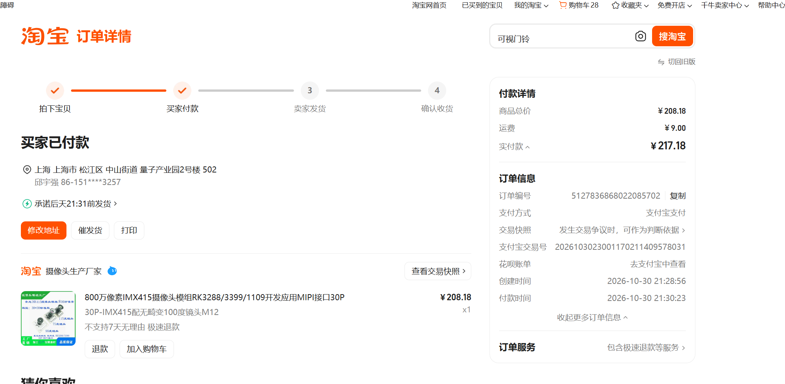
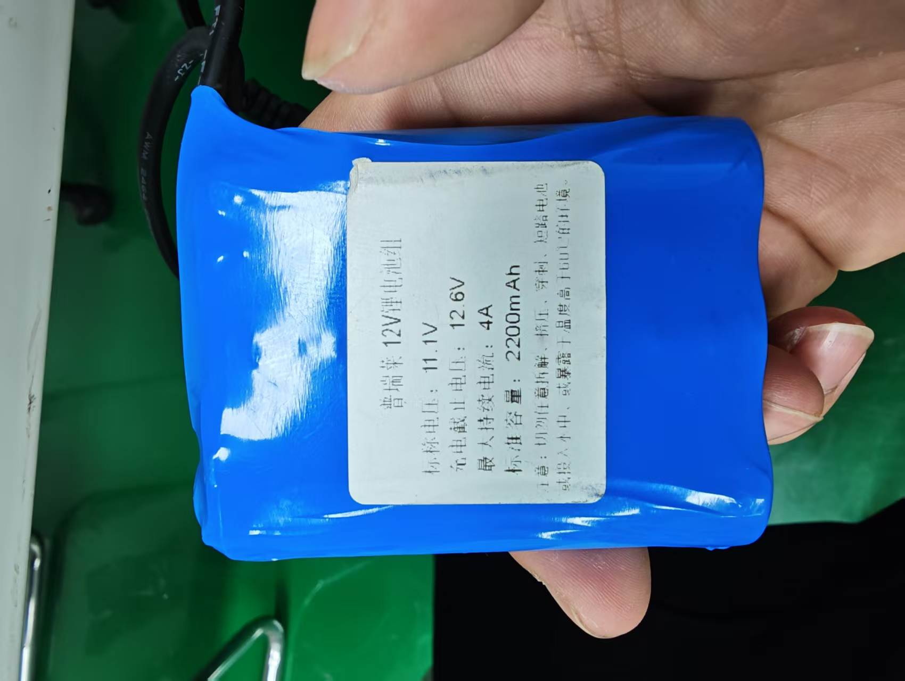

# 购买清单

更新：2026-11-03（相机地址配置、工具出图与电脑取回进度；采购金额不变）。当前清单保留5笔已付款订单、8项商品，合计**1,660.68元**。轮子与电机已按用户报告装配，其余部件到货与实车验收待逐项核对。

[当前模型与逐件建模规格](./01_机械/01_建模规格.md)：已有厂家模型直接复用，缺失模型可以自行建立；已提供23类零件STEP与可编辑整车，未知尺寸明确标注预留包络。

## 当前方案

2026-10-30控制调整：本轮由泰山派40针串口直连四路驱动。轮子与电机已按用户报告装好，电气接线和运动尚未验收。

| 购买项 | 准确型号／页面选项 | 数量 | 单价／参考价 | 状态 | 模型 |
| --- | --- | ---: | ---: | --- | --- |
| 主控 | [泰山派3M 4G+64G，C54110287](https://item.szlcsc.com/57330947.html)；商城毛重98g | 1块 | ¥899.00 | **已付款**，到货待确认 | 可自建，外形简化 |
| 主控散热 | [原配散热风扇套件，C55160086](https://item.szlcsc.com/58921706.html)；商城毛重44.6g | 1套 | ¥29.00 | **已付款**，不重复买 | 可自建，当前为预留包络 |
| 麦轮＋联轴器 | [亚博：65mm尼龙款麦轮*4+3mm六角联轴器](https://item.jd.com/10098108278160.html)，2左＋2右 | 1套 | ¥109.00（发票含税） | **用户报告已装配，电气待测** | 可自建，尺寸简化已建 |
| 编码器电机＋支架 | [亚博310：编码器减速电机+支架](https://item.jd.com/10069318711256.html)，MD310Z20_7.4V、1:20、450rpm、3mm D轴；含安装件和电机线；[310编码器减速电机官方资料](https://www.yahboom.com/study/MD310)，提取码：`4yhd` | 4套 | ¥49.90（发票含税） | **用户报告已装配，电气待测** | 已有厂家STEP，已复用 |
| 四路电机驱动 | [亚博：四路编码器电机驱动模块+铜柱+数据线+电源线](https://item.jd.com/10140357947374.html)；已含T插→红黑裸线；本版从分电端子接驱动DC5V～12V输入，随包T插线备用 | 1套 | ¥55.20（发票含税） | **已付款，正在出库** | 可自建，外形及孔图已建 |
| 碳纤维板 | [轮趣T5X，商品671414115083](https://detail.tmall.com/item.htm?id=671414115083)；选项原文「T5X碳纤维高性能四驱小车底盘加高板【多仓发货 大部分区域次日达】」 | **2套，每套1片板** | **¥40.00，合计¥80.00，免运费** | **已付款，待发货**；两片分别作上下层，实物孔图待测 | 厂家底板CAD已提取，147×210×1.5mm；实购批次待核 |
| RK供电模块 | 亚博机器人稳压电源扩展板，YB-MPP01-V1.0既有选型 | 1块 | ¥63.70（本单实付） | **已付款** | 实物型号、接口及安装尺寸待核 |
| 车载相机 | IMX415 800万像素、30针MIPI、M12镜头；选项原文「30P-IMX415配无畸变100度镜头M12」；商品链接及SKU待补，[订单截图](../05_data/01_raw/03_procurement/20261030_imx415_100deg_order_01.png) | 1个 | ¥208.18＋本单运费¥9.00，实付¥217.18 | **2026-11-02已到货；11-03已在板B识别出图并取回电脑**；使用现有30针长排线，正式C采集程序与实时预览待开发，支架实装待验 | 已换入IMX415模型；板形、孔位按参考图，镜头厚度待实测 |

**当前清单合计：¥1,660.68。** 主控及散热936.00元、亚博麦轮/电机/驱动363.80元、轮趣T5X底板80.00元、亚博电源板63.70元、相机含运费217.18元。订单明细见[采购台账](./02_采购/01_采购台账.xlsx)，相机9元运费只在订单汇总计一次。

实际支出见[采购台账](./02_采购/01_采购台账.xlsx)，[京东导出原件](./02_采购/03_20261024_京东_订单导出_3661477012483787.xlsx)、[轮趣订单详情原件](./02_采购/04_20261024_轮趣_订单详情_5127831576100359305.pdf)、[亚博电源板订单原件](./02_采购/05_20261025_亚博_订单详情_5127385935119112530.pdf)及[来源与SHA-256](../05_data/01_raw/03_procurement/sources.json)已归档。京东导出未拆分商品成交价、运费和优惠，亚博单价现已按2026-10-30发票补齐为实际含税单价；合单金额不重复计费，套餐含件不重复买。

## 已购相机与商家图纸

2026-10-30用户确认已购买100°版本。淘宝店铺「摄像头生产厂家」，订单号`5127836868022085702`；下单21:28:56，支付宝付款21:30:23。截图显示商品208.18元、运费9.00元、实付217.18元，1个，买家已付款、卖家待发货。商品链接、SKU编号及发票待补。**2026-11-02用户确认已到货，11-03已完成板B首次工具出图与电脑取回**；截图中的待发货为下单时原始信息。

商家提供的[IMX415模组图纸原件](../04_references/04_datasheets/02_IMX415_120度模组图纸.pdf)共1页，原文件名为`IX415摄像头 120度 仁恒 2026年10月17日.pdf`，图内署名深圳市仁恒影像科技有限公司，修订日期2025-07-25。图纸列出32×32mm板外形、0.5mm间距30针连接器、引脚名称及2.1mm焦距。**文件名标120度。2026-11-02用户判断两版只更换镜头，本次按同板假设采用32×32mm板形、28×28mm四角孔距及Ø2.2mm孔径建模；尚未实测。** 24.6mm总深及18.3mm镜头外径仅作参考，100度镜头仍以实物为准。原件保持不变，不由此推定100度版本焦距。

订单中的「100度」「无畸变」是商家选项描述；100度指水平、垂直还是对角线尚未说明，实际变形与棋子认字效果未测。2026-11-03已使用现有30针MIPI排线，在板B通过启动插件把I²C4通信地址改为实测的`0x1a`，重启后正式驱动识别成功；GStreamer（已有视频采集工具）拍照及电脑取回、打开已通过。此结果适用于本次板卡、模组、排线和系统，换用其他组合时仍需核对接口与驱动；支架固定、装车视野和整车外廓另行验收。

原截图与PDF已保留，归档前后文件指纹一致；来源、金额和待核项目见[采购来源](../05_data/01_raw/03_procurement/sources.json)。已完成采购登记、到货确认、电脑安装建模和首次工具出图；[支架尺寸及模型](01_机械/01_建模规格.md#p11-imx415-100度m12-30针mipi相机)已更新。支架仍待试打印与实装，正式C采集程序、实时预览、长时稳定性和真实棋子清晰度尚未验收；配置、结果及后续进度统一见[相机记录](../01_docs/03_records/05_20261103_相机采集与电脑预览.md)。

## 最终使用电池

现用电池为**普瑞莱12V锂电池组**，铭牌参数如下。

| 标签项目 | 照片可确认内容 |
| --- | --- |
| 标签名称 | 普瑞莱12V锂电池组 |
| 标称电压 | 11.1V |
| 充电截止电压 | 12.6V |
| 标称容量 | 2200mAh |
| 最大持续电流 | 4A，为电池端标签值，不等于稳压后的5V输出电流 |
| 用途 | 车载电池，用户确定为最终使用电池 |

原照片与本次附件的文件指纹一致，沿用已归档原件；来源及铭牌抄录见[图片登记](../05_data/01_raw/04_hardware/sources.json)。尺寸、重量、完整型号编号、接口尺寸和极性、保护功能及匹配充电器待核。

当前按[11.1V电池经电源模块输出5V的轻载接法](../01_docs/02_design/03_系统规划.md#现有111v电池的5v轻载试验接法2026-10-30)核对。现用电源模块型号、实际输出能力及线材额定待核，整车供电、四轮带载与续航尚未验收。

## 尚需配齐

**2026-10-28机械设计：** 原实购型号和金额不变；新增2片电机桥板、1片驱动安装板及补孔草案，材料、工艺、固定件和费用待核，不列为已购。[结构规格与孔位](01_机械/01_建模规格.md#补孔和固定方式)已同步；未知板卡不按占位件加工。

**上下层装配：** 已购T5X四驱板两片分别作上下层；必要时按310原配支架、板卡和推板位置另设计补孔或转接。[商品原始截图](../05_data/01_raw/03_procurement/20261024_t5x_options_01.png)标称厚1.5mm、重量45g，每套配60mm金属柱4根、M3×8螺丝4颗及M3螺母4颗，含件及重量口径到货核对。板卡另用绝缘固定件，2026-10-27已在原整车布局的上下两层换入同一款[厂家真实板件CAD](01_机械/01_厂家资料/01_T5X四驱/05_四驱底板.step)，原孔槽保留；当前CAD不代替到货孔位与承力验证。

| 项目 | 单车需求／下一步 |
| --- | --- |
| 驱动串口与其他传感器 | 先核RK40针UART与驱动RX2/TX2/GND及兼容电平，配可靠三芯线；不采购额外STM32/ST-Link。碰撞触点和赛题激光后续按需求锁SKU与RK接口 |
| 九轴IMU，已确定新增、未购 | [京东维特智能官方旗舰店JY901S，SKU 10076368616246](https://item.jd.com/10076368616246.html)，选项原文「JY901S基础款(加速度/角速度/角度/磁场)」，1个。2026-10-30已核型号/选项，实时价格未读到，以下单页为准；排针是否焊好、上拉与固定待用户后续询问。优先I²C直接接RK、串口备用，接法与待核范围见[系统规划](../01_docs/02_design/03_系统规划.md#jy901s接入与上拉电阻)；未计入已付款合计 |
| IMU连接与安装配件，待核 | 初次调试拟用约10cm、2.54mm母对母独立单针杜邦线4根，需模块焊好配套排针；供电/电平确认后再接。已有上拉未核实，必要时各用1只4.7kΩ上拉到兼容的3.3V电源，不盲目叠加。模块和RK排针实物、固定件、配件选项和价格待核，未确认整套可直接插接 |
| 供电整套 | 使用普瑞莱11.1V／2200mAh电池与现用电源模块。先核模块输入输出、匹配充电器、电池接口及极性，再配主取电、保险/开关、分支端子线和RK供电线；按[当前轻载接法](../01_docs/02_design/03_系统规划.md#现有111v电池的5v轻载试验接法2026-10-30)核准。 |
| 传感器电源分线，待核当前选项 | [淘宝分线板824064501327](https://item.taobao.com/item.htm?id=824064501327)，选项原文“2排*6P针杜邦线转接板升级款 1个 红黑排针”，**2个**，分别用于3.3V＋GND和5V＋GND。每板一对输入、余5对输出；排针已焊、2.54mm间距、两端有固定孔。选项和外观依据历史商品截图，2026-10-30浏览器能识别正常商品标题，当前选项、库存及成交价尚未核实。输入另需2.54mm母对母线4根；传感器线另计，底部用绝缘固定件隔开碳板。见[接法与限制](../01_docs/02_design/03_系统规划.md#传感器的33v5v电源针不够插时) |
| 结构整套 | 已购T5X四驱碳板不重复买；到货后按65mm六角轮毂＋310原配支架试排并确定孔表，必要时补孔/转接；配推板、相机杆、电池固定和绝缘支柱，核总长宽高、刚度和接线空间 |
| V形前推铲与左右支架，待试打印 | **PETG打印3件：前铲1、左支架1、右支架1**。用户2026-11-02改为3D打印，替代平直前铲候选。试制V角90°、净口56mm、前铲130×44×30mm，完整尺寸、STL、螺栓和垫片见[打印方案](../01_docs/02_design/07_前推铲与打印.md)。棋子规格待官方公布，未打印；材料、加工和紧固件未报价、未计入实际支出 |
| 相机安装与连接 | IMX415已到货并用现有排线完成板B首次工具出图；2026-11-03已设计两个PETG打印件：上层固定座、俯仰托架。复用原板4孔，相机按28×28mm孔距、M2固定，俯仰0～60°手调并锁紧；[打印文件、尺寸与紧固件](../01_docs/02_design/08_相机支架与打印.md)。支架部分只完成电脑设计，实物孔位、镜头、装车排线路径、刚度和最终视野待核；打印与紧固件未报价、未计入实付 |

**前推铲安装要求（2026-11-02）：** 铲面采用非金属PETG试制件，左右支架每侧两个底板固定点，两条竖向长孔锁紧后固定使用；名义离地2mm，可调0～6mm，0mm不作使用建议。V形接触面竖直，不伸入棋子底面，前口敞开可退车释放。按[全部孔位与紧固件](../01_docs/02_design/07_前推铲与打印.md#打印和安装)先核实物板孔、垫片、螺母、工具空间、摄像头视野和转弯间隙，再安排试打印；三件CAD通过和STL封闭不代表防滑、刚度或实装通过。当前整车长247mm，长度名义余量仅3mm，实物螺栓、线缆和变形需并入尺寸验收。

**分线板证据范围：** [原教程](https://www.eefocus.com/circuit/1810224.html)所附[历史淘宝商品截图](https://file.eefcdn.com/articlepic/lxV9ug8nCcZ6T32FDi15g)清楚显示6P红黑升级款的选项、2.54mm间距和两端固定孔。截图中的0.99元及3.50元运费是历史价格，不作为当前报价；不把截图旁的旧SKU参数当作已核实的当前SKU。

**重量与安装：** 电池、电源模块、支架、底板、线束和紧固件需按实物补齐尺寸与质量；整车须≤250×200×180mm、≤1.5kg。原有CAD不能代替实物装配和称重。

**二维地图与测距扩展（2026-10-30）：** 用户确定先用已购相机、编码器及计划新增的IMU验证二维定位和连续推棋，实施排在底盘、相机基础验证之后。超声波、ToF光学测距和二维扫描雷达均未确认购买；先记录盲区或定位失败原因，再选针对性的传感器。三维建模暂不实施，评估依据见[系统规划](../01_docs/02_design/03_系统规划.md#二维定位与场地地图评估)。

[详细来源、截图和接线配置](../05_data/01_raw/03_procurement/compatibility_review.json) · [开发计划](../01_docs/01_plans/01_开发计划.md)

## 报销材料

本次准备已有发票的**4笔订单、7项商品，合计1,443.50元**。

新增相机订单实付217.18元，**发票待补，尚未并入下面的原报销材料包**。采购总额已包含该笔，现有4张发票和原材料包金额仍为1,443.50元。

| 订单与物品 | 金额 | 发票 | 报销状态 |
| --- | ---: | --- | --- |
| 立创：主控及散热 | 936.00元 | [已有PDF](02_采购/06_20261027_立创_发票_SO26102424311.pdf) | 待发送老师、待报销 |
| 京东亚博：麦轮、电机及驱动 | 363.80元 | [已有PDF](02_采购/07_20261030_亚博_发票_3661477000956457.pdf) | 待发送老师、待报销 |
| 轮趣：T5X底板2套 | 80.00元 | [已有PDF](02_采购/09_20261030_轮趣_发票_5127831576100359305.pdf) | 待发送老师、待报销 |
| 淘宝亚博：电源板 | 63.70元 | [已有PDF](02_采购/08_20261030_亚博_发票_5127385935119112530.pdf) | 待发送老师、待报销 |

材料文件夹：`D:\Completed\01_财务票据\上海工程技术大学\2026-10_邱宇强报光电赛材料费_待报销`，内放`材料费购买记录及付款记录.docx`及4张发票PDF，同级ZIP同名。Word只含本次4笔订单的清单和购买付款凭证。

**已报销：暂无已确认记录。** 发给老师后的提交日期、后续报销结果继续更新本表与[采购来源](../05_data/01_raw/03_procurement/sources.json)，以实际确认情况登记。
