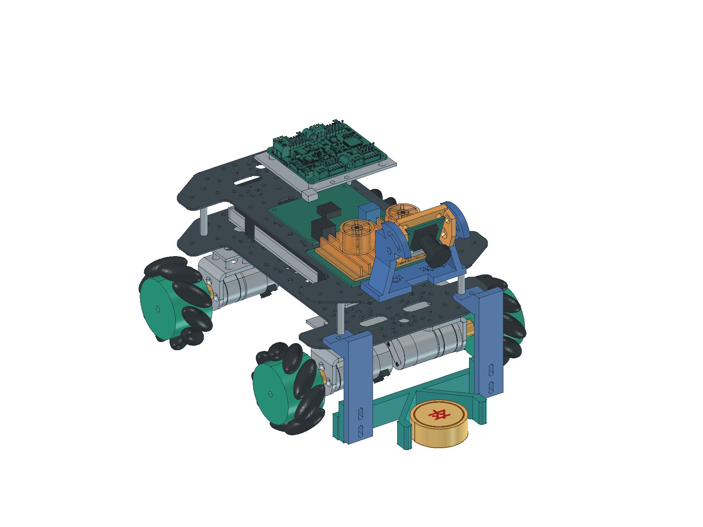
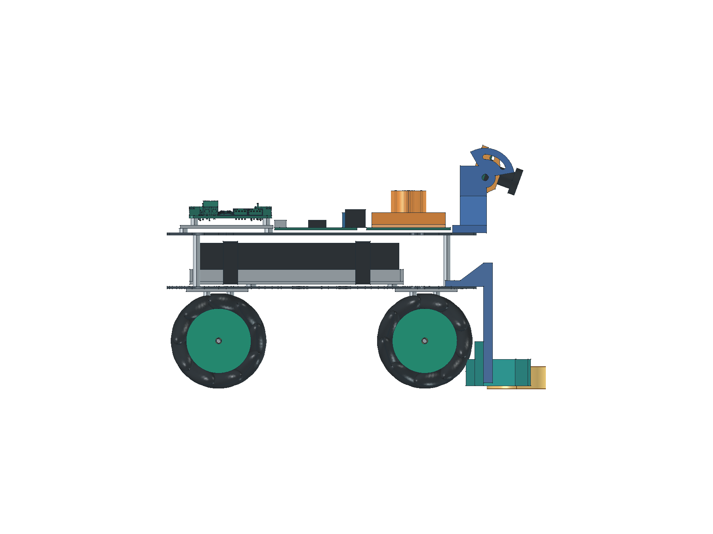

# 光电象棋机器人 2027

面向 2027 年全国大学生光电设计竞赛「智能车光电象棋对抗」。目标是让小车观察场地、自主接近棋子，并将棋子推送到目标区域。

## 硬件外形

| 整车立体外形 | 侧面布局 |
| --- | --- |
|  |  |

当前采用 **RK3576 主控、IMX415 相机、四个 65mm 麦克纳姆轮和 V 形推铲**；相机直接连接主控，主控通过串口控制四路电机驱动。麦克纳姆轮支持前后移动和左右平移。

图为 2026-11-03 保存的电脑装配模型，含模拟棋子，展示已有设计；板卡下移布局尚待调整，打印件与实物安装仍待验证。[打开三维模型](01_docs/03_records/03_20261024_机械装配验证.md#打开模型) · [相机支架](01_docs/02_design/08_相机支架与打印.md) · [前推铲与打印文件](01_docs/02_design/07_前推铲与打印.md)

## 当前进度

- **已打通：** 无线相机预览、主控与驱动的串口查询、网页四向控制和正常计时停车；四向实际移动由用户现场确认。
- **正在准备：** 板卡向下层调整、统一接线和线束固定；按距离前进首版已交叉编译，待 RK 板端运行与地面尺测。
- **下一阶段：** 实现单枚棋子的自主观察、接近对准、推送、释放和到位确认。

任务与验收范围统一见[开发计划](01_docs/01_plans/01_开发计划.md)。整车自主推送尚未验收。

## 常用入口

| 想看什么 | 从这里进入 |
| --- | --- |
| 整机怎么搭 | [整机方案](01_docs/02_design/01_整机方案.md) · [接线与供电](01_docs/02_design/03_系统规划.md) |
| 硬件、采购与模型 | [硬件清单](03_hardware/01_硬件清单.md) · [采购台账](03_hardware/02_采购/01_采购台账.xlsx) · [机械设计文件](03_hardware/01_机械/) |
| 实际做过哪些验证 | [相机与电脑预览](01_docs/03_records/05_20261103_相机采集与电脑预览.md) · [底盘调试](01_docs/03_records/04_20261030_底盘串口调试.md) · [机械检查](01_docs/03_records/03_20261024_机械装配验证.md) |
| 算法示例与结果 | [透视校正](01_docs/03_records/01_20261023_透视变换.md) · [棋子识别](01_docs/03_records/02_20261023_象棋识别.md) |
| 获取项目、运行示例、打开文档网站 | [项目使用说明](01_docs/05_resources/03_项目使用说明.md) |
| 会议与参考资料 | [会议纪要](01_docs/04_meetings/) · [资料清单](01_docs/05_resources/01_资料清单.md) · [官网下载入口](01_docs/05_resources/02_官网下载链接.md) |

维护规则见 [AGENTS.md](AGENTS.md)，参与方式与版权说明见[项目使用说明](01_docs/05_resources/03_项目使用说明.md#维护与版权)。
